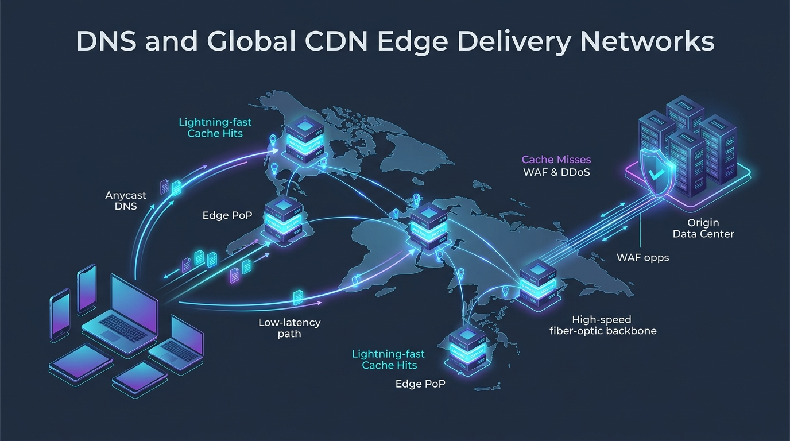
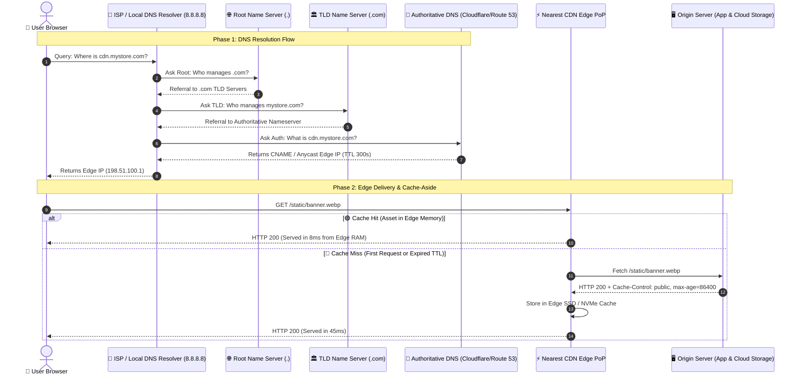

# 🧭 Topic 01: DNS & Global CDN Edge Delivery Networks

> ☕ *"Welcome to your first step into large-scale system design, Ravi! Before a single byte of user traffic ever reaches our servers or Kubernetes clusters, it must navigate the outer galaxy of the Internet: Domain Name Systems (DNS) and Content Delivery Networks (CDNs). Think of today as learning how to build lightning-fast expressways directly to your users' doorsteps."*  
> — **Rithu**

**Ravi:** *"Rithu, to be honest, I always assumed DNS was just a boring phonebook that translates `example.com` into an IP address. Does it really matter that much in senior system design?"*  
**Rithu:** *"Oh, absolutely! Modern DNS is a global intelligent traffic director. Combined with CDNs, it absorbs up to 90% of global web traffic before our backend databases even know a request happened! Let's pull back the curtain and see how Netflix and Cloudflare handle millions of requests every second. 🌸"*

---

## 🎯 1. What Ravi Will Learn Today

- 🧭 **Deconstruct Recursive vs. Iterative DNS**: Trace a DNS query from the browser's local resolver all the way to root, TLD, and authoritative name servers.
- ⚡ **Master Anycast Routing**: Understand how the same IP address exists in 300+ global data centers simultaneously to route users to the nearest physical location.
- 🛡️ **CDN Edge Caching Strategies**: Learn Cache-Control headers (`stale-while-revalidate`, `max-age`, `s-maxage`) and how edge servers cache dynamic vs. static assets.
- 🌍 **Geo-Routing & Failover Automation**: Configure latency-based DNS routing and automated disaster failover across cloud regions.
- 🧪 **Hands-on Edge Verification**: Trace real DNS propagation using `dig` and configure an automated local CDN caching proxy.

---

## 📊 2. Visual Architecture: DNS Resolution & CDN Edge Delivery





---

## 👶 3. Rithu Explains Like You Are a Beginner (ELI5)

### 📦 The Global Postal Office & Local Warehouse Analogy

Imagine you want to buy a pair of shoes from a shoe manufacturer located in Milan, Italy, while you live in Austin, Texas:

1. **The Old Way (No CDN, Direct to Origin)**: Every single customer in Texas, Tokyo, Sydney, and London places an order directly to the one factory warehouse in Milan. The shipping takes 3 weeks (high latency). If 100,000 people order at once, the small Milan factory post desk collapses under physical volume.
2. **The Modern Way (CDN Edge Points of Presence / PoPs)**: The Italian manufacturer places satellite mini-warehouses in Dallas, Tokyo, Frankfurt, and Sydney:
   - When you order from Austin, **Anycast DNS** automatically directs your order to the **Dallas mini-warehouse** (just 20 miles away).
   - If the shoes are already sitting on the Dallas shelf (**Cache Hit**), you receive your delivery in 2 hours!
   - If Dallas ran out of your size (**Cache Miss**), Dallas fetches a batch from Milan once (**Origin Fetch**), shelves it, and gives you your pair. The next 500 Texans who order get it immediately from Dallas without bothering Milan!

---

### 🔍 Core Architectural Questions Answered

#### What is DNS?
The Domain Name System (DNS) is a hierarchical, decentralized database that translates human-friendly domain names (`netflix.com`) into machine-routable IP addresses (`198.51.100.42`).

#### What is a CDN?
A Content Delivery Network (CDN) is a geographically distributed network of proxy servers ("Edge PoPs") that cache content close to end users to deliver high availability and blazing speed.

#### How does it work under the hood?
- **Anycast BGP Routing**: Instead of assigning a unique IP to each server, multiple edge servers across 200 cities announce the **exact same IP address** using BGP (Border Gateway Protocol). The Internet's routers automatically send user packets to whichever physical city has the fewest network hops!
- **Edge Shielding**: Modern CDNs terminate TLS/SSL handshakes at the edge, compress payloads with Brotli/Gzip, and block DDoS attacks with WAF (Web Application Firewall) rules before malicious packets ever reach your cloud VPC.

---

## ⚡ 4. The Essential 80/20 Concepts

| Concept / Record | What Rithu Wants Ravi to Know | Practical Job Importance |
| :--- | :--- | :--- |
| **A vs. CNAME vs. ALIAS Records** | `A` maps a hostname directly to an IPv4. `CNAME` maps a hostname to another domain name (alias). `ALIAS/ANAME` lets you use CNAME-like flattening at the zone apex (`example.com`). | Pointing custom domains to AWS CloudFront, Cloudflare, or Vercel edge distributions safely. |
| **DNS TTL (Time to Live)** | Specifies how many seconds resolvers cache a record. High TTL (86400s) reduces DNS queries; Low TTL (60s) allows lightning-fast disaster recovery switchovers. | **Must lower TTL 48 hours before planned cloud migrations** to avoid users hitting decommissioned IPs! |
| **Anycast Routing** | One IP address advertised from hundreds of global data centers. Routers dynamically guide traffic to the topologically closest PoP. | The secret behind Cloudflare (1.1.1.1), Google DNS (8.8.8.8), and global DDoS mitigation. |
| **Cache-Control: `s-maxage` vs `max-age`** | `max-age` applies to the user's browser cache. `s-maxage` (shared max age) specifically instructs CDNs and reverse proxies how long to hold the asset. | Fine-grained caching: allows CDN to cache an API response for 10 minutes while telling browsers to revalidate immediately. |
| **`stale-while-revalidate`** | Allows the CDN to serve a slightly expired asset immediately to the user while asynchronously fetching a fresh copy from origin in the background. | Completely eliminates user-perceived cache miss latency on popular pages! |
| **Origin Shielding** | An intermediate centralized cache layer between edge PoPs and the origin server. | Prevents 300 global edge servers from simultaneously querying origin on a cache miss (Origin Thundering Herd). |

---

## 💻 5. Practical Configuration: Production CoreDNS & Cloudflare Edge Headers

### Nginx Edge Caching & Cache-Control Headers Configuration
Here is how you configure origin web servers to instruct global CDNs (CloudFront, Fastly, Cloudflare) on caching behaviors:

```nginx
# /etc/nginx/conf.d/cdn-caching.conf

server {
    listen 80;
    server_name api.mystore.com;

    # 1. Immutable Static Assets (Images, fonts, bundled JS/CSS with version hashes)
    location ~* \.(webp|jpg|jpeg|png|css|js|woff2)$ {
        root /var/www/static;
        expires 1y;
        
        # CDN instructions: Cache publicly for 1 year, immutable flag prevents conditional revalidation
        add_header Cache-Control "public, max-age=31536000, s-maxage=31536000, immutable";
        add_header X-Cache-Status "Static-Asset";
        access_log off;
    }

    # 2. Dynamic API Endpoints that tolerate slight eventual consistency (e.g., Product Catalog)
    location /api/v1/products {
        proxy_pass http://backend_app_upstream;
        proxy_set_header Host $host;

        # Micro-caching instruction:
        # User browser caches for 0s (always check), but CDN caches for 60s.
        # stale-while-revalidate allows CDN to serve stale content for up to 300s while revalidating in background!
        add_header Cache-Control "public, max-age=0, s-maxage=60, stale-while-revalidate=300";
    }

    # 3. Sensitive / Private User Endpoints (Shopping Cart, Auth Tokens)
    location /api/v1/user/ {
        proxy_pass http://backend_app_upstream;
        
        # Explicitly forbid ANY intermediate CDN or proxy from saving this response in cache!
        add_header Cache-Control "no-store, no-cache, private, must-revalidate";
        add_header Pragma "no-cache";
    }
}
```

### 🔍 Line-by-Line Breakdown for Ravi
- **`immutable`**: Tells browsers and CDNs that this file will *never* change during its lifetime (because modern build tools include content hashes like `app.8f3a9b.js`). Browsers won't even send an `If-Modified-Since` request.
- **`s-maxage=60, stale-while-revalidate=300`**: The holy grail of API caching! Even if 10,000 people visit the product page per second, the origin database is hit at most once per minute!
- **`no-store, private`**: A critical security safeguard. If this header is missing on an account profile API, a misconfigured CDN could cache Alice's bank balance and serve it to Bob!

---

## ⌨️ 6. Essential Commands Cheat Sheet

| Command / Tool | Syntax | What It Does | When to Run It in Production |
| :--- | :--- | :--- | :--- |
| **Deep DNS Trace** | `dig +trace +nodnssec api.mystore.com` | Walks step-by-step from Root servers to TLD to Authoritative nameservers. | Debugging DNS propagation delays, delegation loops, and regional routing discrepancies. |
| **Inspect CDN Response Headers** | `curl -I -s https://cdn.mystore.com/logo.webp` | Fetches HTTP headers without downloading the body to inspect `CF-Cache-Status` or `X-Cache`. | Verifying whether an asset resulted in `HIT`, `MISS`, `EXPIRED`, or `BYPASS`. |
| **Purge CDN Cache via API** | `curl -X POST "https://api.cloudflare.com/client/v4/zones/$ZONE/purge_cache" -H "Authorization: Bearer $TOKEN" -d '{"files":["https://..."]}'` | Instantly invalidates an asset across all global edge nodes. | Rolling out hotfixes or invalidating cached assets with broken code. |
| **Query Specific DNS Server** | `dig @8.8.8.8 api.mystore.com A` | Asks Google Public DNS directly, bypassing local OS caches. | Checking if a newly updated DNS record has propagated globally. |
| **Reverse DNS Lookup** | `dig -x 1.1.1.1 +short` | Maps an IP address back to its associated domain name (PTR record). | Investigating suspicious traffic origins and verifying mail server reverse DNS. |

---

## 🧪 7. Hands-on Practice: Ravi's Zero-Cost Lab

### 🎯 Objective
Ravi will configure a local DNS query tracing exercise and verify how HTTP caching headers dictate edge caching behavior using Docker and Nginx.

### 📋 Prerequisites
- Terminal with `curl` and `docker`.

---

### Step 1: Create Lab Directory
```bash
mkdir dns-cdn-lab
cd dns-cdn-lab
```

### Step 2: Create a Mock Origin Server with Caching Headers (`nginx.conf`)
```nginx
events { worker_connections 1024; }

http {
    server {
        listen 80;

        location /cached {
            default_type application/json;
            add_header Cache-Control "public, s-maxage=60, max-age=10";
            add_header X-Mock-Origin "Origin-Server-Alpha";
            return 200 '{"message": "I am cached at the edge!"}\n';
        }

        location /private {
            default_type application/json;
            add_header Cache-Control "no-store, private";
            add_header X-Mock-Origin "Origin-Server-Alpha";
            return 200 '{"message": "I must NEVER be cached!"}\n';
        }
    }
}
```

### Step 3: Run the Mock Origin via Docker
```bash
docker run -d --name cdn_lab_origin -p 8085:80 -v ${PWD}/nginx.conf:/etc/nginx/nginx.conf:ro nginx:alpine
```

---

### ✅ Verification Step
Inspect the HTTP headers returned by both endpoints:
```bash
curl -I http://localhost:8085/cached
curl -I http://localhost:8085/private
```

#### Observe the Output:
On `/cached`:
```http
HTTP/1.1 200 OK
Cache-Control: public, s-maxage=60, max-age=10
X-Mock-Origin: Origin-Server-Alpha
```
On `/private`:
```http
HTTP/1.1 200 OK
Cache-Control: no-store, private
```
🎉 **Ravi's Discovery**: You just verified how origin servers talk to CDNs! Any CDN sitting in front of this server will immediately recognize that `/cached` can be saved in RAM, while `/private` must bypass the cache every single time.

---

### 🧹 Cleanup
```bash
docker stop cdn_lab_origin
docker rm cdn_lab_origin
cd ..
rm -rf dns-cdn-lab
```

---

## ⚠️ 8. Rithu's Top 3 Beginner Traps

### 🪤 Trap 1: The "High TTL Migration Trap"
- **Symptom / What happens**: You change your DNS record to point to a new cloud cluster. Half your users continue hitting the old, shut-down server for 48 hours, flooding your helpdesk with "Site Down" reports.
- **Why it happens**: Your domain's `A` record had a default TTL of 86,400 seconds (24 hours). Resolvers around the globe honor this and refuse to ask for the new IP until their timer expires.
- **Rithu's Fix**: **The Pre-Migration TTL Drop Protocol**: 72 hours *before* scheduled migrations, lower the TTL to **60 or 300 seconds**. Once the migration is successfully finished, raise the TTL back to standard values (3600s).

---

### 🪤 Trap 2: The "Private Data Leak" Edge Caching Disaster
- **Symptom / What happens**: A user logs in and sees another stranger's name, profile photo, and order history!
- **Why it happens**: An API route `/api/user/profile` was returned with `Cache-Control: public, max-age=300`. The CDN cached user #1's profile response at the edge and served the exact same cached payload to user #2.
- **Rithu's Fix**:
  1. Always set `Cache-Control: private, no-store` on user-specific responses.
  2. Configure your CDN to include the `Authorization` or `Cookie` header in its **Cache Key**, or completely bypass caching whenever auth headers are present.

---

### 🪤 Trap 3: Origin Overload on Cache Purge (Thundering Herd)
- **Symptom / What happens**: A developer clicks "Purge Everything" in the CDN dashboard after a bad deploy. Within 5 seconds, the origin database crashes from 100% CPU saturation.
- **Why it happens**: Purging all cached items instantly turns millions of user requests into direct origin database queries.
- **Rithu's Fix**: Use **Tiered Caching / Origin Shielding** and **Stale-While-Revalidate**. Alternatively, purge specific URL keys incrementally rather than purging the entire global cache at once.

---

## 💬 9. Ravi's Doubt Corner (Interview Preparation)

### ❓ Question 1 (Ravi asks):
> *"Rithu, what is the exact difference between a DNS CNAME record and an ALIAS/ANAME record, and why can't I put a CNAME on `mydomain.com`?"*

**Rithu's Model Answer:**  
*"Great observation, Ravi! RFC 1034 states that if a `CNAME` record exists for a node, no other records can exist for that same name. But your root zone apex (`mydomain.com`) **must** have `SOA` and `NS` records! Therefore, standard DNS forbids a CNAME on the apex.*  
*DNS providers solved this with **ALIAS (Route 53) or CNAME Flattening (Cloudflare)**. When a resolver asks for `mydomain.com`, the authoritative DNS server queries the target hostname behind the scenes and returns a standard `A` record IP directly to the client. Problem solved!"*

---

### ❓ Question 2 (Ravi asks):
> *"How does GeoDNS differ from Anycast DNS?"*

**Rithu's Model Answer:**  
*"Both route users geographically, but at completely different networking layers:*
- ***GeoDNS*** works at the **Application / DNS Layer**. The DNS server checks the client's IP in a MaxMind database and returns a *different* IP address depending on location (e.g., European users get `5.1.2.3`, American users get `198.1.2.3`). Downsides: DNS caching delays and inaccurate IP geo-databases.
- ***Anycast DNS*** works at the **Network / BGP Routing Layer**. All global servers share the exact *same* IP address. The Internet's BGP routers automatically route packets to the topologically closest server. It is instant, self-healing, and resilient against DDoS attacks."*

---

## ⚡ 10. Quick Revision with Rithu

- 🌍 **DNS is the Front Door**: It directs traffic globally using Anycast and determines whether requests hit the right region.
- ⚡ **CDNs Absorb the Shocks**: Up to 90% of dynamic and static traffic can be absorbed at edge PoPs before touching your VPC.
- 🛡️ **Headers are Law**: The origin controls the edge using `Cache-Control: s-maxage`, `stale-while-revalidate`, and `immutable`.
- ⏱️ **Plan TTL in Advance**: Lower DNS TTLs days before a major cloud migration to ensure rapid failover.
- 🔒 **Guard Personal Data**: Never allow shared CDNs to cache responses containing private user tokens or cookies.

> [!TIP]
> **Rithu's Golden Rule for Topic 01**:  
> *"The fastest request is the one that never touches your origin server. Protect your databases by terminating connections and serving cached data as close to the user's fingertips as physics allows."* 🚀☕
