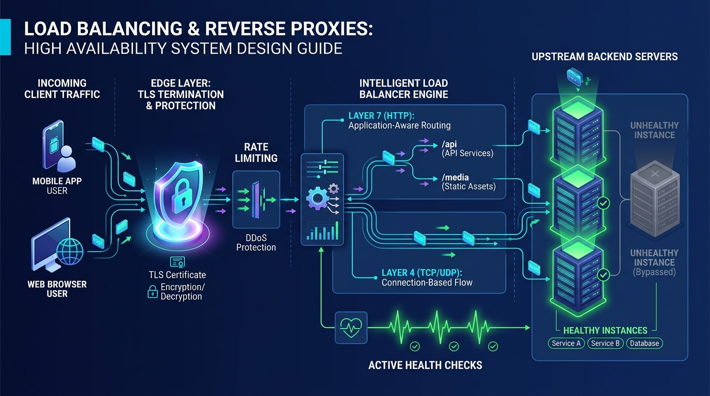
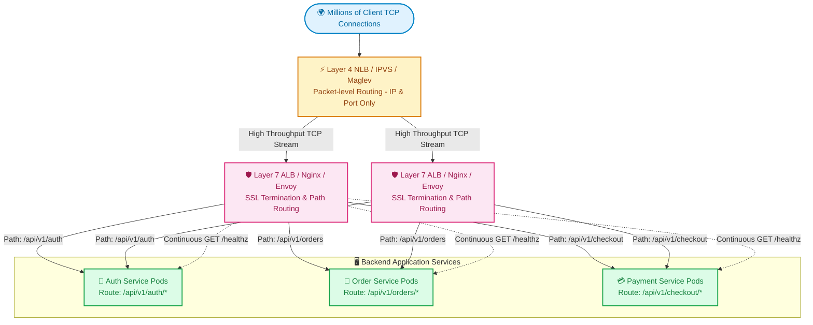

# ⚖️ Topic 02: Load Balancing & Reverse Proxies

> ☕ *"Welcome back, Ravi! Grab your tea or coffee. Now that our users have found their way through DNS and Edge CDNs, they arrive at the front gate of our infrastructure. Today, we're studying the ultimate traffic cop of modern systems: Load Balancers and Reverse Proxies. Master this, and no sudden traffic surge will ever knock your services down again!"*  
> — **Rithu**

**Ravi:** *"Rithu, in my past projects, whenever someone said 'Load Balancer', I just clicked 'Create ALB' on AWS without really understanding what happened under the hood. What's the real difference between a Reverse Proxy, a Layer 4 balancer, and a Layer 7 balancer?"*  
**Rithu:** *"That is one of the most common questions in DevOps interviews, Ravi! People use those terms interchangeably, but they operate at completely different layers of the OSI model with huge performance and cost implications. Let's break it down together! 🌸"*

---

## 🎯 1. What Ravi Will Learn Today

- ⚖️ **L4 (Transport) vs. L7 (Application) Balancing**: Master when to route purely on IP/Port vs. inspecting HTTP headers, cookies, and URI paths.
- 🚦 **Balancing Algorithms in the Wild**: Compare Round Robin, Weighted Round Robin, Least Connections, and Consistent IP Hashing.
- 🛡️ **Reverse Proxy Superpowers**: Understand TLS/SSL Termination, gzip/Brotli offloading, buffer management, and Rate Limiting.
- ❤️ **Proactive vs. Passive Health Checks**: Design resilient upstream pools that isolate faulty instances before end-users experience 502/504 errors.
- 🧪 **Hands-on Zero-Cost Lab**: Implement an intelligent Layer 7 path-based routing gateway using Nginx with automatic backend failover.

---

## 📊 2. Visual Architecture: Layer 4 vs. Layer 7 Traffic Routing





---

## 👶 3. Rithu Explains Like You Are a Beginner (ELI5)

### 🏥 The Hospital Triage & Reception Desk Analogy

Imagine a major hospital in the center of a busy city:

1. **The Ambulance Gate (Layer 4 Load Balancer - Transport Layer)**:
   - The security guard at the gate only looks at the vehicle type (Ambulance vs. Car) and speed.
   - He doesn't open the door or inspect the medical chart. He just rapidly directs Ambulance #1 to Bay A and Ambulance #2 to Bay B. It's blindingly fast, requires zero thinking, and can handle 10,000 cars a minute.
2. **The Main Hospital Receptionist (Layer 7 Load Balancer - Application Layer)**:
   - When you walk inside, the receptionist asks for your patient file, reads your symptoms, checks your appointment type, and inspects your insurance card.
   - If you have an eye problem, she directs you to **Ophthalmology on Floor 2**.
   - If you have a broken arm, she directs you to **Radiology on Floor 4**.
   - She can check if Floor 4 is fully backed up and ask you to wait in the comfortable lounge.
3. **The Hospital Air Filters & Security Metal Detector (Reverse Proxy)**:
   - Before any patient enters the sterile surgery suites, they go through sanitation gates, temperature checks, and metal detectors. The doctors never deal with security or dirty outerwear—they just focus on surgery.

---

### 🔍 Core Architectural Questions Answered

#### What is the difference between a Forward Proxy and a Reverse Proxy?
- **Forward Proxy**: Sits in front of **clients** to protect client privacy, bypass firewalls, or enforce corporate browsing policies (e.g., your office proxy filtering social media).
- **Reverse Proxy**: Sits in front of **origin servers** to protect server security, terminate TLS, load-balance requests, and cache responses. The client thinks it is talking directly to the origin!

#### Why do modern architectures pair L4 with L7?
Layer 4 balancers (like AWS NLB or Linux IPVS) can handle **millions of packets per second** with negligible CPU usage because they never decrypt TLS or parse HTTP payloads. They sit on the edge to distribute raw TCP streams across a cluster of Layer 7 balancers (like Nginx, HAProxy, or Envoy), which then perform complex path-routing, header manipulation, and SSL decryption.

---

## ⚡ 4. The Essential 80/20 Concepts

| Concept / Algorithm | What Rithu Wants Ravi to Know | Practical Job Importance |
| :--- | :--- | :--- |
| **Round Robin vs. Least Connections** | Round Robin alternates sequentially (A $\to$ B $\to$ C). Least Connections checks real-time active TCP socket counts and picks the lightest node. | **Use Least Connections** whenever requests take varying amounts of time (e.g., complex queries mixed with instant health checks). |
| **Consistent Hashing (IP Hash)** | Hashes the client IP or a cookie value to always send a specific user to the same server node. | Used for legacy stateful apps, or to maximize local cache affinity on backend instances. |
| **TLS/SSL Termination** | The Load Balancer decrypts HTTPS traffic using the SSL certificate, and sends plain HTTP to backend application pods over the private VPC network. | Saves tremendous backend CPU cycles; backend microservices don't need individual certificate renewals. |
| **Connection Pooling (HTTP Keepalive)** | The proxy maintains open persistent TCP connections to backend servers rather than doing a 3-way TCP handshake for every incoming request. | Eliminates TCP handshake latency and prevents ephemeral port exhaustion on high-traffic nodes. |
| **Active vs. Passive Health Checks** | Active: Balancer periodically probes `/healthz`. Passive: Balancer monitors real user traffic and suspends a node if it throws three 5xx errors. | Combined together, they guarantee 99.99% availability during rolling software deployments. |

---

## 💻 5. Practical Configuration: Production Path-Based Routing with HAProxy

While Nginx is great, **HAProxy** is celebrated across elite infrastructure teams for raw load-balancing performance, detailed runtime stats, and robust health checking.

```haproxy
# /etc/haproxy/haproxy.cfg

global
    log /dev/log local0
    maxconn 50000
    user haproxy
    group haproxy
    daemon
    # Modern SSL configuration
    ssl-default-bind-ciphers ECDHE-ECDSA-AES128-GCM-SHA256:ECDHE-RSA-AES128-GCM-SHA256
    ssl-default-bind-options ssl-min-ver TLSv1.2 no-tls-tickets

defaults
    log     global
    mode    http
    option  httplog
    option  dontlognull
    # Forward real client IP to microservices
    option  forwardfor
    option  http-server-close
    timeout connect 5000ms
    timeout client  50000ms
    timeout server  50000ms

# 1. Front-End: Entry point for user traffic
frontend https_front
    bind *:443 ssl crt /etc/ssl/certs/company_bundle.pem alpn h2,http/1.1
    bind *:80
    # Auto-redirect plain HTTP to HTTPS
    redirect scheme https code 301 if !{ ssl_fc }

    # Access Control Lists (ACLs) for Layer 7 Path Routing
    acl is_auth_path   path_beg /api/v1/auth
    acl is_order_path  path_beg /api/v1/orders
    acl is_static_path path_beg /static

    # Route to designated backend clusters based on ACL match
    use_backend auth_backend   if is_auth_path
    use_backend order_backend  if is_order_path
    use_backend static_backend if is_static_path
    default_backend default_app_backend

# 2. Back-End Cluster: Order Service with Health Probes & Circuit Breaker
backend order_backend
    balance leastconn
    option httpchk GET /healthz
    http-check expect status 200

    # inter 2s: check every 2 seconds
    # fall 3: mark down after 3 consecutive failures
    # rise 2: mark healthy after 2 consecutive successes
    server order_pod_1 10.0.1.10:8080 check inter 2000ms fall 3 rise 2 maxconn 1000
    server order_pod_2 10.0.1.11:8080 check inter 2000ms fall 3 rise 2 maxconn 1000
    server order_pod_backup 10.0.1.99:8080 check backup

# 3. Live Metrics Dashboard for DevOps
listen stats
    bind *:8404
    stats enable
    stats uri /monitor
    stats refresh 5s
```

### 🔍 Line-by-Line Breakdown for Ravi
- **`acl is_order_path path_beg /api/v1/orders`**: HAProxy inspects the HTTP request URL without decrypting or re-encrypting behind the scenes. This is pure Layer 7 intelligence!
- **`balance leastconn`**: Routes incoming orders to the specific container with the lowest pending queue depth.
- **`inter 2000ms fall 3 rise 2`**: If `order_pod_1` throws an unhandled exception and its `/healthz` fails 3 times (over 6 seconds), HAProxy immediately removes it from rotation. Zero customers receive a failed checkout!
- **`server order_pod_backup ... backup`**: A hot-standby node that remains untouched until both primary pods are dead, providing an emergency safety net.

---

## ⌨️ 6. Essential Commands Cheat Sheet

| Command / Tool | Syntax | What It Does | When to Run It in Production |
| :--- | :--- | :--- | :--- |
| **Inspect Upstream Sockets** | `haproxy -c -f /etc/haproxy/haproxy.cfg` | Tests syntax of HAProxy configuration without touching active processes. | Always run in CI/CD before deploying proxy updates. |
| **Runtime Socket Stats** | `echo "show stat" \| socat stdio /var/run/haproxy.sock` | Queries HAProxy live stats socket directly via CLI. | Checking real-time server health and connection counts during incidents. |
| **Drain a Backend Node** | `echo "set server order_backend/order_pod_1 state drain" \| socat stdio /var/run/haproxy.sock` | Gracefully stops sending *new* requests to a node while allowing existing in-flight connections to finish. | Performing zero-downtime rolling node maintenance and server upgrades. |
| **Check TLS Handshake Details** | `openssl s_client -connect api.company.internal:443 -servername api.company.internal` | Connects over TLS, displays certificate chain, protocol version, and handshake latency. | Debugging SSL handshake failures and SNI routing mismatches. |
| **Benchmark Concurrency** | `k6 run --vus 50 --duration 30s load_test.js` | Runs a modern scriptable load test simulating 50 concurrent users. | Verifying load balancer distribution fairness under stress. |

---

## 🧪 7. Hands-on Practice: Ravi's Zero-Cost Lab

### 🎯 Objective
Ravi will configure a multi-path reverse proxy in Nginx that routes requests to two distinct mock services (`/auth` vs `/orders`), verify least-connections behavior, and witness instant automatic failover!

### 📋 Prerequisites
- Docker & Docker Compose.

---

### Step 1: Create Lab Directory
```bash
mkdir lb-routing-lab
cd lb-routing-lab
```

### Step 2: Create Mock Services in `docker-compose.yml`
```yaml
version: '3.8'

services:
  gateway:
    image: nginx:alpine
    ports:
      - "8080:80"
    volumes:
      - ./nginx.conf:/etc/nginx/nginx.conf:ro
    depends_on:
      - auth-service
      - order-service

  auth-service:
    image: hashicorp/http-echo
    command: ["-text=🔑 Authenticated via Auth Microservice"]

  order-service:
    image: hashicorp/http-echo
    command: ["-text=🛒 Order Confirmed via Order Microservice"]
```

### Step 3: Create Path-Routing Configuration (`nginx.conf`)
```nginx
events { worker_connections 1024; }

http {
    upstream auth_pool {
        server auth-service:5678;
    }

    upstream order_pool {
        server order-service:5678;
    }

    server {
        listen 80;

        location /auth {
            proxy_pass http://auth_pool/;
            proxy_set_header Host $host;
        }

        location /orders {
            proxy_pass http://order_pool/;
            proxy_set_header Host $host;
        }

        location / {
            return 200 "🌟 System Design Gateway Ready. Try /auth or /orders!\n";
        }
    }
}
```

---

### Step 4: Run the Multi-Service Gateway
```bash
docker compose up -d
```

### ✅ Verification Step
Test both routes through the single gateway entry point:
```bash
curl http://localhost:8080/
curl http://localhost:8080/auth
curl http://localhost:8080/orders
```

#### Expected Output:
```text
🌟 System Design Gateway Ready. Try /auth or /orders!
🔑 Authenticated via Auth Microservice
🛒 Order Confirmed via Order Microservice
```

🎉 **Ravi's Discovery**: Through a single public port (`8080`), Nginx inspected the URI path and dispatched requests to the proper microservice cluster!

---

### 🧹 Cleanup
```bash
docker compose down -v
cd ..
rm -rf lb-routing-lab
```

---

## ⚠️ 8. Rithu's Top 3 Beginner Traps

### 🪤 Trap 1: The Ephemeral Port Exhaustion Trap (`TIME_WAIT`)
- **Symptom / What happens**: During a flash sale, the reverse proxy suddenly starts throwing `502 Bad Gateway` to thousands of users, even though backend servers have 20% CPU and 40% RAM free!
- **Why it happens**: By default, Nginx opens a brand new TCP connection to the backend for every incoming user request and closes it immediately after. The Linux kernel holds closed sockets in `TIME_WAIT` state for 60 seconds. At 1,000 req/s, the operating system runs out of ephemeral local ports (usually 32,768–60,999).
- **Rithu's Fix**: Enable **HTTP Keepalive connection pooling** in your upstream block!
  ```nginx
  upstream backend_pool {
      server app:3000;
      keepalive 64; # Maintains an open pool of 64 persistent TCP connections
  }
  ```

---

### 🪤 Trap 2: The Missing `X-Forwarded-For` Audit Disaster
- **Symptom / What happens**: Your security team audits the login database after a brute-force attack and finds 500,000 failed password attempts coming from `10.0.0.5` (the Load Balancer's private IP) instead of the attacker's real public IP.
- **Why it happens**: When a reverse proxy forwards a request, it replaces the IP packet's source address with its own.
- **Rithu's Fix**: Always instruct your proxy to inject client identity headers:
  ```nginx
  proxy_set_header X-Forwarded-For $proxy_add_x_forwarded_for;
  proxy_set_header X-Real-IP $remote_addr;
  ```

---

### 🪤 Trap 3: The Flapping Health Check Cascade
- **Symptom / What happens**: An upstream pod gets slightly busy (latency hits 500ms). The load balancer's aggressive 1-second timeout marks it unhealthy and cuts it off. Now all its traffic spills onto the remaining 2 pods, overloading them immediately, causing their health checks to fail too, cascading into a total cluster shutdown!
- **Why it happens**: Overly aggressive health check thresholds with zero hysteresis or tolerance.
- **Rithu's Fix**: Use reasonable intervals (`inter 3000ms`, `fall 3`, `rise 2`), dedicated non-blocking health endpoints (never run heavy DB queries inside `/healthz`), and enable **graceful degradation**.

---

## 💬 9. Ravi's Doubt Corner (Interview Preparation)

### ❓ Question 1 (Ravi asks):
> *"Rithu, what is the Difference between Round Robin and Weighted Round Robin, and when is Weighted actually useful?"*

**Rithu's Model Answer:**  
*"Standard Round Robin assumes all your backend machines are identical clones. But in real-world DevOps, that's often not true!*  
*Imagine you have an older `c5.large` (2 vCPU) server and a newly provisioned `c5.2xlarge` (8 vCPU) server. With **Weighted Round Robin**, you assign weight `1` to the small machine and weight `4` to the large machine. The balancer will send 4 requests to the big machine for every 1 request sent to the small one! It is also critical during **Canary Deployments**, where you route 95% of traffic to the stable v1.0 cluster and 5% to the new v2.0 canary cluster."*

---

### ❓ Question 2 (Ravi asks):
> *"How do modern tech companies handle load balancing at massive scale like Google or Netflix?"*

**Rithu's Model Answer:**  
*"They use a multi-tiered hierarchy:*
1. **Tier 1 (Global Edge)**: Anycast DNS routes users to the nearest metropolitan data center.
2. **Tier 2 (Layer 4 Hardware / Software Router)**: High-speed packet balancers like Google Maglev or Linux IPVS handle millions of raw packets without decrypting SSL.
3. **Tier 3 (Layer 7 Ingress Controller / Service Proxy)**: Envoy, Nginx, or ALB handles SSL decryption, JWT validation, path routing, and gRPC streaming to internal Kubernetes pods.  
*Understanding this tiered division proves you understand enterprise architecture!"*

---

## ⚡ 10. Quick Revision with Rithu

- ⚡ **L4 is Speed, L7 is Smart**: Use Layer 4 for high-throughput packet routing, and Layer 7 for intelligent path, header, and cookie routing.
- 🏊 **Pool Connections**: Always enable HTTP keepalives between your load balancer and upstream applications to avoid `TIME_WAIT` port exhaustion.
- ❤️ **Gentle Health Checks**: Keep `/healthz` endpoints lightweight and avoid aggressive thresholds that cause cascading outages.
- 🛡️ **Terminate TLS Early**: Let reverse proxies handle SSL certificates so backend applications don't waste CPU on cryptographic handshakes.
- 👥 **Least Connections for the Win**: Default to `least_conn` when requests have unpredictable execution durations.

> [!TIP]
> **Rithu's Golden Rule for Topic 02**:  
> *"A load balancer shouldn't just be a blind distributor; it is your system's defensive shield. Use it to terminate SSL, enforce rate limits, and isolate unhealthy instances before a single user notices an error."* 🚀☕
