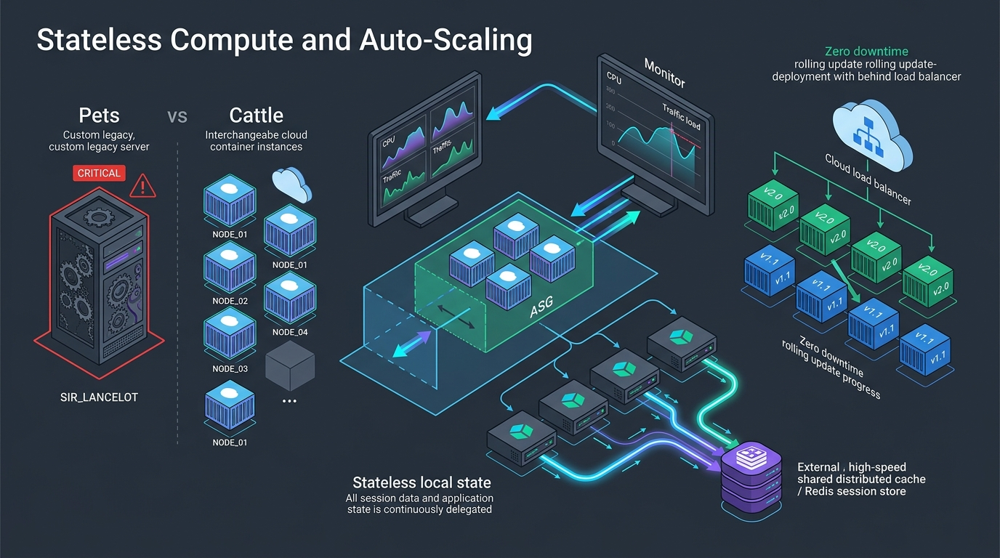
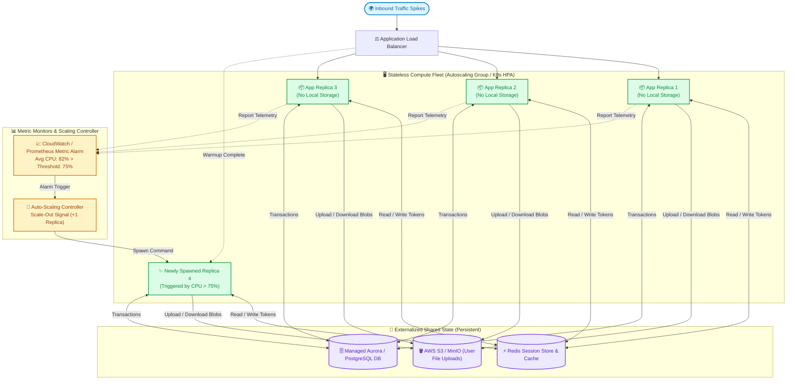

# 🖥️ Topic 03: Stateless Compute & Auto-Scaling

> ☕ *"Sip that coffee, Ravi! Today is the turning point where we transition our mindset from traditional SysAdmin thinking to true Cloud-Native architecture. We are saying goodbye to delicate, hand-crafted servers and embracing ephemeral, disposable, infinitely scalable compute fleets!"*  
> — **Rithu**

**Ravi:** *"Rithu, I keep hearing the DevOps phrase 'Treat your servers like cattle, not pets.' What does that actually mean when an application crashes in production?"*  
**Rithu:** *"It means if a server misbehaves, you don't stay up all night nursing it back to health with band-aids. You terminate it immediately, and an automated autoscaler instantly replaces it with a fresh, identical clone in seconds! Let's see how statelessness makes that possible. 🌸"*

---

## 🎯 1. What Ravi Will Learn Today

- 🐄 **Pets vs. Cattle Philosophy**: Understand why stateful servers limit growth and how immutable infrastructure enables infinite horizontal scale.
- 🍪 **Externalizing State**: Move session data, temporary file uploads, and background jobs out of local disks into Redis and S3.
- 📈 **Kubernetes HPA & Auto-Scaling Groups (ASG)**: Configure metric-driven scaling thresholds based on CPU, Memory, and Custom SQS Queue Latency.
- 🔄 **Zero-Downtime Deployment Strategies**: Master Rolling Updates, Blue-Green deployments, and Canary releases.
- 🧪 **Hands-on Zero-Cost Lab**: Build a fully stateless microservice cluster and watch it dynamically recover from node termination.

---

## 📊 2. Visual Architecture: Stateless Compute & Auto-Scaling Lifecycle





---

## 👶 3. Rithu Explains Like You Are a Beginner (ELI5)

### 🏨 The Hotel Room Keycard Analogy

Imagine staying at a luxury modern hotel:

1. **The "Pet" Approach (Stateful Disaster)**:
   - Every time you visit the hotel, you are forced to stay in Room 304 because your passport, clothes, and room key are physically locked inside Room 304's closet.
   - If Room 304's plumbing bursts, you cannot sleep at all. If 200 tourists arrive, the hotel cannot give them your room. You are chained to that single physical room.
2. **The "Cattle" Approach (Stateless Elegance)**:
   - When you check in, the front desk gives you a digital NFC wristband / keycard (**Stateless JWT / Session Token**).
   - Your luggage is stored in a centralized, secure luggage vault in the hotel basement (**External Redis & S3 Storage**).
   - You can enter **Room 101, Room 204, or Room 512** interchangeably! Any available room is identical.
   - If Room 204's light bulb fails, the manager simply decommissions Room 204, tosses you another key, and you walk into Room 205 without losing a single piece of luggage!

---

### 🔍 Core Architectural Questions Answered

#### What makes a service "Stateless"?
A service is stateless when **no client-specific session data or local file changes persist on the local container or virtual machine** across requests. Any request can be routed to any running instance, and any instance can crash or be terminated at any moment without causing data loss or user disruption.

#### What are the 12-Factor App rules for statelessness?
Factor 6 of the 12-Factor App methodology states: *“Execute the app as one or more stateless processes.”* Any data that needs to persist must be stored in a stateful backing service (typically a database, cache, or object store).

---

## ⚡ 4. The Essential 80/20 Concepts

| Concept / Pattern | What Rithu Wants Ravi to Know | Practical Job Importance |
| :--- | :--- | :--- |
| **Pets vs. Cattle** | Pets have unique names, long lifespans, and manual repairs. Cattle have random IDs (e.g., `app-pod-7f9a`), short lifespans, and are destroyed on failure. | Mindset shift required to confidently adopt Kubernetes, Spot Instances, and Terraform. |
| **Session Externalization** | Store user session tokens in Redis or use self-contained signed tokens (JWTs) instead of local memory. | Unlocks the ability to horizontally scale from 2 to 200 nodes in minutes without dropping active user logins. |
| **Scale-Out vs. Scale-In Cooldowns** | Scale-out must react fast (e.g., 1 min) to absorb traffic surges. Scale-in must have a conservative cooldown (e.g., 5-10 mins) to prevent "flapping". | Prevents oscillation where servers are constantly created and destroyed every few minutes under fluctuating load. |
| **Graceful Shutdown (`SIGTERM`)** | When scaling down or deploying, give containers time (e.g., 30s) to finish in-flight requests and close DB pools before issuing `SIGKILL`. | Eliminates dropped checkout requests and corrupted transactions during rolling updates. |
| **Rolling Update vs. Blue-Green** | Rolling updates replace pods one-by-one (resource efficient). Blue-Green runs two complete identical environments in parallel (instant rollback). | Choosing the right deployment strategy for team velocity vs. risk tolerance. |

---

## 💻 5. Practical Configuration: Kubernetes Horizontal Pod Autoscaler (HPA)

Below is an enterprise-grade Kubernetes manifest pairing a stateless `Deployment` with a metric-driven `HorizontalPodAutoscaler` and safe termination lifecycle hooks:

```yaml
# deployment-and-hpa.yaml
apiVersion: apps/v1
kind: Deployment
metadata:
  name: order-api-deployment
  labels:
    app: order-api
spec:
  replicas: 3
  revisionHistoryLimit: 5
  strategy:
    type: RollingUpdate
    rollingUpdate:
      maxSurge: 25%        # Create up to 25% extra pods during rollout
      maxUnavailable: 0     # Never drop below desired capacity during update!
  selector:
    matchLabels:
      app: order-api
  template:
    metadata:
      labels:
        app: order-api
    spec:
      terminationGracePeriodSeconds: 45 # Time given to finish in-flight work
      containers:
      - name: order-api
        image: company/order-api:v2.1.0
        imagePullPolicy: IfNotPresent
        ports:
        - containerPort: 8080
        # Resource requests & limits are MANDATORY for HPA to calculate percentages!
        resources:
          requests:
            cpu: "250m"      # 1/4 vCPU requested
            memory: "256Mi"
          limits:
            cpu: "500m"      # 1/2 vCPU hard cap
            memory: "512Mi"
        env:
        # State externalization credentials injected via Secrets
        - name: REDIS_SESSION_HOST
          value: "redis-cluster.cache.internal"
        - name: DB_CONNECTION_STRING
          valueFrom:
            secretKeyRef:
              name: app-secrets
              key: database-url
        # Lifecycle hooks for zero-downtime drain
        lifecycle:
          preStop:
            exec:
              command: ["/bin/sh", "-c", "sleep 10"] # Wait for Ingress routing table update
        readinessProbe:
          httpGet:
            path: /readyz
            port: 8080
          initialDelaySeconds: 5
          periodSeconds: 5
        livenessProbe:
          httpGet:
            path: /livez
            port: 8080
          initialDelaySeconds: 15
          periodSeconds: 10
---
apiVersion: autoscaling/v2
kind: HorizontalPodAutoscaler
metadata:
  name: order-api-hpa
spec:
  scaleTargetRef:
    apiVersion: apps/v1
    kind: Deployment
    name: order-api-deployment
  minReplicas: 3
  maxReplicas: 20
  metrics:
  - type: Resource
    resource:
      name: cpu
      target:
        type: Utilization
        averageUtilization: 75 # Scale out when average CPU across all pods hits 75%
  behavior:
    scaleDown:
      stabilizationWindowSeconds: 300 # Wait 5 minutes before removing pods (prevents flapping)
      policies:
      - type: Percent
        value: 20
        periodSeconds: 60 # Shrink at most 20% of fleet per minute
```

### 🔍 Line-by-Line Breakdown for Ravi
- **`maxUnavailable: 0`**: Ensures that during a new code release, Kubernetes *never* kills an old pod until the new pod passes its `readinessProbe`. Zero dropped packets!
- **`resources.requests.cpu: "250m"`**: Autoscalers cannot function without baseline resource requests. The `75%` target is calculated relative to this exact request value.
- **`preStop: sleep 10`**: When a pod is marked for deletion, Kubernetes takes a few seconds to withdraw its IP from the Ingress and endpoints list. Sleeping 10 seconds prevents sending traffic to a container that has already started shutting down.
- **`stabilizationWindowSeconds: 300`**: Tells HPA: *"Even if CPU dips to 20% right after a spike, wait 5 full minutes before terminating pods."* This eliminates rapid churn.

---

## ⌨️ 6. Essential Commands Cheat Sheet

| Command / Tool | Syntax | What It Does | When to Run It in Production |
| :--- | :--- | :--- | :--- |
| **Inspect Auto-Scaler** | `kubectl get hpa order-api-hpa --watch` | Streams real-time current vs. target CPU utilization and replica counts. | Monitoring traffic spikes and confirming auto-scale triggers in real time. |
| **Manual Override Scale** | `kubectl scale deployment order-api-deployment --replicas=10` | Immediately scales pods up or down manually. | Preparing for an anticipated high-volume flash sale or marketing launch. |
| **Inspect Rollout Status** | `kubectl rollout status deployment/order-api-deployment` | Monitors rolling update progress until all new pods are healthy. | Verifying deployments in CI/CD pipelines before running smoke tests. |
| **Rollback Broken Deploy** | `kubectl rollout undo deployment/order-api-deployment` | Instantly rolls back the deployment to the previous working revision. | Rapid emergency mitigation when a new release causes production 500 errors. |
| **Top Pod Consumption** | `kubectl top pods -l app=order-api --sort-by=cpu` | Displays actual real-time CPU and Memory consumption across all pods. | Identifying single hot-spots or uneven load balancer distribution. |

---

## 🧪 7. Hands-on Practice: Ravi's Zero-Cost Lab

### 🎯 Objective
Ravi will spin up an ephemeral Python microservice cluster, externalize session state into Redis, and prove that terminating an active container has **zero impact** on the user's active session!

### 📋 Prerequisites
- Docker & Docker Compose.

---

### Step 1: Create Lab Directory
```bash
mkdir stateless-lab
cd stateless-lab
```

### Step 2: Create a Stateless App with Redis Sessions (`server.py`)
```python
from http.server import BaseHTTPRequestHandler, HTTPServer
import urllib.parse
import socket
import os
import redis

# Connect to external shared state
r = redis.Redis(host=os.getenv('REDIS_HOST', 'redis'), port=6379, decode_responses=True)

class SessionHandler(BaseHTTPRequestHandler):
    def do_GET(self):
        query = urllib.parse.urlparse(self.path).query
        params = urllib.parse.parse_qs(query)
        user = params.get('user', ['guest'])[0]

        # Read and increment visitor count from external Redis, NOT local memory!
        visits = r.incr(f"session:{user}:visits")
        container_id = socket.gethostname()

        self.send_response(200)
        self.send_header('Content-type', 'application/json')
        self.end_headers()
        payload = f'{{"user": "{user}", "visit_count": {visits}, "served_by": "{container_id}"}}\n'
        self.wfile.write(payload.encode('utf-8'))

if __name__ == '__main__':
    server = HTTPServer(('0.0.0.0', 8000), SessionHandler)
    server.serve_forever()
```

### Step 3: Containerize the Service (`Dockerfile`)
```dockerfile
FROM python:3.11-alpine
RUN pip install redis
WORKDIR /app
COPY server.py .
EXPOSE 8000
CMD ["python", "server.py"]
```

### Step 4: Multi-Node Compose Setup (`docker-compose.yml`)
```yaml
version: '3.8'

services:
  lb:
    image: nginx:alpine
    ports:
      - "8080:80"
    volumes:
      - ./nginx.conf:/etc/nginx/nginx.conf:ro
    depends_on:
      - app

  app:
    build: .
    environment:
      - REDIS_HOST=redis
    restart: always

  redis:
    image: redis:alpine
```

### Step 5: Simple Nginx Upstream (`nginx.conf`)
```nginx
events { worker_connections 1024; }
http {
    upstream backend_cluster {
        server app:8000;
    }
    server {
        listen 80;
        location / {
            proxy_pass http://backend_cluster;
        }
    }
}
```

---

### Step 6: Launch with 3 Replicas
```bash
docker compose up -d --build --scale app=3
```

---

### ✅ Verification Step: The Chaos Test
1. Make 3 requests for user `ravi`:
```bash
# In bash or PowerShell:
curl "http://localhost:8080/?user=ravi"
curl "http://localhost:8080/?user=ravi"
curl "http://localhost:8080/?user=ravi"
```
Notice: Each time, `served_by` changes to a different container, but `visit_count` climbs seamlessly (`1 -> 2 -> 3`)!

2. **Now Kill One of the Containers!**
```bash
docker kill stateless-lab-app-1
curl "http://localhost:8080/?user=ravi"
```

#### Output:
```json
{"user": "ravi", "visit_count": 4, "served_by": "b8f2a1104e"}
```
🎉 **Ravi's Discovery**: You just killed a running production container, and the user experienced **zero logout and zero data loss!** The remaining containers picked up where it left off because state was externalized in Redis.

---

### 🧹 Cleanup
```bash
docker compose down -v
cd ..
rm -rf stateless-lab
```

---

## ⚠️ 8. Rithu's Top 3 Beginner Traps

### 🪤 Trap 1: The Local Disk Upload Trap (`/tmp` or `/uploads`)
- **Symptom / What happens**: A user uploads their profile avatar image. They refresh the page and sometimes their avatar loads, and sometimes it returns a broken `404 Not Found`!
- **Why it happens**: The application saved the uploaded image to `./public/avatars/user123.png` on Container A's ephemeral disk. When the user refreshed, the Load Balancer sent the request to Container B, which has an empty avatar directory!
- **Rithu's Fix**: **Never write user files to local disks.** Stream uploads directly to an S3-compatible Object Store using **S3 Presigned URLs**. The application container should remain 100% ephemeral.

---

### 🪤 Trap 2: Scaling Exclusively on CPU
- **Symptom / What happens**: An asynchronous PDF-generation worker queue has 80,000 pending customer orders. Customers are waiting 4 hours for receipts, but your auto-scaler refuses to spawn more workers because CPU is sitting at a relaxed 25%!
- **Why it happens**: The workers are I/O bound (waiting on network sockets, font downloads, and S3 writes), so CPU utilization never crosses the 70% threshold.
- **Rithu's Fix**: Scale on **business / queue metrics** (like SQS Queue Depth or RabbitMQ message backlog) using tools like **KEDA (Kubernetes Event-driven Autoscaling)** rather than blind CPU percentages.

---

### 🪤 Trap 3: The Scale-Down Data Race
- **Symptom / What happens**: During scale-down, customers experience random broken database transactions and corrupted files.
- **Why it happens**: Kubernetes sent `SIGKILL` before the container had time to finish processing active transactions.
- **Rithu's Fix**: Implement proper Unix signal handling (`SIGTERM`) in your application code, close database connection pools cleanly, and configure `terminationGracePeriodSeconds` with sufficient buffer.

---

## 💬 9. Ravi's Doubt Corner (Interview Preparation)

### ❓ Question 1 (Ravi asks):
> *"Rithu, what is the trade-off between JWT (JSON Web Tokens) and Server-Side Redis Sessions for stateless authentication?"*

**Rithu's Model Answer:**  
*"This is a classic senior interview dilemma, Ravi! Here is how you shine:*
- ***JWTs (Pure Statelessness)***: The token is cryptographically signed and stored entirely on the client browser. Pros: Zero database/cache lookups on API calls (blazing fast). Cons: **Immediate revocation is impossible** before expiry (unless you maintain a blacklist, which reintroduces state!).
- ***Redis Session Store***: The client only holds an opaque `session_id`; the data lives in Redis. Pros: Instant revocation upon logout or password reset, fine-grained access control. Cons: Adds an extra network hop to Redis on every authenticated API request.
- **The Modern Compromise**: *Use short-lived JWTs (10-minute expiry) paired with longer-lived Refresh Tokens stored in Redis.*"

---

### ❓ Question 2 (Ravi asks):
> *"What is the difference between Blue-Green and Canary Deployments?"*

**Rithu's Model Answer:**  
*"Both eliminate downtime, but with different risk profiles:*
- ***Blue-Green Deployment***: You provision a 100% full duplicate environment (Green). You run automated tests on Green. Once verified, you flip the router/load balancer switch so 100% of user traffic cuts over instantly. If issues arise, you flip the switch back in 2 seconds. Downsides: Doubles infrastructure cost during deployments.
- ***Canary Deployment***: You route a tiny sliver of live user traffic (e.g., 2%) to the new version while 98% stays on the old version. You observe error rates, latency, and logs. If clean, you ramp up to 10%, 50%, and finally 100%. Downsides: Must maintain backward-compatible database schemas across both versions simultaneously."*

---

## ⚡ 10. Quick Revision with Rithu

- 🐄 **Embrace Cattle**: Never fall in love with an individual server. If it acts up, terminate it and let the orchestrator replace it.
- 📦 **Externalize State**: Offload user sessions to Redis, files to S3/Object Storage, and relational data to managed DBs.
- 📈 **Scale on the Right Metrics**: Don't rely solely on CPU; use SQS/Kafka backlog depth via KEDA for worker tiers.
- 🛑 **Handle `SIGTERM` with Dignity**: Always allow in-flight connections to drain cleanly before terminating a pod.
- 🔄 **Safe Deployments**: Use rolling updates with `maxUnavailable: 0` or Canary releases to protect users during rollouts.

> [!TIP]
> **Rithu's Golden Rule for Topic 03**:  
> *"If turning off a random server in your compute fleet makes you sweat, your architecture isn't stateless yet. Build systems where every compute node is disposable."* 🚀☕
