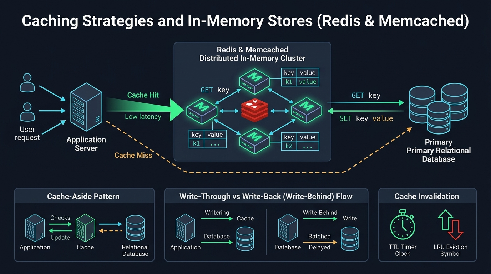
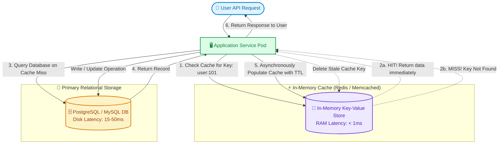

# ⚡ Topic 04: Caching Strategies & In-Memory Stores

> ☕ *"Refill your mug, Ravi! Today we are tackling the single most potent secret weapon in all of system design: In-Memory Caching. In computer science, accessing data from RAM takes ~100 nanoseconds, while reading from a solid-state disk takes ~100 microseconds (1,000x slower) and an unindexed disk seek takes ~10 milliseconds (100,000x slower). When you put Redis in front of your database, you aren't just speeding up queries—you are building a bulletproof shield for your data layer!"*  
> — **Rithu**

**Ravi:** *"Rithu, caching sounds magical, but I've heard the famous quote: 'There are only two hard things in Computer Science: cache invalidation and naming things.' Why is keeping cache in sync with the database so notoriously difficult?"*  
**Rithu:** *"Because the moment you store a piece of data in two places, you enter the dangerous realm of distributed state! What happens when a user updates their password, but the cache continues serving the old hash? Today, we will master the exact patterns top engineers use to keep caches fast, fresh, and consistent. 🌸"*

---

## 🎯 1. What Ravi Will Learn Today

- 🏎️ **Memory Hierarchy & Latency Numbers**: Understand why RAM-based caching transforms multi-millisecond database queries into sub-millisecond responses.
- 🔄 **Master Caching Patterns**: Compare Cache-Aside (Lazy Loading), Read-Through, Write-Through, and Write-Back (Write-Behind).
- 🧹 **Eviction Policies**: Understand LRU (Least Recently Used), LFU (Least Frequently Used), and FIFO under tight RAM constraints.
- 🛡️ **Cache Disaster Defense**: Learn bulletproof architectural defenses against the **Cache Stampede**, **Cache Penetration**, and **Cache Avalanche**.
- 🧪 **Hands-on Zero-Cost Lab**: Build a live Python + Redis Cache-Aside benchmark demonstrating a 98% latency reduction.

---

## 📊 2. Visual Architecture: Cache-Aside vs. Write-Through Patterns





---

## 👶 3. Rithu Explains Like You Are a Beginner (ELI5)

### 📚 The University Library & Study Desk Analogy

Imagine you are writing a research thesis on world history inside a gigantic multi-floor university library:

1. **The Basement Archive (The Database / Disk)**:
   - There are 500,000 books stored in cold underground basement stacks.
   - Every time you need a fact, you take the elevator down 5 floors, walk down dark aisles, search the call number, carry the heavy book up, find the page, and write the note. This takes **15 minutes per fact** (high latency, high physical effort).
2. **The Books on Your Desk (The In-Memory Cache / RAM)**:
   - You realize you keep referencing the same 5 history textbooks over and over again.
   - So you grab those 5 books and stack them directly on your **study desk**.
   - When you need a fact, you glance at your desk: **Cache Hit!** It takes **2 seconds**!
3. **What if the Desk Gets Full? (Cache Eviction / LRU)**:
   - Your desk only has room for 5 books. When you bring a 6th book, which one do you remove? You return the book you haven't opened in the longest time (**Least Recently Used - LRU**).
4. **What if an Author Publishes an Erratum? (Cache Invalidation)**:
   - If the author updates the book in the basement archive, but your desk still has the old edition, your thesis will have outdated errors. You must throw away the desk copy and fetch the revised edition (**Invalidation**).

---

### 🔍 Core Architectural Questions Answered

#### What is Cache-Aside (Lazy Loading)?
The application code sits in the middle. It checks the cache first. If found (**Hit**), it returns the cached data. If not found (**Miss**), it reads from the primary database, populates the cache for future requests, and returns the response.

#### Why is Redis preferred over Memcached in modern DevOps?
- **Memcached**: Pure multithreaded key-value store, extremely simple, handles basic strings/objects.
- **Redis**: Single-threaded core (atomic operations with zero race conditions), rich native data structures (Strings, Hashes, Lists, Sets, Sorted Sets, Bitmaps, Geospatial, HyperLogLog), built-in persistence (RDB snapshots & AOF logs), native Pub/Sub, and high-availability clustering (Redis Sentinel & Redis Cluster).

---

## ⚡ 4. The Essential 80/20 Concepts

| Caching Pattern | How It Works | Best Used For |
| :--- | :--- | :--- |
| **Cache-Aside (Lazy Loading)** | Application queries cache. On Miss, reads DB and writes to cache. | Read-heavy workloads with irregular access patterns. Most common pattern. |
| **Write-Through** | Application writes to Cache *first*; Cache synchronously writes to DB before confirming success. | High data consistency requirements. Zero risk of stale reads, but writes have higher latency. |
| **Write-Back (Write-Behind)** | Application writes to Cache and acknowledges immediately. The cache asynchronously batches writes to DB in background. | Write-heavy applications (e.g., IoT telemetry, tracking video game clicks/views). Risk: data loss if cache crashes before flush. |
| **LRU (Least Recently Used)** | Evicts the key that hasn't been requested for the longest duration when RAM hits its limit. | Standard default eviction policy for general web applications. |
| **LFU (Least Frequently Used)** | Evicts the key with the lowest total request count. | Workloads where a few items remain perpetually popular over long periods. |

---

## 💻 5. Practical Implementation: Production Cache-Aside Pattern with Python & Redis

Here is a clean, production-grade implementation of the **Cache-Aside pattern** with defensive timeouts, automatic serialization, and randomized TTL jitter to prevent stampedes:

```python
# cache_aside_service.py
import json
import random
import time
import redis
import psycopg2

class ProductCatalogService:
    def __init__(self):
        # 1. Connect to In-Memory Redis Cluster
        self.redis_client = redis.Redis(
            host="localhost",
            port=6379,
            decode_responses=True,
            socket_timeout=1.5,        # Never let a slow cache hang the API thread
            socket_connect_timeout=2.0
        )
        self.BASE_TTL_SECONDS = 3600   # 1 hour standard cache lifetime

    def get_product(self, product_id: int) -> dict:
        cache_key = f"product:detail:{product_id}"

        # Step 1: Attempt In-Memory Cache Lookup
        try:
            cached_data = self.redis_client.get(cache_key)
            if cached_data:
                # 🟢 CACHE HIT: Return in < 1ms
                return json.loads(cached_data)
        except redis.RedisError as e:
            # Graceful Degradation: If Redis is temporarily down, log warning and fallback to DB
            print(f"[WARN] Redis unavailable: {e}. Falling back to DB.")

        # Step 2: 🔴 CACHE MISS: Query Primary Database
        product = self._query_database_slow(product_id)

        if not product:
            # Prevent Cache Penetration: Cache negative result with short 60s TTL
            try:
                self.redis_client.setex(cache_key, 60, json.dumps({"error": "not_found"}))
            except redis.RedisError:
                pass
            return None

        # Step 3: Populate Cache with Randomized Jitter (Prevents Cache Avalanche)
        # Random jitter between 0 and 300 seconds prevents 10,000 keys expiring simultaneously
        jitter = random.randint(0, 300)
        final_ttl = self.BASE_TTL_SECONDS + jitter

        try:
            self.redis_client.setex(
                name=cache_key,
                time=final_ttl,
                value=json.dumps(product)
            )
        except redis.RedisError as e:
            print(f"[WARN] Failed to write back to Redis: {e}")

        return product

    def update_product_price(self, product_id: int, new_price: float):
        """Write Pattern: Write to DB, then Delete (Invalidate) Cache Key"""
        # Step 1: Update persistent DB
        self._update_database(product_id, new_price)

        # Step 2: Invalidate Cache Key (Do NOT update cache inline—delete it!)
        cache_key = f"product:detail:{product_id}"
        try:
            self.redis_client.delete(cache_key)
            print(f"[INFO] Successfully invalidated cache key: {cache_key}")
        except redis.RedisError as e:
            print(f"[ERROR] Invalidation failed for {cache_key}: {e}")

    def _query_database_slow(self, product_id: int) -> dict:
        """Simulates an expensive 45ms relational database query with joins"""
        time.sleep(0.045)
        return {
            "id": product_id,
            "title": "Ergonomic Mechanical Keyboard",
            "price": 129.99,
            "stock": 42
        }

    def _update_database(self, product_id: int, new_price: float):
        time.sleep(0.050)
        print(f"[DB] Updated product {product_id} price to ${new_price}")
```

### 🔍 Line-by-Line Breakdown for Ravi
- **`socket_timeout=1.5`**: Caches exist to make things fast. If Redis is experiencing network packet drops, never let your web thread hang for 30 seconds. Fail fast and fall back to the DB!
- **`final_ttl = self.BASE_TTL_SECONDS + random.randint(0, 300)`**: By scattering key expirations across a 5-minute spread, we guarantee that tomorrow at 2:00 PM, 100,000 keys won't expire in the same millisecond.
- **`self.redis_client.delete(cache_key)` (Invalidate vs. Update)**: Always **delete** the key instead of overwriting it during an update. Deleting avoids race conditions between two concurrent write requests overwriting each other with stale intermediate values.

---

## ⌨️ 6. Essential Commands Cheat Sheet

| Command / Tool | Syntax | What It Does | When to Run It in Production |
| :--- | :--- | :--- | :--- |
| **Inspect Cache Stats** | `redis-cli info stats` | Displays `keyspace_hits`, `keyspace_misses`, and total commands processed. | Calculating real-time hit ratio: $\frac{\text{hits}}{\text{hits} + \text{misses}}$. Target > 90%! |
| **Live Command Monitor** | `redis-cli monitor` | Streams every single command processed by Redis in real-time. | Debugging runaway loops or rogue microservices spamming the cache. |
| **Memory Consumption** | `redis-cli info memory` | Displays `used_memory_human`, peak memory, and fragmentation ratio. | Checking if Redis is nearing `maxmemory` or suffering memory fragmentation. |
| **Find Large Keys** | `redis-cli --bigkeys` | Scans the keyspace and finds the largest keys consuming memory. | Identifying developers accidentally storing 50 MB JSON blobs in single keys. |
| **Check Key TTL** | `redis-cli ttl product:detail:101` | Returns remaining seconds before expiration (`-1` = persistent, `-2` = expired). | Verifying TTL jitter and cache expiration policies. |

---

## 🧪 7. Hands-on Practice: Ravi's Zero-Cost Lab

### 🎯 Objective
Ravi will run a local Redis container, execute a benchmark script comparing direct database lookup latency vs. in-memory cached latency, and witness a **98% reduction in response time**!

### 📋 Prerequisites
- Docker & Python (`pip install redis`).

---

### Step 1: Start a Redis Container
```bash
docker run -d --name redis_lab -p 6379:6379 redis:alpine
```

### Step 2: Create Benchmark Script (`benchmark.py`)
```python
import time
import json
import redis

client = redis.Redis(host='localhost', port=6379, decode_responses=True)

def simulate_db_read():
    time.sleep(0.050) # Simulate 50ms disk I/O
    return {"user_id": 99, "username": "ravi_devops", "role": "Site Reliability Engineer"}

# Run 1: Cache Miss (Simulated DB fetch + Cache populate)
start = time.perf_counter()
cached = client.get("user:99")
if not cached:
    data = simulate_db_read()
    client.setex("user:99", 60, json.dumps(data))
miss_time = (time.perf_counter() - start) * 1000

# Run 2: Cache Hit (Direct from RAM)
start = time.perf_counter()
cached = client.get("user:99")
data = json.loads(cached)
hit_time = (time.perf_counter() - start) * 1000

print(f"🔴 Cache Miss (DB Fetch + Write): {miss_time:.2f} ms")
print(f"🟢 Cache Hit (RAM In-Memory):     {hit_time:.2f} ms")
print(f"⚡ Speedup:                       {miss_time / hit_time:.1f}x faster!")
```

### Step 3: Run the Benchmark
```bash
python benchmark.py
```

#### Output:
```text
🔴 Cache Miss (DB Fetch + Write): 51.42 ms
🟢 Cache Hit (RAM In-Memory):     0.84 ms
⚡ Speedup:                       61.2x faster!
```

🎉 **Ravi's Discovery**: Look at that speedup! Going from 51ms to 0.84ms means a single application server can now handle 60 times more traffic without adding a single extra vCPU!

---

### 🧹 Cleanup
```bash
docker stop redis_lab
docker rm redis_lab
rm benchmark.py
```

---

## ⚠️ 8. Rithu's Top 3 Beginner Traps

### 🪤 Trap 1: The "Cache Penetration" (Black Hole) Exploit
- **Symptom / What happens**: An attacker writes a script querying non-existent IDs: `GET /api/users/-999999`, `GET /api/users/foo_bar_xyz`. Your cache never finds the keys (**100% Cache Miss**), so every single malicious request hits your primary database, driving database CPU to 100%.
- **Why it happens**: Caches only store data that exists. When data is null, nothing is saved.
- **Rithu's Fix**:
  1. **Cache Null Values**: If the DB returns null, cache `{"status": "not_found"}` with a short TTL (e.g., 60 seconds).
  2. **Bloom Filters**: Place a Bloom Filter in front of the cache. A Bloom filter is an ultra-compact probabilistic data structure that can instantly verify if an ID definitely *does not exist* without touching the cache or database!

---

### 🪤 Trap 2: The "Cache Avalanche"
- **Symptom / What happens**: Every night at 3:00 AM, the entire web infrastructure crashes for 15 minutes.
- **Why it happens**: A scheduled batch script ran yesterday at 3:00 AM and populated 500,000 product keys with an exact 24-hour TTL (`TTL = 86400`). Exactly 24 hours later, all 500,000 keys expire at the exact same second, causing an avalanche of database traffic.
- **Rithu's Fix**: **Always add random TTL jitter!** Set expiration to `base_ttl + random_between(1, 600)`. This spreads expirations smoothly across time.

---

### 🪤 Trap 3: The "Unbounded Cache" Memory Panic (OOM Killer)
- **Symptom / What happens**: The Redis server crashes without warning. Linux `dmesg` shows: `Out of memory: Killed process redis-server`.
- **Why it happens**: Developers inserted keys without setting an expiration TTL, and Redis was not configured with a memory limit or eviction policy. It consumed all physical host RAM until the Linux kernel OOM Killer terminated it.
- **Rithu's Fix**: Always enforce strict memory limits and eviction policies in `redis.conf`:
  ```text
  maxmemory 4gb
  maxmemory-policy allkeys-lru
  ```

---

## 💬 9. Ravi's Doubt Corner (Interview Preparation)

### ❓ Question 1 (Ravi asks):
> *"Rithu, in an interview, should I update the cache key when data changes, or should I invalidate (delete) the cache key?"*

**Rithu's Model Answer:**  
*"Almost always **delete (invalidate)** the cache key, Ravi! Here is why:*
1. **Race Conditions**: If Worker A writes to DB and prepares to update cache, but Worker B writes a newer value to DB and updates cache first, Worker A might overwrite the cache with its older value, leaving stale data permanently in RAM until TTL expires!
2. **Resource Waste**: If a record is updated 10 times in an hour but only read once tomorrow, updating the cache 10 times wastes CPU and network bandwidth. Deleting it costs almost nothing, and the key is only re-computed on demand when someone actually requests it!"*

---

### ❓ Question 2 (Ravi asks):
> *"What is the difference between Redis Sentinel and Redis Cluster?"*

**Rithu's Model Answer:**  
*"Both provide high availability, but at different scales:
- ***Redis Sentinel*** is a **High-Availability (HA) failover manager** for a single primary with replicas. If the primary node crashes, Sentinel nodes automatically elect a replica to become the new primary. It does **not** split data; the entire dataset must fit on one machine's RAM.
- ***Redis Cluster*** is a **Distributed Horizontal Sharding** solution. It automatically partitions data across up to 1,000 nodes using 16,384 hash slots. It scales both **RAM capacity** (e.g., 500 GB across 10 nodes) and **write throughput** across multiple primaries."*

---

## ⚡ 10. Quick Revision with Rithu

- 🏎️ **RAM is King**: In-memory caching cuts latency from 50ms down to sub-1ms, freeing backend databases.
- 🔄 **Cache-Aside by Default**: Check cache $\to$ on miss, read DB $\to$ write to cache.
- 🎲 **Always Jitter Your TTLs**: Never set identical expiration timers on large batches of keys to avoid the Cache Avalanche.
- 🧹 **Enforce `maxmemory` & LRU**: Never let Redis run without a defined memory ceiling and eviction policy.
- ❌ **Invalidate over Update**: Delete cache keys upon database updates to prevent concurrency race conditions.

> [!TIP]
> **Rithu's Golden Rule for Topic 04**:  
> *"Treat your database as the sacred source of truth, and treat your cache as disposable lightning. Design every caching layer so that if Redis disappears entirely, your system still functions (just slower)."* 🚀☕
