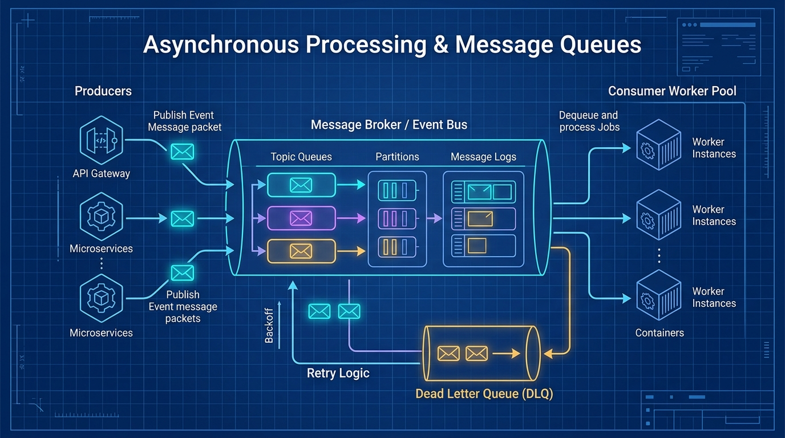

# 📬 Topic 06: Asynchronous Processing & Message Queues

> ☕ *"Time for a fresh cup, Ravi! Until now, everything we've built has been synchronous: a user makes a request, waits impatiently for our code to execute, and receives a response. But what happens when an operation takes 15 seconds—like generating an AI summary, encoding a video, or communicating with a finicky third-party payment gateway? That's where Asynchronous Processing and Event-Driven Architecture save the day!"*  
> — **Rithu**

**Ravi:** *"Rithu, in one of my early projects, whenever someone signed up, our API synchronously sent a welcome email. When the SMTP email server had a 10-second timeout, our entire mobile app hung and timed out! Is this why we need Message Queues?"*  
**Rithu:** *"Spot on, Ravi! That is the classic synchronous coupling disaster. If sending an email fails or slows down, your user shouldn't suffer. With a message queue, the API responds in 5ms: 'Got it!', drops an event onto a queue, and lets background workers process it safely. Let's see how modern systems decouple tasks with RabbitMQ and Kafka! 🌸"*

---

## 🎯 1. What Ravi Will Learn Today

- 📬 **Synchronous vs. Asynchronous Communication**: Eliminate thread blocking and decouple producer microservices from consumer workers.
- 🐇 **Message Queues vs. Event Streams**: Master the fundamental differences between RabbitMQ (Task Queues) and Apache Kafka (Distributed Append-Only Commit Logs).
- 🔁 **At-Least-Once Delivery & Idempotency**: Design consumer systems that safely handle duplicate messages without charging customers twice.
- 💀 **Dead Letter Queues (DLQ) & Exponential Backoff**: Build self-healing retry pipelines that safely quarantine unparseable or poisoned messages.
- 🧪 **Hands-on Zero-Cost Lab**: Build a live Python producer-consumer task pipeline with RabbitMQ and observe real-time background task processing.

---

## 📊 2. Visual Architecture: Asynchronous Event-Driven Pipeline



```mermaid
flowchart LR
    classDef clientStyle fill:#e0f2fe,stroke:#0284c7,stroke-width:2px,color:#0369a1;
    classDef apiStyle fill:#dcfce7,stroke:#16a34a,stroke-width:2px,color:#15803d;
    classDef brokerStyle fill:#ffedd5,stroke:#ea580c,stroke-width:2px,color:#9a3412;
    classDef workerStyle fill:#ede9fe,stroke:#7c3aed,stroke-width:2px,color:#5b21b6;
    classDef dlqStyle fill:#fee2e2,stroke:#dc2626,stroke-width:2px,color:#991b1b;

    User([👤 User / Client]):::clientStyle -->|1. POST /orders| API[🖥️ API Gateway / Producer]:::apiStyle
    API -->>|2. Immediate HTTP 202 Accepted| User

    subgraph Message_Broker ["📬 Message Broker Cluster (RabbitMQ / Kafka)"]
        direction TB
        Exchange[("🔀 Direct / Topic Exchange")]:::brokerStyle
        QueueMain[("📥 Main Task Queue: orders.process")]:::brokerStyle
        DLQ[("💀 Dead Letter Queue: orders.dlq")]:::dlqStyle

        Exchange -->|Routing Key| QueueMain
        QueueMain -.->|Max 3 Retries Exceeded| DLQ
    end

    API -->|3. Publish Event: OrderCreated| Exchange

    subgraph Worker_Fleet ["⚙️ Asynchronous Consumer Workers"]
        direction TB
        W1["🛠️ Worker Instance 1"]:::workerStyle
        W2["🛠️ Worker Instance 2"]:::workerStyle
        W3["🛠️ Worker Instance 3"]:::workerStyle
    end

    QueueMain -->|Prefetch = 1| W1 & W2 & W3
    W1 & W2 & W3 -->|ACK on Success| QueueMain
    W1 & W2 & W3 -.->|NACK on Failure (Retry)| QueueMain
    DLQ --> AlertSystem[🚨 SRE Pager / Investigation Console]:::dlqStyle
```

---

## 👶 3. Rithu Explains Like You Are a Beginner (ELI5)

### ☕ The Fast-Food Coffee Shop Counter Analogy

Imagine two different ways a coffee shop can handle breakfast rush:

1. **The Synchronous Nightmare (Blocking)**:
   - You walk to the register and order a complex iced caramel macchiato.
   - The cashier takes your money, then says: *"Stand right there."*
   - The cashier walks to the espresso machine, grinds beans, steams milk, drizzles syrup, puts a lid on, and hands it to you. It takes **4 minutes**.
   - During those 4 minutes, the line behind you is completely frozen! Nobody else can order or pay. The store loses business.
2. **The Asynchronous Event Queue (Decoupled & Non-blocking)**:
   - You order at the counter. The cashier takes payment in **5 seconds**, prints an order ticket (**Event / Message**), pins it on a wheel (**Queue**), hands you a receipt with #42, and immediately serves the next customer!
   - 3 baristas (**Consumer Workers**) pick tickets off the wheel at their own pace.
   - If Barista #2 drops a cup, she just remakes it without stopping the cash register.
   - You sit comfortably in the lounge until your ticket #42 is called. The coffee shop serves 10x more customers per hour!

---

### 🔍 Core Architectural Questions Answered

#### RabbitMQ vs. Apache Kafka: What is the real difference?
- **RabbitMQ (Smart Broker, Dumb Consumer)**:
  - Designed as a **traditional message broker** (AMQP).
  - Tracks individual message acknowledgments (ACK/NACK).
  - Once a message is acknowledged, the broker deletes it from RAM/disk.
  - Ideal for discrete, transactional jobs: sending emails, resizing photos, running background reports.
- **Apache Kafka (Dumb Broker, Smart Consumer)**:
  - Designed as a **distributed append-only commit log**.
  - Messages are partitioned and retained on disk for days or weeks, regardless of whether they have been read.
  - Consumers track their own reading position (**Offset**).
  - Ideal for massive real-time data streaming: user clickstreams, IoT telemetry, financial audit logs, and event sourcing.

---

## ⚡ 4. The Essential 80/20 Concepts

| Concept / Pattern | What Rithu Wants Ravi to Know | Practical Job Importance |
| :--- | :--- | :--- |
| **At-Least-Once Delivery** | Brokers guarantee messages are delivered at least once, but network glitches can cause duplicate deliveries. | Consumers **must be idempotent** (processing the same message twice causes no harm). |
| **Idempotency Keys** | Include a unique `idempotency_key` (UUID) with each message. Workers check Redis/DB before processing to discard duplicates. | Prevents double-charging credit cards or sending duplicate invoices. |
| **Dead Letter Queue (DLQ)** | An isolated queue holding messages that fail repeatedly after maximum retry attempts. | Prevents a single corrupt "poison pill" message from crashing all workers in an infinite loop. |
| **Exponential Backoff with Jitter** | Retry after $2^n + \text{random}$ seconds ($2s \to 4s \to 8s \to 16s$) rather than retrying instantly. | Prevents hammering an already-struggling downstream database or third-party API. |
| **Backpressure & Prefetch Count** | Set `prefetch_count = 1` so workers only pull messages they have capacity to process. | Prevents a fast worker from hoarding 100 messages in RAM while other workers sit idle. |

---

## 💻 5. Practical Implementation: Robust Consumer with Retries & Idempotency

Below is a production-grade Python script using `pika` (RabbitMQ) demonstrating message acknowledgment, idempotency checks via Redis, and safe DLQ routing:

```python
# worker_consumer.py
import json
import time
import pika
import redis

# Connect to Redis for Idempotency check
redis_client = redis.Redis(host='localhost', port=6379, decode_responses=True)

def process_order(ch, method, properties, body):
    """Consumer callback handling incoming queue events safely"""
    payload = json.loads(body.decode('utf-8'))
    order_id = payload.get("order_id")
    idempotency_key = f"processed:order:{order_id}"

    print(f"\n[📥 RECEIVED] Processing Order ID: {order_id}")

    # 1. Idempotency Check: Have we already processed this message?
    # SETNX returns 1 if key was set (new), 0 if key already existed (duplicate)
    is_new = redis_client.set(idempotency_key, "locked", ex=86400, nx=True)
    if not is_new:
        print(f"[⚠️ DUPLICATE] Order {order_id} was already processed! Acknowledging and discarding.")
        ch.basic_ack(delivery_tag=method.delivery_tag)
        return

    try:
        # 2. Simulate Business Logic (Payment charging & invoice generation)
        time.sleep(1.2)

        # Simulate intentional crash for poison pill testing
        if payload.get("fail_test"):
            raise ValueError("Downstream Payment Provider Timeout!")

        print(f"[✅ SUCCESS] Order {order_id} charged and confirmed.")

        # 3. Positively Acknowledge (ACK): Remove message from broker
        ch.basic_ack(delivery_tag=method.delivery_tag)

    except Exception as e:
        retry_count = properties.headers.get("x-retry-count", 0) if properties.headers else 0
        print(f"[❌ FAILED] Error on order {order_id}: {e}. Current retry count: {retry_count}")

        # If retries exceeded 3 times, reject without requeue (Broker routes to DLQ)
        if retry_count >= 3:
            print(f"[💀 DEAD-LETTER] Max retries reached. Routing Order {order_id} to DLQ.")
            ch.basic_nack(delivery_tag=method.delivery_tag, requeue=False)
        else:
            # Requeue with incremented retry header
            print(f"[🔁 REQUEUE] Re-publishing to retry exchange with delay...")
            ch.basic_ack(delivery_tag=method.delivery_tag)
            # (In production, publish to a delayed exchange or retry queue)
```

---

## ⌨️ 6. Essential Commands Cheat Sheet

| Command / Tool | Syntax | What It Does | When to Run It in Production |
| :--- | :--- | :--- | :--- |
| **RabbitMQ Queue Status** | `rabbitmqctl list_queues name messages consumers` | Lists queues, unacknowledged message depth, and connected workers. | Detecting queue pile-ups where message arrival outpaces worker processing. |
| **Purge Poison Queue** | `rabbitmqctl purge_queue orders.test` | Deletes all pending unacknowledged messages in a queue. | Emergency cleanup of rogue test messages during staging incidents. |
| **Kafka Topic Consumer Lag** | `kafka-consumer-groups.sh --bootstrap-server localhost:9092 --describe --group order_workers` | Displays `CURRENT-OFFSET`, `LOG-END-OFFSET`, and total consumer `LAG`. | The single most important Kafka metric: alerts when workers fall behind producers. |
| **Monitor RabbitMQ CLI** | `rabbitmq-plugins enable rabbitmq_management` | Enables web-based management UI on port `15672`. | Visualizing throughput graphs, connection channels, and DLQs. |
| **Inspect Message Payload** | `rabbitmqadmin get queue=orders.dlq count=1 ackmode=ack_requeue_false` | Pulls a single message from the DLQ for manual inspection without losing it. | Diagnosing what bad payload caused worker exceptions. |

---

## 🧪 7. Hands-on Practice: Ravi's Zero-Cost Lab

### 🎯 Objective
Ravi will spin up a RabbitMQ message broker with the management interface, publish events using a quick Python script, and watch background workers chew through tasks asynchronously!

### 📋 Prerequisites
- Docker & Python (`pip install pika`).

---

### Step 1: Start RabbitMQ with Management UI
```bash
docker run -d --name rabbitmq_lab -p 5672:5672 -p 15672:15672 rabbitmq:3-management-alpine
```

### Step 2: Create a Producer Script (`producer.py`)
```python
import pika
import json

connection = pika.BlockingConnection(pika.ConnectionParameters('localhost'))
channel = connection.channel()

# Declare durable queue
channel.queue_declare(queue='task_orders', durable=True)

# Publish 5 asynchronous tasks
for i in range(1, 6):
    message = json.dumps({"order_id": i, "item": "Keyboard", "quantity": 1})
    channel.basic_publish(
        exchange='',
        routing_key='task_orders',
        body=message,
        properties=pika.BasicProperties(delivery_mode=2) # Persistent message on disk
    )
    print(f" [🚀 SENT] Published Order #{i}")

connection.close()
```

### Step 3: Run Producer
```bash
python producer.py
```

---

### ✅ Verification Step: Inspect the Live Queue
Open your browser at `http://localhost:15672` (Username: `guest`, Password: `guest`).  
Click **Queues** $\to$ `task_orders`. You will see **5 Ready Messages** sitting safely in the broker, waiting for workers to wake up!

Now run a quick one-line worker to consume them:
```bash
python -c "
import pika, json, time
conn = pika.BlockingConnection(pika.ConnectionParameters('localhost'))
ch = conn.channel()
def cb(ch, method, props, body):
    print(f' [⚙️ WORKER] Finished: {body.decode()}')
    ch.basic_ack(delivery_tag=method.delivery_tag)
ch.basic_consume(queue='task_orders', on_message_callback=cb)
print('Worker listening for 5 seconds...'); ch.start_consuming()
"
```

🎉 **Ravi's Discovery**: The publisher didn't wait for workers, and workers didn't wait for the publisher! They are completely decoupled across time and space.

---

### 🧹 Cleanup
```bash
docker stop rabbitmq_lab
docker rm rabbitmq_lab
rm producer.py
```

---

## ⚠️ 8. Rithu's Top 3 Beginner Traps

### 🪤 Trap 1: The "Auto-Ack" Message Loss Disaster
- **Symptom / What happens**: An unhandled exception occurs in your worker code. The container crashes, and 500 unprocessed user orders vanish into thin air without ever executing!
- **Why it happens**: The consumer used `auto_ack=True`. The moment RabbitMQ delivers the TCP packet to the worker socket, it deletes the message from the queue, even if the worker process crashes 1 millisecond later!
- **Rithu's Fix**: **Always use manual acknowledgment (`auto_ack=False`)!** Only call `ch.basic_ack()` *after* the database transaction commits and the file finishes uploading.

---

### 🪤 Trap 2: The Poison Pill Infinite Loop
- **Symptom / What happens**: A user submits an order with corrupt emojis that crash the JSON parser. The worker crashes, RabbitMQ re-queues the message, the next worker picks it up and crashes, and soon all 10 worker containers are constantly restarting!
- **Why it happens**: Blindly setting `requeue=True` on unhandled exceptions without tracking retry counts or utilizing a Dead Letter Queue.
- **Rithu's Fix**: Catch unhandled exceptions, increment an `x-retry-count` header, and route to a **Dead Letter Queue (DLQ)** after 3 failed attempts.

---

### 🪤 Trap 3: Memory Bloat from Massive Message Payloads
- **Symptom / What happens**: RabbitMQ node memory reaches 95% and triggers disk alarm blocking all producers.
- **Why it happens**: Developers published raw 15 MB PDF files or video binaries directly into message payloads!
- **Rithu's Fix**: Use the **Claim Check Pattern**: Store large binary payloads in AWS S3 or MinIO, and only put a tiny JSON pointer in the message:
  `{"order_id": 42, "pdf_s3_uri": "s3://receipts/order_42.pdf"}`.

---

## 💬 9. Ravi's Doubt Corner (Interview Preparation)

### ❓ Question 1 (Ravi asks):
> *"Rithu, what does 'Idempotency' mean in system design, and how do I implement it in practice?"*

**Rithu's Model Answer:**  
*"An operation is **idempotent** if applying it once produces the exact same result as applying it 100 times.*
- *Example of non-idempotent: `POST /account/pay?amount=50` (running it twice charges \$100).*
- *Example of idempotent: `PUT /account/balance?set=500` (running it 10 times leaves balance at \$500).*
*In event-driven architectures, we achieve idempotency by stamping every event with an **Idempotency Key (UUID)**. When the consumer receives the event, it performs an atomic check (e.g., `INSERT INTO processed_events (id) VALUES ('uuid-123')`). If the insert fails due to a unique key constraint, the consumer knows it’s a duplicate and discards it safely!"*

---

### ❓ Question 2 (Ravi asks):
> *"When should I choose Kafka over RabbitMQ?"*

**Rithu's Model Answer:**  
*"Use this simple mental rubric in interviews:*
- *Choose **RabbitMQ** when:*
  1. You have complex routing logic (Topic exchanges, fanout, direct).
  2. You need granular message-level acknowledgments and retries.
  3. Workload consists of discrete, isolated background tasks.
- *Choose **Apache Kafka** when:*
  1. You require extreme throughput (hundreds of thousands or millions of events/sec).
  2. You need **Message Replay** (e.g., re-running last month’s telemetry data through a newly trained machine learning model).
  3. You are building real-time event-streaming architectures (stream processing with Kafka Streams or Apache Flink)."*

---

## ⚡ 10. Quick Revision with Rithu

- 📬 **Decouple with Queues**: Keep synchronous APIs lightning fast by offloading tasks > 200ms to background workers.
- 🔁 **Assume Duplicates**: Distributed networks guarantee *At-Least-Once* delivery; always write idempotent consumers.
- 💀 **Protect with DLQs**: Route repeatedly failing messages to a Dead Letter Queue to prevent crashing worker pools.
- 🪣 **Claim Check for Blobs**: Never send large binaries through message brokers; store them in S3 and pass references.
- 🛑 **Never Auto-ACK**: Always acknowledge messages *after* business logic successfully executes.

> [!TIP]
> **Rithu's Golden Rule for Topic 06**:  
> *"If your web API is waiting on an external network service or a heavy file render, your architecture is blocking. Hand off the work to a message queue and return an instant 202 Accepted to the user."* 🚀☕
