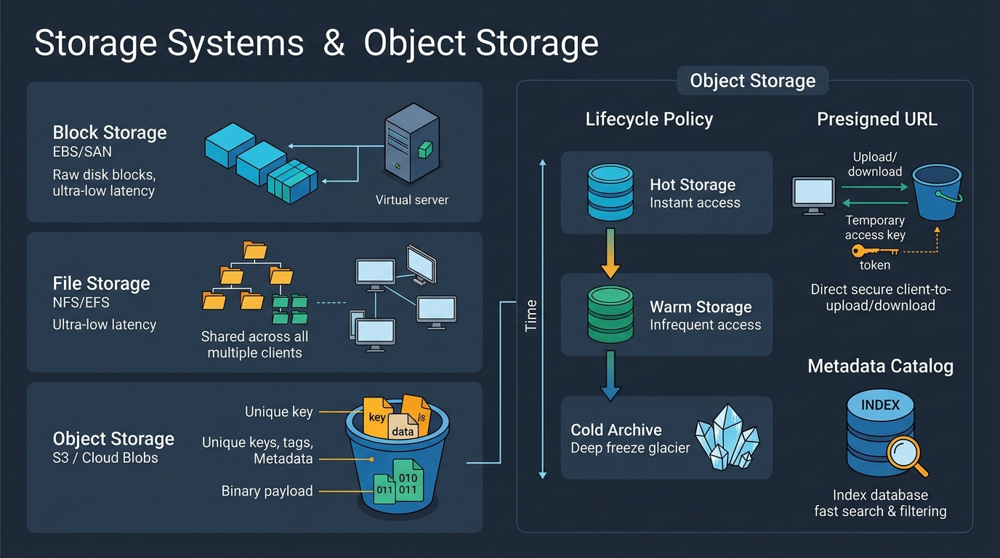
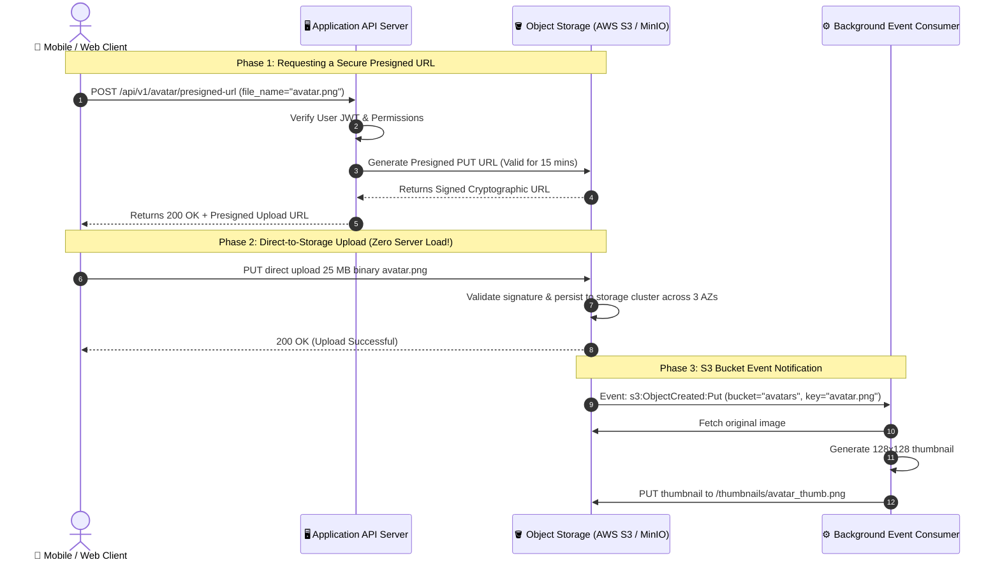

# 🪣 Topic 07: Storage Systems & Object Storage (S3 & Blobs)

> ☕ *"Refill that mug, Ravi! Today we are tackling unstructured and semi-structured storage: videos, photos, database backups, logs, and machine learning datasets. If you try to store these multi-gigabyte blobs inside relational database columns, your databases will choke and explode your cloud bill. Let's learn how modern distributed Object Storage (Amazon S3, Google Cloud Storage, MinIO) scales out to exabytes of data!"*  
> — **Rithu**

**Ravi:** *"Rithu, whenever I needed to save user avatars or PDF invoices, I just saved them to an `uploads/` folder on my server disk. Why shouldn't I do that in production, and how is Object Storage different from a regular file system?"*  
**Rithu:** *"In a cloud-native world, servers are disposable! If your server crashes or auto-scales down, that local `uploads/` folder is gone forever. Furthermore, traditional file systems struggle when a single folder contains 5 million files. Today, we'll see why Object Storage uses a flat key-value namespace with 99.999999999% (11 9's!) durability! 🌸"*

---

## 🎯 1. What Ravi Will Learn Today

- 🧱 **Block vs. File vs. Object Storage**: Learn the distinct use cases, latency profiles, and cost structures of EBS, EFS/NFS, and S3/Blob Storage.
- 🪣 **Anatomy of an Object Store**: Understand Keys, Buckets, Payloads, Custom Metadata, and the flat hierarchy design.
- 🔑 **Presigned URLs for Direct-to-S3 Uploads**: Completely bypass application web servers by letting client browsers stream gigabyte files directly to S3.
- ❄️ **Automated Lifecycle Tiering**: Transition aged data automatically between Hot (Standard), Warm (Infrequent Access), and Cold (Glacier Deep Archive) tiers.
- 🧪 **Hands-on Zero-Cost Lab**: Spin up a local S3-compatible MinIO object store using Docker and generate secure Presigned Upload URLs.

---

## 📊 2. Visual Architecture: Storage Hierarchy & Direct Presigned S3 Uploads





---

## 👶 3. Rithu Explains Like You Are a Beginner (ELI5)

### 🏢 The Storage Locker vs. The City Library Analogy

Imagine three different ways of storing physical items:

1. **Block Storage (Like Raw Legos / Virtual Hard Disk - AWS EBS)**:
   - Fast, low-latency, raw storage attached directly to a single computer motherboard via a virtual cable.
   - It doesn't know what a "file" is—it just knows byte sectors (Block 0 to Block 1024).
   - Only **one** server can attach to it at a time. Perfect for database files (PostgreSQL data directories).
2. **File Storage (Like an Office Shared Filing Cabinet - AWS EFS / NFS)**:
   - Uses hierarchical folders (`/documents/invoices/2026/october/receipt.pdf`).
   - Multiple computers can mount and share the same cabinet simultaneously.
   - Downsides: When a folder contains 10 million files, directory traversal becomes agonizingly slow, and permissions locking creates bottlenecks.
3. **Object Storage (Like a Valet Parking Garage - AWS S3 / MinIO)**:
   - You don't park your car yourself; you hand your keys to the valet.
   - The valet hands you a claim ticket with a unique ID: `TICKET-89742` (**The Object Key**).
   - Your car is parked in an enormous, flat 100-acre lot. There are no "folders" or "trees"—just a flat collection of objects identified by their key!
   - Attached to the car is an index card with information: *"Silver sedan, owner is Ravi, expires in 2 hours"* (**Custom Metadata**).
   - You can store 1 billion cars, and finding any car takes the exact same constant time: $O(1)$!

---

### 🔍 Core Architectural Questions Answered

#### What makes Object Storage so durable (11 9's of durability)?
When you upload a file to S3 Standard, it is **automatically replicated across at least 3 geographically separate Availability Zones (data centers)** before returning `200 OK`. Even if an entire data center is struck by lightning, your file remains fully intact.

#### Why shouldn't application servers handle large file uploads?
If 100 users simultaneously upload 500 MB videos through your web servers, your Node.js or Python processes will hold open 100 slow network sockets for minutes, exhausting server memory and thread pools. With **Presigned URLs**, the client uploads directly to S3's global ingestion endpoints, reducing web server load to zero!

---

## ⚡ 4. The Essential 80/20 Concepts

| Storage Tier / Concept | What Rithu Wants Ravi to Know | Practical Job Importance |
| :--- | :--- | :--- |
| **Block vs. File vs. Object** | Block = fast raw disk for DBs (EBS). File = shared hierarchy (EFS). Object = flat, unlimited scale via HTTP REST API (S3). | Choosing the wrong storage type can increase cloud bills by 1,000% or throttle throughput. |
| **Presigned URLs** | Short-lived, cryptographically signed URLs granting temporary `PUT` or `GET` access without exposing private AWS credentials. | The industry standard pattern for uploading media files directly from mobile apps and browsers. |
| **Lifecycle Policies** | Automatically transition files: Hot (Standard) $\to$ Warm (Infrequent Access after 30 days) $\to$ Cold (Glacier after 90 days) $\to$ Delete after 365 days. | Slashes cloud storage costs by 80–90% on log archives, backups, and user uploads. |
| **Multipart Uploads** | Splits large files (> 100 MB) into smaller chunks uploaded in parallel with independent retries. | Prevents a failed 5 GB upload from restarting from 0% when network drops at 99%. |
| **S3 Event Notifications** | Triggers asynchronous serverless functions (AWS Lambda) or SQS events whenever an object is created or deleted. | Powers automated pipelines: image resizing, antivirus scanning, transcribing audio, and OCR processing. |

---

## 💻 5. Practical Implementation: Direct-to-Storage Presigned URL Generator in Python

Below is an enterprise-grade service using `boto3` that generates secure, expiring Presigned Upload URLs:

```python
# presigned_service.py
import boto3
from botocore.exceptions import ClientError
from botocore.config import Config
import uuid

class StorageManager:
    def __init__(self):
        # Configure Boto3 S3 Client with signature version 4
        self.s3_client = boto3.client(
            's3',
            region_name='us-east-1',
            config=Config(signature_version='s3v4')
        )
        self.BUCKET_NAME = "company-user-assets-prod"

    def generate_upload_url(self, user_id: int, file_extension: str, max_file_size_bytes: int = 10485760) -> dict:
        """
        Generates a secure Presigned Post URL allowing a client to upload
        up to 10MB directly to S3 within a 15-minute window.
        """
        # Unique deterministic object key
        unique_file_id = uuid.uuid4().hex
        object_key = f"avatars/user_{user_id}/{unique_file_id}.{file_extension}"

        # Enforce security constraints: file size ceiling and exact bucket target
        conditions = [
            ["content-length-range", 1024, max_file_size_bytes], # 1KB minimum to 10MB max
            {"bucket": self.BUCKET_NAME},
            {"key": object_key}
        ]

        try:
            # Generate cryptographic Presigned Post payload
            response = self.s3_client.generate_presigned_post(
                Bucket=self.BUCKET_NAME,
                Key=object_key,
                Fields={"key": object_key},
                Conditions=conditions,
                ExpiresIn=900 # Expire in 15 minutes (900 seconds)
            )
            return {
                "upload_endpoint": response["url"],
                "form_fields": response["fields"],
                "final_file_url": f"https://{self.BUCKET_NAME}.s3.amazonaws.com/{object_key}"
            }
        except ClientError as e:
            print(f"[ERROR] Failed to generate presigned upload: {e}")
            raise e

# Example Usage
if __name__ == "__main__":
    manager = StorageManager()
    upload_ticket = manager.generate_upload_url(user_id=42, file_extension="webp")
    print("Presigned Upload Payload for Frontend Client:")
    print(upload_ticket)
```

### 🔍 Line-by-Line Breakdown for Ravi
- **`object_key = f"avatars/user_{user_id}/{unique_file_id}.webp"`**: Uses a unique UUID to prevent file name collisions (e.g., two users both uploading `profile.jpg`).
- **`["content-length-range", 1024, 10485760]`**: A critical security safeguard! S3 validates this condition on the HTTP upload. If an attacker tries to upload a 20 GB file, S3 rejects the connection immediately at the edge.
- **`ExpiresIn=900`**: The token self-destructs after 15 minutes, preventing stolen or leaked URLs from being reused.

---

## ⌨️ 6. Essential Commands Cheat Sheet

| Command / Tool | Syntax | What It Does | When to Run It in Production |
| :--- | :--- | :--- | :--- |
| **Sync Directories to S3** | `aws s3 sync ./build s3://my-app-assets/ --delete` | Synchronizes local folder to S3 bucket, uploading only modified files. | Deploying static website builds and backing up config directories. |
| **Inspect Bucket Size** | `aws s3 ls s3://my-bucket --recursive --human-readable --summarize` | Calculates total object count and cumulative gigabytes/terabytes in bucket. | Auditing cloud storage growth and identifying unmanaged directories. |
| **Apply Lifecycle Policy** | `aws s3api put-bucket-lifecycle-configuration --bucket my-bucket --lifecycle-configuration file://policy.json` | Installs JSON lifecycle rules (e.g., transition to Glacier after 90 days). | Automating cost optimization on log buckets and backups. |
| **Generate Quick Download URL** | `aws s3 presign s3://my-bucket/database-dump.sql --expires-in 3600` | Creates a temporary download link valid for 1 hour from the terminal. | Securely sharing diagnostic logs or database dumps with team members. |
| **MinIO Local Client Alias** | `mc alias set myminio http://localhost:9000 minioadmin minioadmin` | Configures local MinIO CLI client for local S3 simulation testing. | Testing S3 scripts locally during zero-cost dev and CI/CD pipelines. |

---

## 🧪 7. Hands-on Practice: Ravi's Zero-Cost Lab

### 🎯 Objective
Ravi will spin up an S3-compatible **MinIO** server using Docker, create a bucket, upload a file via the CLI, and verify HTTP access!

### 📋 Prerequisites
- Docker installed.

---

### Step 1: Start MinIO Object Storage Container
```bash
docker run -d --name minio_lab \
  -p 9000:9000 -p 9001:9001 \
  -e "MINIO_ROOT_USER=minioadmin" \
  -e "MINIO_ROOT_PASSWORD=minioadmin" \
  minio/minio server /data --console-address ":9001"
```

### Step 2: Open MinIO Web Console
Open your browser and navigate to:
```text
http://localhost:9001
Username: minioadmin
Password: minioadmin
```

### Step 3: Create a Bucket & Upload a File via Terminal
```bash
# Create a dummy image file
echo "Antigravity Cloud Native Blob Storage Payload" > test-blob.txt

# Use curl to upload to MinIO S3 API endpoint
curl -X PUT -T test-blob.txt http://localhost:9000/my-test-bucket/test-blob.txt \
  -u minioadmin:minioadmin
```

---

### ✅ Verification Step: Inspect Object via HTTP
```bash
curl -s http://localhost:9000/my-test-bucket/test-blob.txt -u minioadmin:minioadmin
```

#### Output:
```text
Antigravity Cloud Native Blob Storage Payload
```

🎉 **Ravi's Discovery**: You just created an on-premise, enterprise-grade, S3-compatible Object Storage cluster right on your local machine! Any script written with the AWS S3 SDK can target this MinIO instance by simply changing the endpoint URL.

---

### 🧹 Cleanup
```bash
docker stop minio_lab
docker rm minio_lab
rm test-blob.txt
```

---

## ⚠️ 8. Rithu's Top 3 Beginner Traps

### 🪤 Trap 1: The "Public Bucket" Data Leak Headline
- **Symptom / What happens**: Security researchers find your company's unencrypted customer passports or payroll files on the internet, and your company is on the news.
- **Why it happens**: A developer turned on "Make Bucket Public" to fix a broken image link during testing and forgot to turn it off.
- **Rithu's Fix**:
  - Always turn on **AWS S3 Block Public Access** at the account root level.
  - Distribute private objects using **Presigned URLs** or route through **CloudFront with Origin Access Control (OAC)**.

---

### 🪤 Trap 2: Incomplete Multipart Upload Accumulation
- **Symptom / What happens**: Your S3 storage bill shows 15 Terabytes of storage, but when you list all files, you only count 2 Terabytes of data!
- **Why it happens**: When users upload 2 GB video files via multipart upload and abandon the browser tab midway, S3 retains the uploaded fragments indefinitely.
- **Rithu's Fix**: Add an automated lifecycle rule: **AbortIncompleteMultipartUpload** after 7 days:
  ```json
  {
    "AbortIncompleteMultipartUpload": { "DaysAfterInitiation": 7 }
  }
  ```

---

### 🪤 Trap 3: The Glacier Restore Shock
- **Symptom / What happens**: An engineer needs to query last year's logs stored in S3 Glacier. They write a script requesting 10,000 files immediately and receive an error: `ObjectNotInActiveTierError` or an unexpected \$4,000 expedited retrieval bill!
- **Why it happens**: Cold archive storage tiers (Glacier / Glacier Deep Archive) physically store data on magnetic tapes or spun-down disks. Retrieval requires a restore request that takes 3 to 12 hours.
- **Rithu's Fix**: Educate the team on retrieval SLAs: **Standard** (instant), **Infrequent Access** (instant, higher egress cost), and **Glacier** (asynchronous batch restore taking hours).

---

## 💬 9. Ravi's Doubt Corner (Interview Preparation)

### ❓ Question 1 (Ravi asks):
> *"Rithu, what is the difference between S3 Strong Read-After-Write Consistency vs. Eventual Consistency?"*

**Rithu's Model Answer:**  
*"Historically, S3 was **Eventually Consistent** for overwrite `PUTs` and `DELETEs`. If you updated an object and read it immediately, you might receive the old version for a few seconds.*  
*However, in December 2020, AWS upgraded S3 to support **Strong Read-After-Write Consistency** for all `GET`, `PUT`, and `LIST` operations with zero latency penalty and zero cost! Once an upload returns `200 OK`, any subsequent read request across any global region will immediately return the latest bytes. Knowing this historical change immediately demonstrates to an interviewer that you stay up-to-date with cloud advancements!"*

---

### ❓ Question 2 (Ravi asks):
> *"When should we use AWS EFS (Elastic File System) instead of AWS S3?"*

**Rithu's Model Answer:**  
*"Use this simple comparison:*
- *Use **AWS EFS (NFS File Storage)** when:*
  1. Multiple Kubernetes pods or EC2 instances need to mount the **same Linux filesystem concurrently** (POSIX compliant: `chmod`, file locks, sub-directories).
  2. Legacy applications expect a local folder path (e.g., `/mnt/shared_data/file.txt`) without modifying application code to make HTTP REST API calls.
- *Use **AWS S3 (Object Storage)** when:*
  1. Storing immutable blobs (images, audio, backups, log files).
  2. Cost is paramount (S3 Standard is ~\$0.023/GB vs. EFS at ~\$0.30/GB—S3 is over **10x cheaper!**).
  3. You need global distribution via CDNs."*

---

## ⚡ 10. Quick Revision with Rithu

- 🪣 **Flat Namespace**: Object Storage stores items using flat keys ($O(1)$ lookup) and metadata, eliminating slow directory traversal.
- 🔑 **Presign for Speed**: Stream uploads directly from client browsers to S3 using Presigned URLs to keep web servers lightweight.
- ❄️ **Automate Lifecycle Tiers**: Move old data from Hot $\to$ Warm $\to$ Cold Glacier to save up to 90% on storage bills.
- 🛡️ **Block Public Access**: Keep buckets private by default; use Origin Access Control (OAC) with CDNs for distribution.
- ✂️ **Abort Multipart Fragments**: Clean up abandoned upload chunks with 7-day lifecycle rules to prevent invisible storage billing.

> [!TIP]
> **Rithu's Golden Rule for Topic 07**:  
> *"Application servers should never become parking lots for user files. Offload your files to Object Storage, let clients upload directly via Presigned URLs, and keep your compute tier clean and disposable."* 🚀☕
