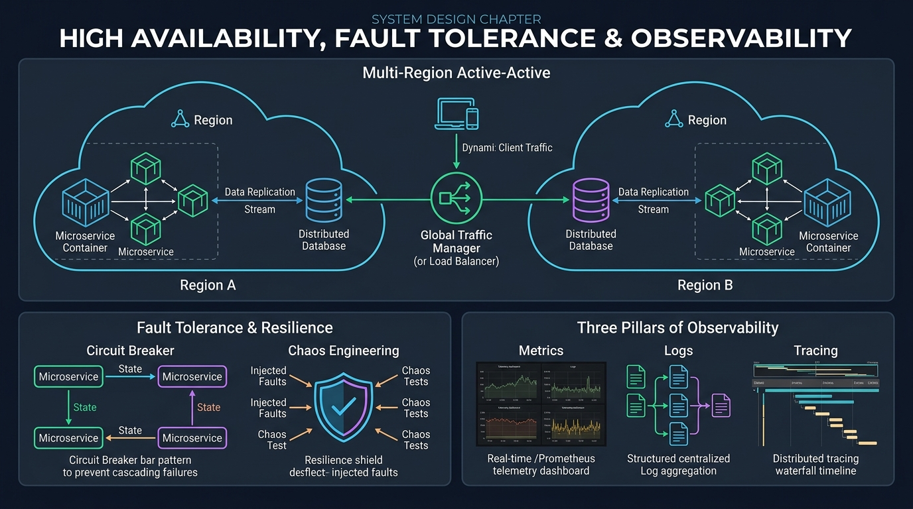
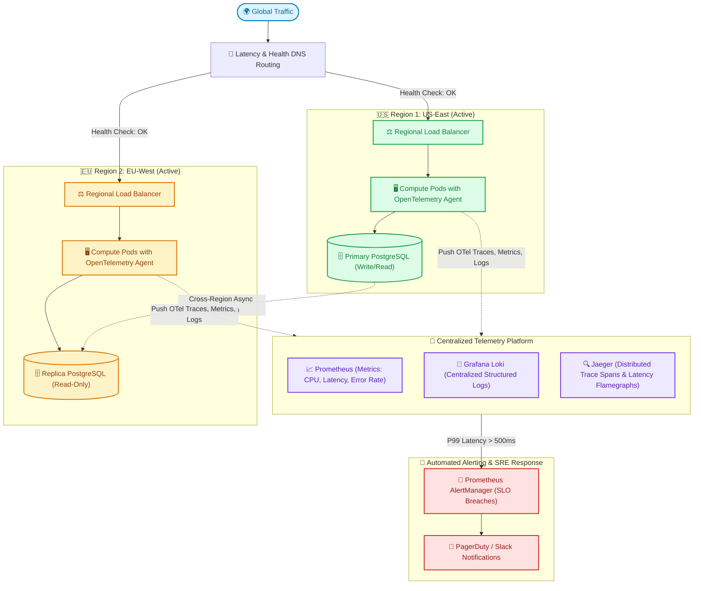

# 🛡️ Topic 08: High Availability, Fault Tolerance & Observability

> ☕ *"Pour yourself a celebratory cup, Ravi! Today is the grand finale of our System Design curriculum. You've learned how to design every individual tier: DNS, Load Balancers, Stateless Compute, Caches, Databases, Queues, and Object Stores. Today, we bring them all together under the golden law of DevOps engineering: 'Everything fails all the time.' Let's master the art of building systems that survive catastrophic cloud outages while you sleep peacefully!"*  
> — **Rithu**

**Ravi:** *"Rithu, what is the real difference between High Availability (HA) and Fault Tolerance (FT)? And how do we actually know what went wrong when a microservice starts throwing random 500 errors across 50 different pods?"*  
**Rithu:** *"That's the ultimate senior engineer question, Ravi! High Availability minimizes downtime to seconds using rapid automated failover, while Fault Tolerance guarantees zero interruption whatsoever (at much higher cost). And to diagnose issues instantly, we rely on the **Three Pillars of Observability**: Metrics, Logs, and Distributed Tracing. Let's explore how Netflix and Google build indestructible systems! 🌸"*

---

## 🎯 1. What Ravi Will Learn Today

- 📈 **The Availability Math (Nines of Uptime)**: Calculate the true business impact of 99.9% (Three 9s = 8.7 hours downtime/yr) vs 99.999% (Five 9s = 5 minutes downtime/yr).
- 🌍 **Multi-Region Architectures**: Compare Active-Passive (Warm/Cold Standby) with Active-Active geo-distributed deployments.
- ⚡ **Circuit Breakers & Graceful Degradation**: Protect downstream microservices from cascading collapses using Netflix Hystrix/Resilience4j patterns.
- 🔭 **The 3 Pillars of Observability**: Unify **Metrics** (Prometheus), **Logs** (Loki/Fluentd), and **Distributed Traces** (OpenTelemetry/Jaeger).
- 🧪 **Hands-on Zero-Cost Lab**: Implement an automated Circuit Breaker in Python and observe real-time failure isolation and recovery.

---

## 📊 2. Visual Architecture: Multi-Region Resilience & The Observability Pillars





---

## 👶 3. Rithu Explains Like You Are a Beginner (ELI5)

### ✈️ The Twin-Engine Commercial Airplane Analogy

Imagine flying across the ocean in a modern passenger airliner:

1. **High Availability (Twin Engines)**:
   - The airplane has **two independent jet engines**.
   - If Engine #1 suffers a mechanical malfunction, Engine #2 instantly takes over the load.
   - You might have to descend to a slightly lower altitude and fly a little slower (**Graceful Degradation**), but the plane stays in the air and lands safely without crashing!
2. **The Circuit Breaker (The House Fuse Box)**:
   - When a toaster in your kitchen shorts out, you don't want the electrical fire to spread into the walls and burn the entire house down.
   - The **fuse trips (Circuit Opens)** immediately. Power to that single outlet is cut, saving the rest of the building.
   - In microservices, if the Payment Gateway is timing out, a circuit breaker cuts it off immediately and serves an apologetic fallback message, preventing your entire web server thread pool from locking up!
3. **The Black Box Flight Recorder (Observability)**:
   - Modern airplanes record everything: engine temperature every second (**Metrics**), cockpit audio voice recordings (**Logs**), and the exact physical motion of every wing flap and rudder cable (**Distributed Tracing**).
   - If anything goes wrong, engineers don't have to guess: they open the telemetry records and see the exact millisecond where things went off course!

---

### 🔍 Core Architectural Questions Answered

#### What are the "Golden Signals" of SRE?
Defined in Google’s Site Reliability Engineering (SRE) handbook, every production system must monitor four vital metrics:
1. **Latency**: The time it takes to service a request (p50, p95, p99).
2. **Traffic**: Demand on the system (requests per second / RPS).
3. **Errors**: The rate of failed requests (HTTP 5xx error percentage).
4. **Saturation**: How "full" your service is (memory, CPU, disk I/O percentage).

#### Metrics vs. Logs vs. Traces: Which one should I look at first?
- **Metrics (The Siren)**: Tell you **THAT** something is wrong (e.g., *"Error rate spiked to 14% on `/checkout`"*).
- **Traces (The Map)**: Tell you **WHERE** it is happening (e.g., *"The delay is occurring inside the Auth microservice span during a database lock"*).
- **Logs (The Detective)**: Tell you **WHY** it happened (e.g., *"NullPointerException: user.billing_address is undefined at line 42"*).

---

## ⚡ 4. The Essential 80/20 Concepts

| Concept / Metric | What Rithu Wants Ravi to Know | Practical Job Importance |
| :--- | :--- | :--- |
| **SLI vs. SLO vs. SLA** | **SLI** = What you measure (e.g., 99.8% of requests take < 200ms). **SLO** = Internal team goal (99.9%). **SLA** = Legal contract with penalties/refunds to customers (99.5%). | Defining reliability targets in production without promising unrealistic 100% uptime. |
| **Circuit Breaker States** | **Closed** (Normal flow) $\to$ **Open** (Tripped, fail-fast without calling failing service) $\to$ **Half-Open** (Trial probe to check if service recovered). | Prevents cascading failures when a downstream microservice is on fire. |
| **P99 Latency vs. Average Latency** | Average latency hides the worst customer pain. P99 measures the slowest 1% of requests. | At 100 million requests/day, 1% represents **1 million frustrated users**! |
| **Active-Passive vs. Active-Active** | Active-Passive has an idle standby datacenter (cheaper, failover delay). Active-Active serves live traffic simultaneously from both datacenters (expensive, complex data sync). | Designing Disaster Recovery (DR) plans according to business Recovery Time Objectives (RTO). |
| **Distributed Context Propagation** | Injecting a unique `traceparent` (TraceID) header into HTTP/gRPC requests so telemetry across 15 microservices connects into one coherent graph. | The foundational mechanic behind OpenTelemetry and microservice debugging. |

---

## 💻 5. Practical Implementation: Python Circuit Breaker Pattern

Below is a production-grade, zero-dependency **Circuit Breaker** implementation in Python with state transitions (`CLOSED`, `OPEN`, `HALF_OPEN`), failure thresholds, and automatic recovery probing:

```python
# circuit_breaker.py
import time
from enum import Enum

class CircuitState(Enum):
    CLOSED = "CLOSED"         # Normal operation: traffic flows freely
    OPEN = "OPEN"             # Tripped: traffic is blocked immediately
    HALF_OPEN = "HALF_OPEN"   # Probing: testing if downstream service has recovered

class CircuitBreakerOpenException(Exception):
    """Raised when request is rejected immediately by the Circuit Breaker"""
    pass

class CircuitBreaker:
    def __init__(self, failure_threshold: int = 3, recovery_timeout_seconds: float = 5.0):
        self.failure_threshold = failure_threshold
        self.recovery_timeout = recovery_timeout_seconds
        self.state = CircuitState.CLOSED
        self.failure_count = 0
        self.last_state_change = time.time()

    def call(self, func, *args, **kwargs):
        current_time = time.time()

        # Check if OPEN circuit should transition to HALF-OPEN trial probe
        if self.state == CircuitState.OPEN:
            if current_time - self.last_state_change > self.recovery_timeout:
                print("\n[⚡ PROBE] Recovery timeout elapsed. Switching state: OPEN -> HALF_OPEN")
                self.state = CircuitState.HALF_OPEN
                self.last_state_change = current_time
            else:
                # Fail-Fast! Do NOT call downstream service!
                remaining = self.recovery_timeout - (current_time - self.last_state_change)
                raise CircuitBreakerOpenException(f"Circuit is OPEN! Request blocked. Retry in {remaining:.1f}s")

        try:
            # Attempt function execution
            result = func(*args, **kwargs)

            # If successful in HALF-OPEN, downstream service is healthy again!
            if self.state == CircuitState.HALF_OPEN:
                print("[✅ RECOVERED] Probe succeeded! Switching state: HALF_OPEN -> CLOSED")
                self.state = CircuitState.CLOSED
                self.failure_count = 0
                self.last_state_change = current_time

            return result

        except Exception as e:
            self._handle_failure()
            raise e

    def _handle_failure(self):
        self.failure_count += 1
        current_time = time.time()
        print(f"[⚠️ WARNING] Downstream failure detected! Current failure count: {self.failure_count}/{self.failure_threshold}")

        if self.failure_count >= self.failure_threshold:
            print("[💥 TRIPPED] Failure threshold reached! Switching state: -> OPEN")
            self.state = CircuitState.OPEN
            self.last_state_change = current_time

# Simulated Flaky Downstream Service
def flaky_third_party_payment_api(should_fail=False):
    if should_fail:
        raise ConnectionResetError("Downstream Payment Provider 504 Gateway Timeout!")
    return {"status": "success", "charge_id": "ch_98412"}
```

### 🔍 Line-by-Line Breakdown for Ravi
- **`CircuitBreakerOpenException`**: When the circuit is `OPEN`, we don't even attempt to open a network socket! The user gets an immediate graceful fallback in 0.1ms instead of waiting for a 30-second connection timeout.
- **`self.failure_threshold = 3`**: Protects the downstream database or API from being battered when it's already struggling.
- **`HALF_OPEN` state**: The circuit breaker doesn't just switch back to `CLOSED` blindly. It cautiously allows *one single test request* through. If it succeeds, the gates open; if it fails, the circuit trips back to `OPEN` for another timeout period.

---

## ⌨️ 6. Essential Commands Cheat Sheet

| Command / Tool | Syntax | What It Does | When to Run It in Production |
| :--- | :--- | :--- | :--- |
| **Prometheus PromQL Query** | `rate(http_requests_total{status=~"5.."}[5m]) / rate(http_requests_total[5m]) * 100` | Calculates real-time HTTP 5xx error percentage over a 5-minute rolling window. | Setting automated pager alerts for SLO violations. |
| **P99 Latency Calculation** | `histogram_quantile(0.99, sum(rate(http_request_duration_seconds_bucket[5m])) by (le))` | Computes 99th percentile response time in seconds across all application pods. | Detecting slow database queries and microservice bottlenecks. |
| **Tail Structured JSON Logs** | `kubectl logs -l app=order-api -f \| jq 'select(.level=="error")'` | Streams real-time error logs across all pods matching the selector, formatted as clean JSON. | Live debugging during active production incidents. |
| **Check Network Connectivity** | `curl -Iv --connect-timeout 2 https://api.internal.service/healthz` | Tests TLS handshake, DNS resolution, and TCP connection latency in under 2 seconds. | Diagnosing network security group or firewall blocking. |
| **Simulate Chaos Latency** | `tc qdisc add dev eth0 root netem delay 200ms` | Linux Traffic Control: artificially injects 200ms of latency into network packets. | Testing circuit breakers and failover timeouts during Chaos Game Days. |

---

## 🧪 7. Hands-on Practice: Ravi's Zero-Cost Lab

### 🎯 Objective
Ravi will run the Circuit Breaker simulation script locally, simulate a catastrophic downstream failure, observe the circuit trip to `OPEN`, and watch it automatically recover when the service heals!

### 📋 Prerequisites
- Python 3 installed.

---

### Step 1: Create Lab Directory
```bash
mkdir resilience-lab
cd resilience-lab
```

### Step 2: Create Test Runner (`test_resilience.py`)
Save the following runnable script:

```python
import time
from circuit_breaker import CircuitBreaker, CircuitBreakerOpenException, flaky_third_party_payment_api

cb = CircuitBreaker(failure_threshold=3, recovery_timeout_seconds=3.0)

print("--- Phase 1: Normal Operations (Service is healthy) ---")
for i in range(1, 3):
    res = cb.call(flaky_third_party_payment_api, should_fail=False)
    print(f"Request {i}: {res['status']}")

print("\n--- Phase 2: Downstream Catastrophe (3 Consecutive Failures) ---")
for i in range(1, 4):
    try:
        cb.call(flaky_third_party_payment_api, should_fail=True)
    except Exception as e:
        print(f"Request {i} failed: {e}")

print("\n--- Phase 3: Circuit is OPEN (Fail-Fast Protection!) ---")
try:
    cb.call(flaky_third_party_payment_api, should_fail=False)
except CircuitBreakerOpenException as e:
    print(f"Intercepted by Circuit Breaker: {e}")

print("\n--- Phase 4: Wait for Recovery Timeout (3 seconds) ---")
time.sleep(3.2)

print("\n--- Phase 5: Service Heals & Recovers ---")
res = cb.call(flaky_third_party_payment_api, should_fail=False)
print(f"Final Request: {res['status']}")
```

### Step 3: Run the Resilience Simulation
```bash
python test_resilience.py
```

#### Expected Output:
```text
--- Phase 1: Normal Operations (Service is healthy) ---
Request 1: success
Request 2: success

--- Phase 2: Downstream Catastrophe (3 Consecutive Failures) ---
[⚠️ WARNING] Downstream failure detected! Current failure count: 1/3
Request 1 failed: Downstream Payment Provider 504 Gateway Timeout!
[⚠️ WARNING] Downstream failure detected! Current failure count: 2/3
Request 2 failed: Downstream Payment Provider 504 Gateway Timeout!
[⚠️ WARNING] Downstream failure detected! Current failure count: 3/3
[💥 TRIPPED] Failure threshold reached! Switching state: -> OPEN
Request 3 failed: Downstream Payment Provider 504 Gateway Timeout!

--- Phase 3: Circuit is OPEN (Fail-Fast Protection!) ---
Intercepted by Circuit Breaker: Circuit is OPEN! Request blocked. Retry in 3.0s

--- Phase 4: Wait for Recovery Timeout (3 seconds) ---

--- Phase 5: Service Heals & Recovers ---
[⚡ PROBE] Recovery timeout elapsed. Switching state: OPEN -> HALF_OPEN
[✅ RECOVERED] Probe succeeded! Switching state: HALF_OPEN -> CLOSED
Final Request: success
```

🎉 **Ravi's Discovery**: Look at Phase 3! When the downstream service was broken, your application **did not waste a single millisecond** waiting on socket timeouts; it failed fast and gracefully protected itself!

---

### 🧹 Cleanup
```bash
cd ..
rm -rf resilience-lab
```

---

## ⚠️ 8. Rithu's Top 3 Beginner Traps

### 🪤 Trap 1: The "Split-Brain" Catastrophe in Multi-Master Clusters
- **Symptom / What happens**: A temporary network partition occurs between Region 1 and Region 2. Both regions believe the other has died, elect themselves as the Primary master, and begin accepting writes. When the network reconnects, you have two irreconcilable, conflicting database realities!
- **Why it happens**: Lack of a quorum (majority voting) mechanism or using naive multi-master setups across high-latency WAN links.
- **Rithu's Fix**:
  - Always use an **odd number of voting consensus nodes** (e.g., 3 or 5 nodes in Raft/Paxos clusters like etcd or ZooKeeper).
  - A partition must possess a strict majority: $\lfloor \frac{N}{2} \rfloor + 1$ nodes to accept writes; the minority partition must refuse writes immediately.

---

### 🪤 Trap 2: Log Aggregation System Crash During Incidents
- **Symptom / What happens**: Your web service begins throwing 10,000 exceptions/sec. Suddenly, your logging cluster (Elasticsearch/Loki) crashes, meaning you have zero visibility right at the most critical moment of the outage!
- **Why it happens**: Unbounded stack traces sent synchronously over the network saturated log shippers.
- **Rithu's Fix**:
  - Use **buffer queues** (like a lightweight Kafka or Redis topic) between log shippers (Fluentbit) and log storage.
  - Implement **log sampling and rate limiting** so that repeating error logs are deduplicated before transmission.

---

### 🪤 Trap 3: The Cascading Timeout Avalanche
- **Symptom / What happens**: Frontend calls Service A (timeout 10s), Service A calls Service B (timeout 10s), Service B calls Service C (timeout 10s). The user waits 30 seconds for an error, retries immediately, and exhausts all worker threads across all three services.
- **Why it happens**: Upstream timeouts were longer than downstream timeouts, with zero deadline propagation.
- **Rithu's Fix**: **Enforce Context Deadlines (gRPC / HTTP Deadline Propagation)**. If the user's browser gives up after 2 seconds, cancel all downstream in-flight database and API calls immediately!

---

## 💬 9. Ravi's Doubt Corner (Interview Preparation)

### ❓ Question 1 (Ravi asks):
> *"Rithu, what is Chaos Engineering, and why on earth would any sane company intentionally break things in production like Netflix does with Chaos Monkey?"*

**Rithu's Model Answer:**  
*"Because **unplanned outages happen at 3:00 AM on Sunday**, while **Chaos Engineering experiments happen at 11:00 AM on Tuesday** when your entire engineering team is in the office with coffee in hand!*  
*Chaos Engineering is the discipline of experimenting on a system in order to build confidence in the system’s capability to withstand turbulent conditions. Netflix created **Chaos Monkey** to randomly terminate production EC2 instances during business hours. This forced engineers to design every single service to be stateless, redundant, and self-healing. If you don't test your disaster recovery plans continuously, you don't actually have a disaster recovery plan!"*

---

### ❓ Question 2 (Ravi asks):
> *"What is the practical difference between RPO and RTO in disaster recovery?"*

**Rithu's Model Answer:**  
*"Two vital business metrics for any infrastructure architect:
- ***RPO (Recovery Point Objective)***: **How much data can you afford to lose?** Measured in time. If you take database backups every 4 hours, your RPO is 4 hours (up to 4 hours of customer data is permanently lost during a catastrophe).
- ***RTO (Recovery Time Objective)***: **How long can you afford to be offline?** If your failover script takes 15 minutes to switch DNS to the backup region, your RTO is 15 minutes.
- **Interview Insight**: *The closer RPO and RTO approach 0, the exponentially higher your cloud infrastructure bill becomes! Balancing cost against risk is the mark of a true senior engineer."*

---

## ⚡ 10. Quick Revision with Rithu

- 🛡️ **Expect Failure**: Assume every server, switch, and cloud region will fail. Design automated health checks and failovers.
- ⚡ **Trip the Breaker**: Use Circuit Breakers to fail fast and prevent cascading collapses across microservices.
- 🔭 **The 3 Pillars**: Monitor **Metrics** to detect incidents, **Traces** to isolate the culprit component, and **Logs** to diagnose the root cause.
- 📊 **Target P99, Not Average**: Average latency is a misleading metric; always optimize for 95th and 99th percentiles.
- 🐵 **Embrace Chaos**: Continuously test failure scenarios during normal working hours so you never fear unexpected outages.

> [!TIP]
> **Rithu's Golden Rule for Topic 08**:  
> *"True reliability isn't measured by whether your system never encounters errors; it's measured by how gracefully it handles them. Build systems that bend without breaking, degrade gracefully, and recover automatically."* 🚀☕
