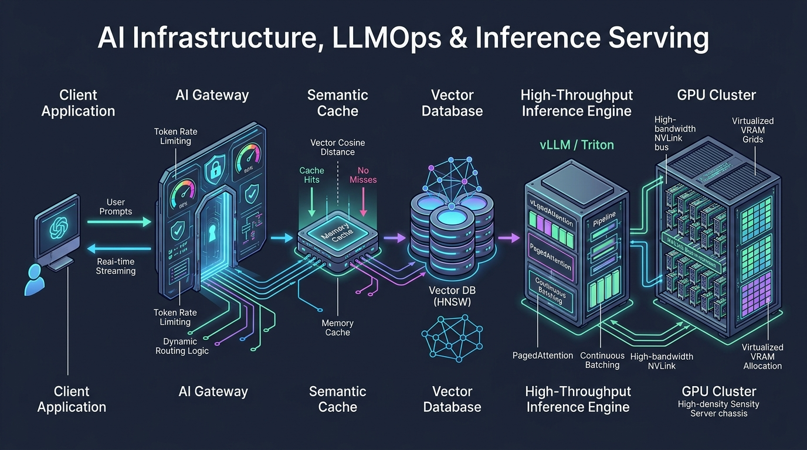
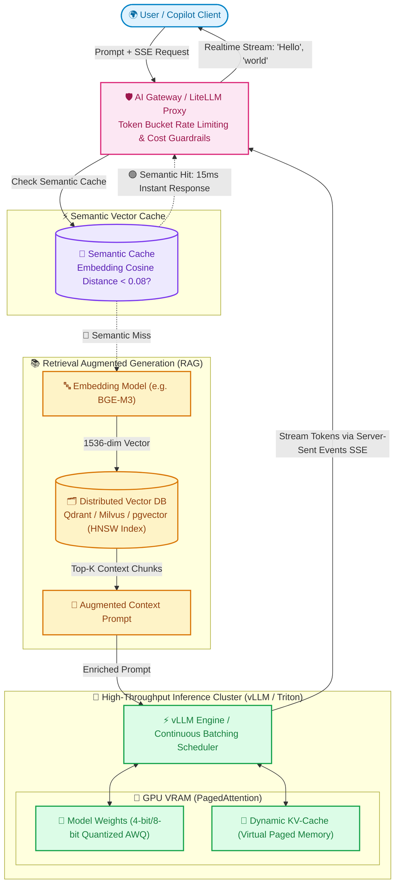

# 🤖 Topic 09: AI Infrastructure, LLMOps & Inference Serving

> ☕ *"Take a seat and take a big sip, Ravi! Welcome to system design in 2026. The days when DevOps engineers only cared about CPU, RAM, and disk are officially over. Today, you are an **AI Infrastructure Architect**. We are dealing with 80-gigabyte GPU VRAM allocations, billion-parameter neural networks, millisecond token streaming, and vector databases processing millions of high-dimensional embeddings. Let's master the systems that power modern Artificial Intelligence!"*  
> — **Rithu**

**Ravi:** *"Rithu, when my team tried to self-host an open-source LLM like Llama 3 on Kubernetes, our GPUs kept crashing with CUDA Out-of-Memory (OOM) errors, and requests took 45 seconds to generate answers! How do companies like Anthropic, OpenAI, or Perplexity serve millions of users with real-time streaming?"*  
**Rithu:** *"Because traditional web scaling doesn't work for AI, Ravi! A web request takes 10ms and finishes. An LLM request can hold open a GPU's VRAM for 30 seconds while generating 500 tokens one-by-one! To solve this, elite AI engineers use **PagedAttention, Continuous Batching with vLLM, Semantic Caching, and Vector Search**. Let's build your AI infrastructure mental model from the ground up! 🌸"*

---

## 🎯 1. What Ravi Will Learn Today

- 🧠 **The Anatomy of an LLM Request**: Deconstruct Prompt Evaluation (Prefill Phase) vs. Auto-regressive Token Generation (Decode Phase).
- ⚡ **High-Throughput Inference Engines**: Master **vLLM** and **Triton Inference Server**, Continuous Batching, and PagedAttention (virtual memory for KV Cache).
- 🗄️ **Vector Databases & RAG Architecture**: Scale **Qdrant, Milvus, and pgvector** using Hierarchical Navigable Small World (HNSW) similarity indexing.
- 🎯 **Semantic Caching**: Cut LLM inference costs and latency by 70% using embedding cosine distance to cache semantically identical prompts.
- 🧪 **Hands-on Zero-Cost Lab**: Build a local Vector Search & Semantic Similarity engine using Python and SQLite with cosine distance calculation.

---

## 📊 2. Visual Architecture: The Modern GenAI & LLM Inference Stack





---

## 👶 3. Rithu Explains Like You Are a Beginner (ELI5)

### 👨‍🍳 The Gourmet Master Chef & The Sous-Chef Library Analogy

Imagine dining at an ultra-exclusive custom restaurant:

1. **The Classic Web Request (A Vending Machine)**:
   - You put in a coin and press button B4. A candy bar drops out. The machine is instantly ready for the next person in 0.01 seconds. This is standard REST APIs.
2. **The LLM Request (The Gourmet Master Chef - The GPU)**:
   - You order a custom dish that requires the chef to taste, stir, adjust seasoning, wait 10 seconds, and add another ingredient one flake at a time.
   - The chef cannot just walk away mid-dish. The pan (**GPU VRAM**) is completely occupied for the entire duration!
3. **The Sous-Chef with the Research Library (RAG & Vector DB)**:
   - If you ask the chef: *"Can you make grandma's secret 1923 Italian pasta?"*, the chef doesn't have it memorized in his brain (**Model Weights**).
   - So a quick research assistant (**Vector Database**) runs into the historical cookbook library, finds the exact 2 matching pages (**Top-K Vector Similarity Search**), and places them next to the cutting board!
4. **The Blackboard of Frequent Answers (Semantic Caching)**:
   - If Customer #1 asks: *"How do I reset my account password?"*, the chef spends 20 seconds preparing the answer.
   - When Customer #2 asks: *"What are the steps to change my forgotten password?"*, traditional caches fail because the words are different.
   - But a **Semantic Cache** understands that both sentences mean the exact same thing! It points to the blackboard and answers instantly without bothering the chef!

---

### 🔍 Core Architectural Questions Answered

#### What is the difference between Prefill and Decode phases in LLM inference?
- **Prefill (Compute-Bound)**: The inference engine digests the user's prompt (e.g., 2,000 input tokens). It processes all tokens in parallel, saturating the GPU Tensor Cores.
- **Decode (Memory-Bandwidth-Bound)**: The engine generates one token at a time sequentially. To generate token #501, it must read all model weights and historical Key-Value (KV) vectors from VRAM. The GPU spends most of its time waiting for memory transfer, not computing!

#### What is PagedAttention (vLLM)?
Traditional inference engines allocated a continuous block of GPU memory for each user's KV-cache based on the maximum sequence length (e.g., 4,096 tokens). If the user only generated 100 tokens, 95% of precious GPU VRAM was wasted! Inspired by Virtual Memory in operating systems, **PagedAttention** breaks the KV-cache into non-contiguous memory pages, virtually eliminating VRAM fragmentation and allowing **4x to 8x higher concurrent batching throughput**.

---

## ⚡ 4. The Essential 80/20 Concepts

| Concept / Tool | What Rithu Wants Ravi to Know | Practical Job Importance |
| :--- | :--- | :--- |
| **Continuous Batching (Iteration-level)** | Traditional batching waits for all requests in a batch to finish before accepting new ones. Continuous batching inserts new prompts into the iteration loop as soon as any single request emits an `<END>` token. | Increases GPU utilization from 25% to 85% and slashes queue wait times. |
| **HNSW (Hierarchical Navigable Small World)** | A multi-layer graph-based indexing algorithm used by Vector DBs (Qdrant, Milvus). Navigates fast "expressway" layers down to dense clusters. | Provides $O(\log N)$ vector search over 50 million embeddings with > 98% recall. |
| **Quantization (AWQ / GPTQ / FP8)** | Compresses 16-bit floating point weights down to 8-bit or 4-bit integers with negligible loss in accuracy. | Allows running a 70-Billion parameter model (which normally requires two \$30,000 A100 GPUs) on a single workstation GPU! |
| **Semantic Caching** | Evaluates Cosine Similarity: $\text{sim}(u, v) = \frac{u \cdot v}{\|u\| \|v\|}$. If similarity $> 0.92$, returns cached output without invoking LLM. | Lowers external LLM API bills (OpenAI/Anthropic) by 50–80% for repetitive customer support queries. |
| **Server-Sent Events (SSE)** | Unidirectional HTTP streaming protocol using `Content-Type: text/event-stream`. | The universal standard protocol for streaming token-by-token LLM completions to browsers and IDEs. |

---

## 💻 5. Practical Implementation: Semantic Vector Search & Similarity Matcher

Below is a production-grade Python script demonstrating **Vector Cosine Similarity**, **Semantic Threshold Matching**, and a **Fallback LLM Trigger**:

```python
# semantic_cache_engine.py
import math
import time

def cosine_similarity(vec_a: list[float], vec_b: list[float]) -> float:
    """Computes mathematical cosine similarity between two high-dimensional vectors"""
    dot_product = sum(a * b for a, b in zip(vec_a, vec_b))
    norm_a = math.sqrt(sum(a * a for a in vec_a))
    norm_b = math.sqrt(sum(b * b for b in vec_b))
    if norm_a == 0.0 or norm_b == 0.0:
        return 0.0
    return dot_product / (norm_a * norm_b)

class SemanticCache:
    def __init__(self, similarity_threshold: float = 0.90):
        # In production, this would be backed by Qdrant, Milvus, or Redis Vector Engine
        self.cache_entries = [] # List of tuples: (query_text, embedding_vector, cached_llm_response)
        self.threshold = similarity_threshold

    def get(self, query_vector: list[float]) -> dict | None:
        best_match = None
        highest_score = -1.0

        for text, emb, response in self.cache_entries:
            sim = cosine_similarity(query_vector, emb)
            if sim > highest_score:
                highest_score = sim
                best_match = (text, response)

        if highest_score >= self.threshold:
            print(f" [🟢 SEMANTIC CACHE HIT] Score: {highest_score:.4f} (Threshold: {self.threshold})")
            return {
                "matched_query": best_match[0],
                "response": best_match[1],
                "similarity": highest_score
            }

        print(f" [🔴 SEMANTIC CACHE MISS] Highest Score: {highest_score:.4f} < {self.threshold}")
        return None

    def put(self, query_text: str, query_vector: list[float], llm_response: str):
        self.cache_entries.append((query_text, query_vector, llm_response))
        print(f" [💾 CACHE SAVED] Stored semantic entry for: '{query_text}'")

# Demonstration Simulation
if __name__ == "__main__":
    cache = SemanticCache(similarity_threshold=0.88)

    # Simulated 3-dimensional embeddings (In real world: 1536-dimensional vectors from text-embedding-3-small)
    emb_how_to_reset = [0.92, 0.38, 0.05]
    emb_steps_to_change = [0.91, 0.40, 0.04] # Semantically almost identical!
    emb_weather_forecast = [0.10, 0.02, 0.99] # Completely different semantic meaning!

    # 1. First user queries password reset (Cold miss -> Call LLM -> Store in cache)
    cache.put(
        query_text="How do I reset my password?",
        query_vector=emb_how_to_reset,
        llm_response="Go to Settings -> Security -> Click 'Reset Password' and check your email."
    )

    # 2. Second user asks with completely different wording
    print("\n--- User 2 queries: 'What are the steps to change my password?' ---")
    hit = cache.get(emb_steps_to_change)
    if hit:
        print(f"Instant Answer Served (0ms GPU): {hit['response']}")

    # 3. Third user asks about weather
    print("\n--- User 3 queries: 'What is the weather in Tokyo?' ---")
    hit = cache.get(emb_weather_forecast)
    if not hit:
        print("Triggering expensive GPU / OpenAI inference for weather...")
```

---

## ⌨️ 6. Essential AI DevOps Commands Cheat Sheet

| Command / Tool | Syntax | What It Does | When to Run It in Production |
| :--- | :--- | :--- | :--- |
| **GPU Telemetry Monitor** | `nvidia-smi --query-gpu=utilization.gpu,memory.used,memory.total,temperature.gpu --format=csv -l 1` | Streams real-time GPU compute utilization, VRAM usage, and temperatures every second. | Diagnosing GPU under-utilization or CUDA Out-Of-Memory thrashing. |
| **vLLM Production Server** | `python3 -m vllm.entrypoints.openai.api_server --model mistralai/Mistral-7B-Instruct-v0.2 --gpu-memory-utilization 0.90 --max-model-len 4096` | Spawns a high-performance OpenAI-compatible inference server with PagedAttention. | Deploying self-hosted open-weights LLMs in Kubernetes clusters. |
| **Inspect Vector DB Health** | `curl -s http://localhost:6333/collections/knowledge_base \| jq .` | Queries Qdrant collection status: vector count, segment status, and HNSW graph index state. | Monitoring RAG knowledge base indexing and memory footprints. |
| **Token Streaming Test** | `curl -N -X POST http://localhost:8000/v1/chat/completions -H "Content-Type: application/json" -d '{"model": "llama3", "messages": [{"role": "user", "content": "Hi"}], "stream": true}'` | Streams raw Server-Sent Event (SSE) chunks directly to the terminal. | Verifying streaming API proxy latency and chunk buffer handling. |
| **GPU Kubernetes Daemon** | `kubectl get nodes "-o=custom-columns=NAME:.metadata.name,GPU:.status.allocatable.nvidia\.com/gpu"` | Lists total allocatable physical NVIDIA GPUs across all Kubernetes worker nodes. | Verifying GPU device plugin status before scheduling AI workload pods. |

---

## 🧪 7. Hands-on Practice: Ravi's Zero-Cost Lab

### 🎯 Objective
Ravi will spin up a local instance of the high-performance **Qdrant Vector Database** via Docker, create an HNSW vector collection, insert sample embeddings, and execute a sub-millisecond semantic nearest-neighbor search!

### 📋 Prerequisites
- Docker & terminal.

---

### Step 1: Start Qdrant Vector Engine
```bash
docker run -d --name qdrant_lab -p 6333:6333 -p 6334:6334 qdrant/qdrant:latest
```

### Step 2: Create a Vector Collection with Cosine Distance
Execute via `curl`:
```bash
curl -X PUT "http://localhost:6333/collections/devops_docs" \
  -H "Content-Type: application/json" \
  -d '{
    "vectors": {
      "size": 4,
      "distance": "Cosine"
    }
  }'
```

### Step 3: Insert Document Embeddings
Let's store 3 conceptual vectors (representing documents on Kubernetes, Docker, and Cooking):
```bash
curl -X PUT "http://localhost:6333/collections/devops_docs/points?wait=true" \
  -H "Content-Type: application/json" \
  -d '{
    "points": [
      {"id": 1, "vector": [0.95, 0.85, 0.10, 0.05], "payload": {"topic": "Kubernetes Pod Autoscaling"}},
      {"id": 2, "vector": [0.90, 0.80, 0.12, 0.04], "payload": {"topic": "Docker Container Networking"}},
      {"id": 3, "vector": [0.05, 0.02, 0.95, 0.89], "payload": {"topic": "Italian Sourdough Pizza Recipe"}}
    ]
  }'
```

---

### ✅ Verification Step: Perform Vector Similarity Search
Search for a document conceptually close to Containers (`[0.92, 0.82, 0.08, 0.03]`):
```bash
curl -X POST "http://localhost:6333/collections/devops_docs/points/search" \
  -H "Content-Type: application/json" \
  -d '{
    "vector": [0.92, 0.82, 0.08, 0.03],
    "limit": 2,
    "with_payload": true
  }'
```

#### Output:
```json
{
  "result": [
    {
      "id": 1,
      "score": 0.9992,
      "payload": { "topic": "Kubernetes Pod Autoscaling" }
    },
    {
      "id": 2,
      "score": 0.9984,
      "payload": { "topic": "Docker Container Networking" }
    }
  ],
  "status": "ok",
  "time": 0.0004
}
```

🎉 **Ravi's Discovery**: Look at the execution time: `0.0004s` (0.4 milliseconds)! Notice how the Pizza recipe (ID 3) was completely filtered out because its vector was mathematically distant. You just built the core engine behind Modern RAG systems!

---

### 🧹 Cleanup
```bash
docker stop qdrant_lab
docker rm qdrant_lab
```

---

## ⚠️ 8. Rithu's Top 3 Beginner Traps

### 🪤 Trap 1: The "Token Buffering" Proxy Lag
- **Symptom / What happens**: An engineer configures an Nginx reverse proxy in front of an LLM. When users ask questions, the browser sits with a blank screen for 15 seconds, and then the entire 500-word response appears all at once in a flash!
- **Why it happens**: By default, Nginx and other HTTP proxies buffer responses (`proxy_buffering on`) until a 4KB or 8KB buffer is full before forwarding bytes to the client. This completely breaks Server-Sent Events (SSE) token streaming!
- **Rithu's Fix**: Explicitly disable proxy buffering for streaming AI routes:
  ```nginx
  location /v1/chat/completions {
      proxy_pass http://vllm_cluster;
      proxy_buffering off;
      proxy_cache off;
      proxy_set_header Connection '';
      chunked_transfer_encoding on;
  }
  ```

---

### 🪤 Trap 2: The "Naïve Chunking" Context Shredder
- **Symptom / What happens**: You build a RAG knowledge base for your company's API documentation. When users ask technical questions, the LLM hallucinates or replies: *"I don't know"*, even though the answer is in the docs.
- **Why it happens**: The ingestion pipeline blindly split Markdown documents by fixed 500-character increments, slicing function signatures and code snippets in half midway through lines.
- **Rithu's Fix**: Use **Recursive Semantic & AST-Aware Chunking**. Split on logical Markdown headers (`#`, `##`), paragraph boundaries, and code block delimiters with a 15% overlapping sliding window.

---

### 🪤 Trap 3: The "Unbounded KV-Cache" CUDA Out-Of-Memory (OOM) Crash
- **Symptom / What happens**: An inference pod runs smoothly with 2 users. A 3rd user sends an 8,000-token PDF prompt, and the GPU immediately dies with `torch.cuda.OutOfMemoryError: CUDA out of memory`.
- **Why it happens**: Naïve HuggingFace transformers store KV-tensors in contiguous GPU RAM without pre-allocating or capping sequence limits.
- **Rithu's Fix**: Deploy dedicated inference runtimes (**vLLM, TGI, or TensorRT-LLM**) with strict `--gpu-memory-utilization 0.90` limits and virtual PagedAttention.

---

## 💬 9. Ravi's Doubt Corner (Interview Preparation)

### ❓ Question 1 (Ravi asks):
> *"Rithu, what is the difference between RAG (Retrieval-Augmented Generation) and Model Fine-Tuning, and when should an architect choose one over the other?"*

**Rithu's Model Answer:**  
*"Use this memorable rule in interviews:*
- ***Fine-Tuning*** is for teaching a model **Style, Tone, Grammar, or a Niche Vocabulary** (e.g., training a model to output strict legal contracts or talk like a radiologist). Fine-tuning is static, expensive, and does **not** reliably prevent factual hallucinations.
- ***RAG (Retrieval-Augmented Generation)*** is for providing **Dynamic, Up-to-Date Facts and Private Knowledge** (e.g., querying your company's Slack chats, current product inventory, or internal Notion docs). RAG is cheap, updates in real-time without retraining, and provides source citations.
- **The Verdict**: *Always start with RAG. Only fine-tune if you need the model to adhere to a specific specialized structural output or domain dialect."*

---

### ❓ Question 2 (Ravi asks):
> *"How do we calculate how much GPU VRAM is required to serve an LLM in production?"*

**Rithu's Model Answer:**  
*"DevOps interviewers love this calculation! Use this 3-step formula:*
1. **Model Weights Footprint**:
   $$\text{VRAM (GB)} \approx \text{Parameters (Billions)} \times \text{Bytes per Parameter}$$
   - For a **7-Billion parameter model** in 16-bit float (FP16 = 2 bytes): $7 \times 2 = \mathbf{14\text{ GB}}$.
   - If quantized to 4-bit (AWQ = 0.5 bytes): $7 \times 0.5 = \mathbf{3.5\text{ GB}}$.
2. **KV-Cache (Context Window & Concurrency)**:
   $$\text{KV VRAM} \approx 2 \times \text{Layers} \times \text{Heads} \times \text{HeadDim} \times \text{Tokens} \times \text{Concurrency}$$
   - Budget $\approx 1\text{ to }2\text{ GB}$ per concurrent user with a 4K context window.
3. **Overhead & Activation Memory**: Add $20\%$ safety buffer.
- **Summary**: *To serve a 7B model concurrently for 10 users, budget at least one 24GB GPU (like an NVIDIA RTX 4090 or A10G).* "

---

## ⚡ 10. Quick Revision with Rithu

- 🧠 **Prefill vs. Decode**: Prefill is compute-heavy (processes prompt in parallel); Decode is memory-bandwidth heavy (generates tokens one-by-one).
- 📑 **PagedAttention is Essential**: Breaks KV-cache into virtual memory pages to eliminate GPU VRAM fragmentation.
- 🗂️ **HNSW Powers Vector Search**: Multi-layered graph indexing provides sub-millisecond nearest neighbor search over millions of embeddings.
- 🎯 **Semantic Caching Saves Fortunes**: Match user intent by cosine similarity rather than exact string matching to bypass expensive LLM calls.
- 🌊 **Disable Proxy Buffering**: Turn off buffering in Nginx/Envoy so token streams flow to users in real time.

> [!TIP]
> **Rithu's Golden Rule for Topic 09**:  
> *"In the AI era, GPUs are your most expensive and scarce resource. Never let a GPU do work that a Vector Database, an In-Memory Semantic Cache, or an Edge CDN can answer for a fraction of a penny."* 🚀☕
