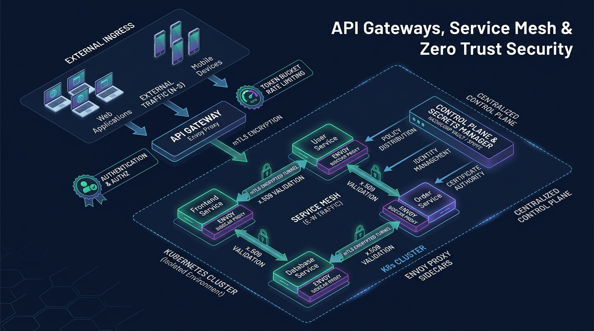
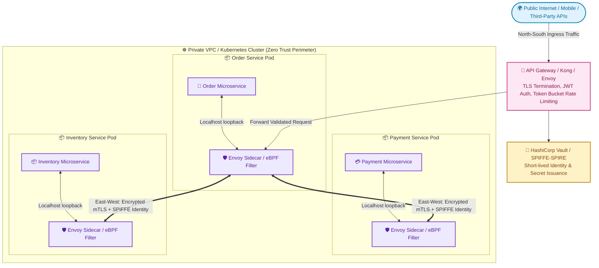

# 🛡️ Topic 10: API Gateways, Service Mesh & Zero-Trust Architecture

> ☕ *"Refill your mug, Ravi! Today we enter the fortress of modern cloud security and traffic governance. As companies split monolithic apps into hundreds of microservices, managing security, authentication, and traffic routing manually becomes impossible. Today, we'll master the two gatekeepers of distributed systems: **API Gateways** (guarding the external perimeter) and **Service Meshes** (protecting internal pod-to-pod communication with Zero-Trust mTLS)!"*  
> — **Rithu**

**Ravi:** *"Rithu, why do we need an API Gateway if we already have an Nginx Load Balancer? And why do people run Istio or Envoy as a 'Service Mesh' inside Kubernetes when Kubernetes already has Services and ClusterIPs?"*  
**Rithu:** *"That is one of the top questions in senior DevOps interviews, Ravi! Load balancers distribute packets, but **API Gateways** enforce business-level policies: JWT verification, consumer tier rate-limiting, and API monetization. And while ClusterIP routes packets, a **Service Mesh** encrypts traffic between pods with automatic mutual TLS (mTLS), enforces Zero-Trust identity, and gives you microservice-level telemetry without touching a single line of application code! Let's dive in! 🌸"*

---

## 🎯 1. What Ravi Will Learn Today

- 🧭 **North-South vs. East-West Traffic**: Differentiate traffic entering the cloud from the internet vs. communication moving between internal microservices.
- 🚪 **API Gateway Superpowers (Kong / Envoy)**: Implement centralized JWT authentication, request transformation, and dynamic plugin pipelines.
- 🪣 **Rate-Limiting Algorithms**: Master the mathematical mechanics of **Token Bucket**, **Leaky Bucket**, and **Sliding Window Log**.
- 🔒 **Service Mesh & Zero Trust (mTLS)**: Understand how Envoy sidecars and modern eBPF service meshes (Cilium / Istio Ambient) secure East-West traffic with rotating X.509 certificates.
- 🧪 **Hands-on Zero-Cost Lab**: Build a working Token Bucket Rate Limiter in Python that enforces fair API throttling with dynamic burst allowances.

---

## 📊 2. Visual Architecture: North-South Ingress & East-West Service Mesh





---

## 👶 3. Rithu Explains Like You Are a Beginner (ELI5)

### 🏰 The Medieval Walled Castle & Internal Diplomatic Passports Analogy

Imagine a grand medieval castle city:

1. **The Outer Fortress Drawbridge (The API Gateway - North-South)**:
   - When merchants, peasants, and foreign ambassadors arrive from the outside world (**North-South Traffic**), they cannot simply enter the castle halls.
   - The guards at the main gate (**API Gateway**) demand passports (**JWT Authentication**), check baggage for weapons (**WAF / Schema Validation**), and allow only 5 carts per minute (**Token Bucket Rate Limiting**).
2. **The Diplomatic Courtyards (The Service Mesh - East-West)**:
   - Inside the castle, there are separate departments: the Royal Treasury, the Armory, and the Kitchens (**Microservices**).
   - In the old days, once you were inside the outer gate, you could walk anywhere freely (**Flat Network Vulnerability**). If an assassin sneaked into the kitchen, they could walk into the King's bedroom!
   - Under **Zero-Trust & Service Mesh**: Every door has an armed guard (**Envoy Sidecar**). Even if the Kitchen cook wants to deliver bread to the Armory, they must present a biometric cryptographic token (**mTLS & SPIFFE ID**). Nobody is trusted simply because they are inside the walls!

---

### 🔍 Core Architectural Questions Answered

#### What is the difference between an API Gateway and a Reverse Proxy?
- **Reverse Proxy (Nginx/HAProxy)**: Focuses on **networking performance**: TCP/HTTP routing, SSL termination, and round-robin load distribution.
- **API Gateway (Kong, Envoy, APISIX)**: Focuses on **application & business logic**: validating OAuth2/JWT tokens, enforcing API consumer quotas (e.g., Free vs. Enterprise tiers), rate limiting by API Key, orchestrating microservice response aggregation, and managing developer portal documentation.

#### What is Zero-Trust Security?
The core principle of Zero Trust is: **"Never trust, always verify."** Traditional networks assumed everything inside the private corporate firewall was safe. Zero Trust assumes the internal network is already compromised, requiring every microservice to authenticate and authorize every single request via mutual TLS (mTLS).

---

## ⚡ 4. The Essential 80/20 Concepts

| Concept / Algorithm | What Rithu Wants Ravi to Know | Practical Job Importance |
| :--- | :--- | :--- |
| **Token Bucket Algorithm** | A bucket holds tokens refilled at a constant rate $R$. Each request consumes 1 token. Allows temporary traffic bursts up to bucket capacity $B$. | The industry-standard rate limiter used by AWS, Stripe, and Cloudflare. |
| **Leaky Bucket Algorithm** | Requests enter a bucket of fixed capacity and leak out to backend servers at a constant, unvarying rate. | Smooths out jagged traffic spikes into a predictable, constant-rate stream. |
| **Mutual TLS (mTLS)** | Both client and server present X.509 certificates to cryptographically prove their identity and encrypt the wire. | Defends against packet-sniffing and Man-in-the-Middle (MitM) attacks inside Kubernetes. |
| **SPIFFE / SPIRE** | Secure Production Identity Framework for Everyone: assigns cryptographic identities (e.g., `spiffe://cluster.local/ns/prod/sa/order-service`) to ephemeral containers. | Eliminates long-lived static API tokens between microservices. |
| **Sidecar vs. Ambient/eBPF Mesh** | Sidecar runs an Envoy container alongside every pod (high memory overhead). Modern eBPF (Cilium/Istio Ambient) enforces mTLS directly in the Linux kernel. | Slashes cluster memory consumption by up to 60% in massive enterprise fleets. |

---

## 💻 5. Practical Implementation: Production Token Bucket Rate Limiter in Python

Below is an enterprise-grade, thread-safe implementation of the **Token Bucket Algorithm** with real-time token replenishment:

```python
# token_bucket_limiter.py
import time
import threading

class TokenBucketRateLimiter:
    """
    Thread-safe Token Bucket Rate Limiter.
    Allows bursts up to 'capacity', refilling at 'refill_rate' tokens per second.
    """
    def __init__(self, capacity: int, refill_rate: float):
        self.capacity = float(capacity)
        self.refill_rate = float(refill_rate) # Tokens added per second
        self.tokens = float(capacity)
        self.last_refill_timestamp = time.monotonic()
        self.lock = threading.Lock()

    def allow_request(self, tokens_needed: int = 1) -> tuple[bool, float]:
        """
        Evaluates whether a request can proceed.
        Returns: (is_allowed, remaining_tokens)
        """
        with self.lock:
            current_time = time.monotonic()
            elapsed = current_time - self.last_refill_timestamp

            # 1. Refill tokens based on elapsed wall-clock time
            tokens_to_add = elapsed * self.refill_rate
            self.tokens = min(self.capacity, self.tokens + tokens_to_add)
            self.last_refill_timestamp = current_time

            # 2. Check if sufficient tokens exist
            if self.tokens >= tokens_needed:
                self.tokens -= tokens_needed
                return True, self.tokens
            else:
                return False, self.tokens

# Demonstration Simulation
if __name__ == "__main__":
    # Capacity = 5 burst tokens, refills at 2 tokens per second
    limiter = TokenBucketRateLimiter(capacity=5, refill_rate=2.0)

    print("--- Burst Phase: Sending 7 rapid requests ---")
    for req_id in range(1, 8):
        allowed, remaining = limiter.allow_request()
        status = "🟢 200 OK" if allowed else "🔴 429 Too Many Requests"
        print(f"Request #{req_id}: {status} | Tokens Left: {remaining:.2f}")

    print("\n--- Wait 1.5 seconds for replenishment ---")
    time.sleep(1.5)

    print("--- Retry Phase: Sending 2 more requests ---")
    for req_id in range(8, 10):
        allowed, remaining = limiter.allow_request()
        status = "🟢 200 OK" if allowed else "🔴 429 Too Many Requests"
        print(f"Request #{req_id}: {status} | Tokens Left: {remaining:.2f}")
```

### 🔍 Line-by-Line Breakdown for Ravi
- **`tokens_to_add = elapsed * self.refill_rate`**: Instead of running a wasteful background timer thread ticking every second, we calculate token refill *lazily* on-demand whenever a request arrives!
- **`self.tokens = min(self.capacity, ...)`**: Ensures tokens never exceed the bucket's maximum capacity, capping bursting potential.
- **`threading.Lock()`**: Guarantees atomic decrements in multithreaded web application servers, preventing race-condition token underflows.

---

## ⌨️ 6. Essential Commands Cheat Sheet

| Command / Tool | Syntax | What It Does | When to Run It in Production |
| :--- | :--- | :--- | :--- |
| **Inspect Istio Proxy Sync** | `istioctl proxy-status` | Checks synchronization status between Istio control plane (istiod) and all Envoy sidecars. | Diagnosing configuration drift and routing latency in a Service Mesh. |
| **Inspect Sidecar Configuration** | `istioctl proxy-config endpoints order-pod-7f9a.prod` | Dumps the active dynamic routing table and mTLS endpoints inside a specific pod's Envoy proxy. | Troubleshooting 503 Service Unavailable or failed mTLS handshakes. |
| **Verify mTLS Strictness** | `istioctl authn tls-check order-pod-7f9a.prod` | Verifies whether internal microservice traffic is strictly enforcing mTLS (`STRICT` vs `PERMISSIVE`). | Conducting security audits and Zero-Trust compliance checks. |
| **Cilium eBPF Status** | `cilium status --verbose` | Inspects eBPF kernel program status, BPF map allocations, and network policy enforcement. | Troubleshooting modern kernel-level sidecarless service meshes. |
| **Kong Gateway Status** | `curl -s http://localhost:8001/status \| jq .` | Returns Kong Gateway connection pools, active database nodes, and memory cache stats. | Monitoring API Gateway health and plugin latencies. |

---

## 🧪 7. Hands-on Practice: Ravi's Zero-Cost Lab

### 🎯 Objective
Ravi will run the Token Bucket Rate Limiter, simulate a malicious burst of 10 requests, observe HTTP 429 rate-limiting in action, and witness automatic token recovery.

### 📋 Prerequisites
- Python 3 installed.

---

### Step 1: Create Lab Directory
```bash
mkdir rate-limiter-lab
cd rate-limiter-lab
```

### Step 2: Create Test Script (`test_limiter.py`)
Save the runnable script:
```python
import time
from token_bucket_limiter import TokenBucketRateLimiter

limiter = TokenBucketRateLimiter(capacity=3, refill_rate=1.0) # 3 burst max, 1 token/sec

print("Testing Token Bucket (Capacity: 3, Refill: 1/sec):")
for i in range(1, 6):
    allowed, left = limiter.allow_request()
    print(f"Request {i}: {'ACCEPTED' if allowed else 'THROTTLED (HTTP 429)'} (Remaining: {left:.1f})")

print("\nSleeping for 2 seconds to recharge...")
time.sleep(2.0)

for i in range(6, 8):
    allowed, left = limiter.allow_request()
    print(f"Request {i}: {'ACCEPTED' if allowed else 'THROTTLED (HTTP 429)'} (Remaining: {left:.1f})")
```

### Step 3: Run the Verification
```bash
python test_limiter.py
```

#### Output:
```text
Testing Token Bucket (Capacity: 3, Refill: 1/sec):
Request 1: ACCEPTED (Remaining: 2.0)
Request 2: ACCEPTED (Remaining: 1.0)
Request 3: ACCEPTED (Remaining: 0.0)
Request 4: THROTTLED (HTTP 429) (Remaining: 0.0)
Request 5: THROTTLED (HTTP 429) (Remaining: 0.0)

Sleeping for 2 seconds to recharge...
Request 6: ACCEPTED (Remaining: 1.0)
Request 7: ACCEPTED (Remaining: 0.0)
```

🎉 **Ravi's Discovery**: You just built the core throttling algorithm that protects platforms like Twitter, Stripe, and Shopify from denial-of-service surges!

---

### 🧹 Cleanup
```bash
cd ..
rm -rf rate-limiter-lab
```

---

## ⚠️ 8. Rithu's Top 3 Beginner Traps

### 🪤 Trap 1: The "Local Memory" Multi-Pod Rate Limiting Trap
- **Symptom / What happens**: You configure a 100 req/min rate limit in your API code. But in production with 10 application replicas, an attacker makes 950 requests in a minute without ever being throttled!
- **Why it happens**: Each container tracked token counts in its own local memory variable. With 10 pods, the attacker got 100 requests per pod = 1,000 requests total!
- **Rithu's Fix**: **Centralize Rate Limiting in Redis!** Use atomic Redis Lua scripts (`redis.eval`) or enforce rate limits at the centralized API Gateway (Kong/Envoy) before traffic reaches compute nodes.

---

### 🪤 Trap 2: The Service Mesh "Sidecar CPU Tax"
- **Symptom / What happens**: A team installs Istio on a 200-microservice cluster. Cluster cloud costs surge by 40%, and p99 latency climbs by 12ms per hop.
- **Why it happens**: Every single pod has an Envoy sidecar consuming 50MB RAM and 0.1 vCPU. In a request that traverses 6 microservices, packets undergo 12 proxy hops and 6 TLS handshakes!
- **Rithu's Fix**:
  - Adopt modern **eBPF-based Service Meshes (like Cilium Service Mesh or Istio Ambient)** that enforce mTLS directly inside the Linux kernel without injecting a heavy sidecar into every pod.
  - Apply service mesh only to sensitive namespaces rather than cluster-wide indiscriminately.

---

### 🪤 Trap 3: Permissive vs. Strict mTLS Migration Blackout
- **Symptom / What happens**: You toggle `PeerAuthentication` mode to `STRICT` in Istio. Immediately, internal cron jobs and Prometheus metric scrapers fail with `Connection Reset by Peer`.
- **Why it happens**: Any legacy client inside the cluster that lacks a sidecar cannot perform the mTLS handshake and is rejected by strict pods.
- **Rithu's Fix**: Always transition via **`PERMISSIVE` mode first**. Monitor the telemetry metrics to verify that 100% of internal traffic has adopted mutual certificates before enforcing `STRICT` mode.

---

## 💬 9. Ravi's Doubt Corner (Interview Preparation)

### ❓ Question 1 (Ravi asks):
> *"Rithu, what is the difference between Token Bucket and Leaky Bucket, and when do we pick one over the other?"*

**Rithu's Model Answer:**  
*"Use this clean distinction in interviews:*
- ***Token Bucket***: Tokens are added at a constant rate, and requests can proceed as long as tokens are available. **It permits bursts of traffic** up to the bucket capacity. Great for human web browsing where users navigate quickly, pause, and click again.
- ***Leaky Bucket***: Requests enter a queue and are dispatched to the backend at a **strictly constant, smooth rate** (like water leaking from a hole). It eliminates bursts entirely. Great for smoothing out erratic write traffic before writing to a delicate legacy database."*

---

### ❓ Question 2 (Ravi asks):
> *"How does mTLS prevent Man-in-the-Middle (MitM) attacks inside a cloud VPC?"*

**Rithu's Model Answer:**  
*"In standard TLS (one-way), only the server presents a certificate to prove who it is. In **Mutual TLS (mTLS)**:*
1. Service A connects to Service B.
2. Service B presents its certificate (signed by the internal CA).
3. Service A verifies it, and then **presents its own client certificate** to Service B.
4. Service B verifies Service A's identity via SPIFFE ID (e.g., verifying that the caller is truly `service-account: order-api` and not a compromised Redis pod).
*Both sides authenticate each other, and all packet payloads are encrypted on the wire, making network packet eavesdropping inside the cloud cluster completely futile."*

---

## ⚡ 10. Quick Revision with Rithu

- 🧭 **North-South vs East-West**: API Gateways secure external ingress; Service Meshes secure internal microservice traffic.
- 🪣 **Token Bucket Permits Bursts**: Tokens refill over time; requests consume tokens. Centralize in Redis for multi-pod consistency.
- 🔒 **Zero Trust is Non-Negotiable**: Never trust internal VPC traffic; enforce mTLS and cryptographic workload identities.
- 🐝 **eBPF is the Future**: Modern sidecarless meshes bypass heavy user-space proxies by routing packets directly in the Linux kernel.
- 🚦 **Layer Your Defenses**: API Gateway $\to$ WAF $\to$ Auth $\to$ Rate Limiting $\to$ Service Mesh mTLS $\to$ Application Logic.

> [!TIP]
> **Rithu's Golden Rule for Topic 10**:  
> *"Perimeter security is an illusion in modern cloud infrastructure. Assume attackers already have a foothold inside your cluster, and ensure every single microservice verifies identity, encrypts payloads, and throttles access independently."* 🚀☕
