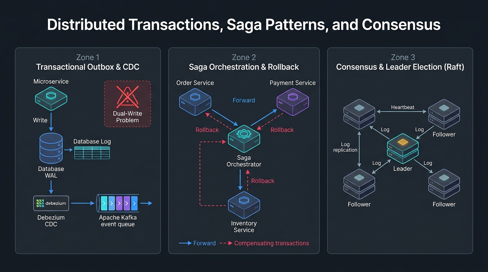
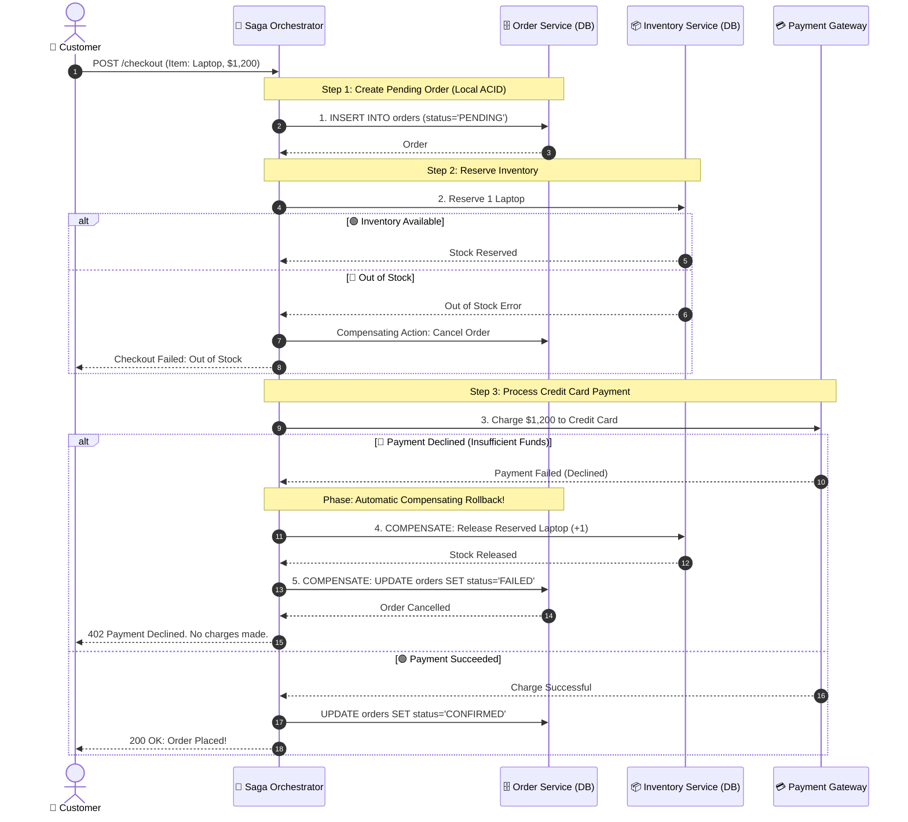

# 🔄 Topic 11: Distributed Transactions, Saga Patterns & Consensus

> ☕ *"Sip that hot coffee, Ravi! Today we tackle the single most feared question in senior and staff engineer system design interviews: **Distributed Data Consistency**. In a monolithic application, you had one database; an ACID transaction (`BEGIN ... COMMIT`) guaranteed that either everything succeeded or everything rolled back. But in a distributed microservice architecture, your business flow touches 4 different databases across 4 different cloud networks! Today, we master how to maintain bulletproof financial consistency across distributed systems without locking databases or losing customer money!"*  
> — **Rithu**

**Ravi:** *"Rithu, this gives me nightmares! If a user orders a laptop: Order Service writes to Postgres, Inventory Service decrements stock, and Payment Service charges their card. What happens if the credit card is declined after inventory was already reserved? We can't just do `ROLLBACK` across three separate databases!"*  
**Rithu:** *"Exactly, Ravi! That is the fundamental problem of distributed systems. Trying to use traditional Two-Phase Commit (2PC) creates massive blocking bottlenecks and single points of failure. Instead, modern architects use **The Saga Pattern**, **Compensating Transactions**, **The Transactional Outbox Pattern**, and **Raft Consensus**. Let's conquer these patterns together! 🌸"*

---

## 🎯 1. What Ravi Will Learn Today

- 💥 **The Dual-Write Problem**: Understand why writing to a local database and publishing to a Kafka queue inside the same function inevitably leads to data inconsistency.
- 📦 **The Transactional Outbox Pattern**: Learn how Change Data Capture (CDC with Debezium) guarantees zero lost messages between databases and message brokers.
- 🎭 **The Saga Pattern (Orchestration vs. Choreography)**: Coordinate multi-stage distributed transactions with automated compensating rollbacks.
- 🗳️ **Raft Distributed Consensus**: Demystify how systems like **etcd** and **Kubernetes** elect leaders and maintain replicated state machines during network partitions.
- 🧪 **Hands-on Zero-Cost Lab**: Implement an automated Saga Orchestrator in Python that safely triggers compensating transactions when downstream payments fail.

---

## 📊 2. Visual Architecture: The Transactional Outbox & Saga Orchestrator





---

## 👶 3. Rithu Explains Like You Are a Beginner (ELI5)

### ✈️ The Vacation Booking Agent Analogy

Imagine planning a vacation to Hawaii that requires three independent reservations:

1. **The Monolith (One Travel Agency - ACID Transaction)**:
   - You walk into an agency that owns the hotel, owns the airline, and owns the car rental.
   - The agent writes one contract. If anything is unavailable, you tear up the contract. Easy!
2. **The Microservices Reality (Three Independent Companies)**:
   - You must book with **Delta Airlines**, **Hilton Hotels**, and **Hertz Car Rental**.
   - None of them share a database.
   - You book Delta Airlines (Seat confirmed, \$500 charged).
   - You book Hilton Hotel (Room confirmed, \$800 charged).
   - You call Hertz Car Rental: *"Sorry, we have zero cars left!"*
3. **The Saga Compensating Transaction**:
   - You cannot "undo" the airline ticket or hotel room via an SQL `ROLLBACK` command—they are independent external companies!
   - Instead, you execute **Compensating Actions**:
     - You call Hilton: *"Please cancel reservation #542 and refund my card."* (**Compensating Action**)
     - You call Delta: *"Please cancel flight #101 and refund my card."* (**Compensating Action**)
   - The end state is consistent again: you have no vacation, but your money is fully refunded!

---

### 🔍 Core Architectural Questions Answered

#### What is the Dual-Write Problem?
Consider this common backend code snippet:
```python
# The Naïve Dual-Write Trap
db.execute("INSERT INTO orders ...")     # Step 1: Database Write
kafka_producer.send("order_created", ...) # Step 2: Publish Event
```
If the database crashes during Step 1, no event is sent (safe). But what if Step 1 succeeds, and then **the network cable disconnects or the container runs out of memory before Step 2 completes?** Your database recorded the order, but Kafka never received the message! Downstream payment workers never trigger, leaving your system in an inconsistent state forever.

#### What is the Transactional Outbox Pattern?
To eliminate the dual-write problem, you write your business record AND an event message into an `outbox` table **inside the exact same local ACID database transaction**:
```sql
BEGIN;
INSERT INTO orders (id, user_id, amount) VALUES (101, 42, 1200);
INSERT INTO outbox_events (aggregate_id, event_type, payload) 
VALUES (101, 'OrderCreated', '{"amount": 1200}');
COMMIT;
```
Because both inserts happen in the same local transaction, either both succeed or neither succeeds! A background Change Data Capture (CDC) engine (like **Debezium**) reads the database WAL log and streams events to Kafka with 100% guarantee!

---

## ⚡ 4. The Essential 80/20 Concepts

| Concept / Pattern | What Rithu Wants Ravi to Know | Practical Job Importance |
| :--- | :--- | :--- |
| **Saga Orchestration** | A centralized coordinator service directs the workflow, calls each microservice, and executes compensating actions on failure. | Easier to understand, debug, and monitor. Best choice for complex business workflows. |
| **Saga Choreography** | Microservices publish events to Kafka, and other services react autonomously without a central coordinator. | Highly decoupled and lightweight, but difficult to track and trace when workflows span > 5 services. |
| **Transactional Outbox** | Writes events into a local `outbox` table in the same ACID transaction as business data. | Eliminates the Dual-Write problem and guarantees zero lost messages. |
| **Change Data Capture (CDC)** | Reads database Write-Ahead Logs (WAL) in real-time (e.g., Debezium) and streams row mutations to Kafka. | Powers data pipelines, search index updates (Elasticsearch), and cache invalidation. |
| **Raft Consensus Protocol** | A consensus algorithm where nodes elect a Leader; all state changes flow through the Leader to a Quorum of Followers. | The brain behind **etcd**, **Consul**, and **Kubernetes** state synchronization. |

---

## 💻 5. Practical Implementation: Python Saga Orchestrator with Compensating Actions

Below is a production-grade Saga Orchestration engine demonstrating forward execution, state tracking, and automatic reverse compensating rollbacks:

```python
# saga_orchestrator.py
import time
import uuid

class StepResult:
    def __init__(self, success: bool, data: dict = None, error: str = None):
        self.success = success
        self.data = data or {}
        self.error = error

class OrderCheckoutSaga:
    """
    Saga Orchestrator coordinating Order, Inventory, and Payment.
    Executes compensating transactions in reverse order upon failure.
    """
    def __init__(self):
        self.executed_compensations = []

    def execute(self, order_id: str, amount: float, should_payment_fail: bool = False) -> bool:
        print(f"\n🚀 [SAGA START] Initiating Checkout Saga for Order: {order_id} (${amount})")

        # Step 1: Create Pending Order
        step1 = self._action_create_order(order_id)
        if not step1.success:
            print(f"❌ Step 1 Failed: {step1.error}")
            return False
        # Register compensating transaction
        self.executed_compensations.append(lambda: self._compensate_cancel_order(order_id))

        # Step 2: Reserve Inventory
        step2 = self._action_reserve_inventory(order_id)
        if not step2.success:
            print(f"❌ Step 2 Failed: {step2.error}. Triggering rollbacks...")
            self._rollback()
            return False
        # Register compensating transaction
        self.executed_compensations.append(lambda: self._compensate_release_inventory(order_id))

        # Step 3: Charge Payment
        step3 = self._action_charge_payment(order_id, amount, fail=should_payment_fail)
        if not step3.success:
            print(f"❌ Step 3 Failed: {step3.error}. Triggering compensating rollbacks...")
            self._rollback()
            return False

        print(f"✅ [SAGA COMPLETE] All distributed steps succeeded for Order {order_id}!\n")
        return True

    def _rollback(self):
        """Executes registered compensations in reverse order (LIFO stack)"""
        print("\n⚠️ [SAGA COMPENSATING ROLLBACK INITIATED]")
        for compensate_fn in reversed(self.executed_compensations):
            compensate_fn()
        print("🛡️ [SAGA ROLLBACK COMPLETE] Distributed state restored to consistency.\n")

    # Forward Actions
    def _action_create_order(self, order_id: str) -> StepResult:
        print(f" -> [Order Service] Created Order #{order_id} with status=PENDING")
        return StepResult(success=True)

    def _action_reserve_inventory(self, order_id: str) -> StepResult:
        print(f" -> [Inventory Service] Reserved 1 item for Order #{order_id}")
        return StepResult(success=True)

    def _action_charge_payment(self, order_id: str, amount: float, fail: bool) -> StepResult:
        if fail:
            return StepResult(success=False, error="Payment Declined (Insufficient Funds)")
        print(f" -> [Payment Service] Successfully charged ${amount} to card")
        return StepResult(success=True)

    # Compensating Actions (Undo)
    def _compensate_release_inventory(self, order_id: str):
        print(f" <- [COMPENSATE] Inventory Service: Released reserved stock (+1) for Order #{order_id}")

    def _compensate_cancel_order(self, order_id: str):
        print(f" <- [COMPENSATE] Order Service: Marked Order #{order_id} as CANCELLED")

# Demonstration Simulation
if __name__ == "__main__":
    saga = OrderCheckoutSaga()

    print("================ SCENARIO 1: Happy Path ================")
    saga.execute(order_id="ORD-101", amount=1200.0, should_payment_fail=False)

    print("=========== SCENARIO 2: Downstream Payment Failure ===========")
    saga_failing = OrderCheckoutSaga()
    saga_failing.execute(order_id="ORD-102", amount=1200.0, should_payment_fail=True)
```

---

## ⌨️ 6. Essential Commands Cheat Sheet

| Command / Tool | Syntax | What It Does | When to Run It in Production |
| :--- | :--- | :--- | :--- |
| **etcd Cluster Health** | `etcdctl endpoint health --write-out=table` | Verifies Raft consensus health, raft term, and active leader across etcd nodes. | Diagnosing Kubernetes API server split-brain issues and etcd quorum failures. |
| **Inspect etcd Leader** | `etcdctl endpoint status --write-out=table` | Displays the current elected Raft Leader and database commit index. | Verifying smooth leader re-elections during rolling master node upgrades. |
| **Debezium Connector Status** | `curl -s http://localhost:8083/connectors/order-outbox-connector/status \| jq .` | Inspects Change Data Capture (CDC) streaming status from PostgreSQL WAL to Kafka. | Detecting broken CDC pipelines or outbox table parsing errors. |
| **Inspect PostgreSQL WAL Activity** | `SELECT slot_name, plugin, active, restart_lsn FROM pg_replication_slots;` | Displays logical replication slots utilized by Debezium CDC connectors. | Troubleshooting disk space exhaustion caused by inactive WAL replication slots. |
| **Kafka Outbox Consumer Lag** | `kafka-consumer-groups.sh --bootstrap-server localhost:9092 --describe --group saga_orchestrator` | Displays pending unconsumed events in the outbox stream. | Checking if Saga orchestrators are keeping pace with checkout traffic. |

---

## 🧪 7. Hands-on Practice: Ravi's Zero-Cost Lab

### 🎯 Objective
Ravi will execute the Saga Orchestration script locally, simulate a payment failure, and observe the automatic invocation of compensating rollback transactions across independent mock services!

### 📋 Prerequisites
- Python 3 installed.

---

### Step 1: Create Lab Directory
```bash
mkdir saga-lab
cd saga-lab
```

### Step 2: Create Test Script (`test_saga.py`)
Save the runnable script:
```python
from saga_orchestrator import OrderCheckoutSaga

print("--- Running Test: Simulating Payment Decline ---")
orchestrator = OrderCheckoutSaga()
result = orchestrator.execute(order_id="ORD-999", amount=499.99, should_payment_fail=True)
print(f"Overall Transaction Result: {'SUCCESS' if result else 'GRACEFULLY ROLLED BACK'}")
```

### Step 3: Run the Verification
```bash
python test_saga.py
```

#### Output:
```text
--- Running Test: Simulating Payment Decline ---

🚀 [SAGA START] Initiating Checkout Saga for Order: ORD-999 ($499.99)
 -> [Order Service] Created Order #ORD-999 with status=PENDING
 -> [Inventory Service] Reserved 1 item for Order #ORD-999
❌ Step 3 Failed: Payment Declined (Insufficient Funds). Triggering compensating rollbacks...

⚠️ [SAGA COMPENSATING ROLLBACK INITIATED]
 <- [COMPENSATE] Inventory Service: Released reserved stock (+1) for Order #ORD-999
 <- [COMPENSATE] Order Service: Marked Order #ORD-999 as CANCELLED
🛡️ [SAGA ROLLBACK COMPLETE] Distributed state restored to consistency.

Overall Transaction Result: GRACEFULLY ROLLED BACK
```

🎉 **Ravi's Discovery**: Look at the execution trace! Even though Inventory had already subtracted stock from its database, the Saga Orchestrator caught the Payment exception and ran compensating logic in reverse order, releasing the inventory and cancelling the order!

---

### 🧹 Cleanup
```bash
cd ..
rm -rf saga-lab
```

---

## ⚠️ 8. Rithu's Top 3 Beginner Traps

### 🪤 Trap 1: The "Non-Idempotent Compensation" Trap
- **Symptom / What happens**: An orchestrator calls `compensate_release_inventory()`. Due to a network hiccup, it retries. The inventory count increments twice, inflating store stock by phantom units!
- **Why it happens**: Compensating transactions were not designed to be idempotent.
- **Rithu's Fix**: **Compensating transactions MUST be idempotent!** Always check whether a cancellation was already processed (e.g., using transaction UUIDs and database unique constraints) before applying state changes.

---

### 🪤 Trap 2: The Two-Phase Commit (2PC) Performance Death Spiral
- **Symptom / What happens**: An architect implements standard Two-Phase Commit (2PC) across 5 microservices. The platform's throughput plummets from 5,000 req/s to 35 req/s, and databases lock up.
- **Why it happens**: 2PC is a **synchronous blocking protocol**. All participating databases hold disk row locks open during the prepare phase. If one service takes 3 seconds, all other databases sit locked and paralyzed.
- **Rithu's Fix**: **Never use 2PC in distributed microservices.** Use the **Asynchronous Saga Pattern** with compensating actions and eventual consistency.

---

### 🪤 Trap 3: The Forgotten WAL Slot Disk Fill Crash
- **Symptom / What happens**: You configure PostgreSQL logical replication for Debezium CDC. Six months later, the Debezium container crashes and remains down for 3 days. Suddenly, the primary PostgreSQL database crashes because the hard drive is 100% full!
- **Why it happens**: PostgreSQL preserves Write-Ahead Log (WAL) files on disk until the logical replication slot confirms they have been consumed. If Debezium is dead, PostgreSQL refuses to delete WAL logs until the disk completely runs out of space!
- **Rithu's Fix**: Set `max_slot_wal_keep_size = 20GB` in PostgreSQL to cap maximum disk usage for lagging replication slots, and configure Prometheus alerts on replication slot lag.

---

## 💬 9. Ravi's Doubt Corner (Interview Preparation)

### ❓ Question 1 (Ravi asks):
> *"Rithu, what is the difference between Saga Orchestration and Saga Choreography, and how do I decide between them in an interview?"*

**Rithu's Model Answer:**  
*"Frame your response around **Complexity and Observability**:*
- ***Choreography (Event-Driven / Decentralized)***: Services react to Kafka events without a central coordinator (e.g., OrderService emits `OrderCreated`, InventoryService hears it and emits `StockReserved`).
  - *Pros*: Simple for 2–3 services, zero single point of failure.
  - *Cons*: Becomes 'distributed spaghetti' when workflows grow to 8 services. There is no single place in code to inspect what the workflow actually does.
- ***Orchestration (Centralized Coordinator)***: A dedicated state machine (or engine like **Temporal / AWS Step Functions**) tells each service what to do.
  - *Pros*: Easy to monitor, explicit error handling, centralized timeouts and compensations.
  - *Cons*: Introduces an orchestrator component that must be maintained.
- **Rule of Thumb**: *Start with Choreography for 2 services; switch to Orchestration whenever business workflows span 3 or more steps."*

---

### ❓ Question 2 (Ravi asks):
> *"How does the Raft consensus algorithm prevent Split-Brain during network partitions?"*

**Rithu's Model Answer:**  
*"Raft relies on a strict mathematical **Quorum**:*
$$\text{Quorum} = \left\lfloor \frac{N}{2} \right\rfloor + 1$$
*In a 5-node cluster, Quorum is 3 nodes.*  
*If a network partition splits the cluster into 2 nodes on the left and 3 nodes on the right:*
- The **minority partition (2 nodes)** can never achieve 3 votes. It cannot elect a leader and refuses all client writes.
- The **majority partition (3 nodes)** elects a leader, achieves quorum on log entries, and safely continues processing writes.
*When the network heals, the minority partition updates its commit log from the true leader. Split-brain is mathematically impossible!"*

---

## ⚡ 10. Quick Revision with Rithu

- 💥 **Beware the Dual-Write**: Never write to a database and publish to a message broker in an uncoordinated block; use the Transactional Outbox pattern.
- 📦 **CDC with Debezium**: Stream outbox events directly from the database WAL to guarantee zero lost events.
- 🎭 **Sagas Over 2PC**: Two-Phase Commit is too slow and blocking for modern cloud apps; use Sagas with compensating actions.
- 🔁 **Compensations Must Be Idempotent**: Ensure undo operations can be safely executed multiple times without corrupting state.
- 🗳️ **Quorum Protects Consensus**: Raft and etcd rely on odd-numbered node quorums ($\lfloor N/2 \rfloor + 1$) to prevent split-brain catastrophes.

> [!TIP]
> **Rithu's Golden Rule for Topic 11**:  
> *"In a distributed system, you cannot prevent failures from happening halfway through a workflow. True architectural mastery lies in designing your system so it can gracefully walk backward through compensating actions to restore peace and consistency."* 🚀☕
