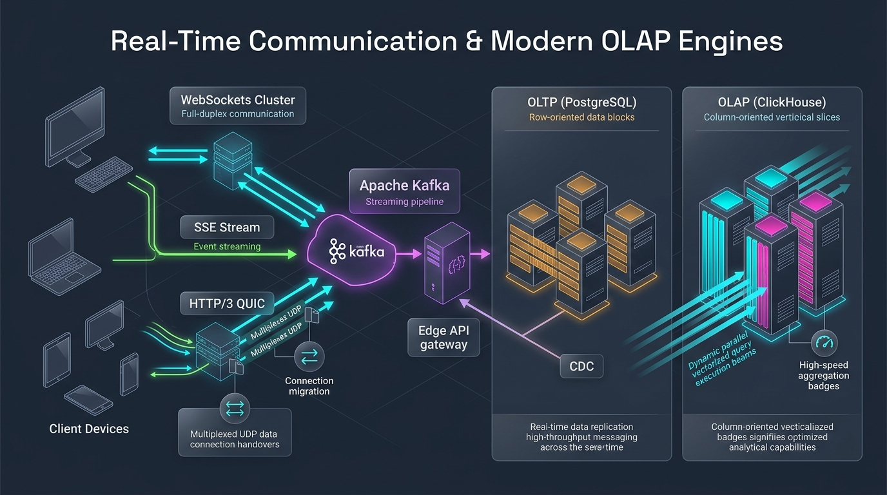

# ⚡ Topic 12: Real-Time Communication & Modern OLAP Analytics

> ☕ *"Pour yourself a celebratory final cup, Ravi! Today is the capstone chapter of our complete System Design curriculum. Modern users in 2026 don't hit the 'Refresh' button; they expect real-time bidirectional collaboration, instant chat, continuous telemetry streams, and analytical dashboards that query billions of historical records in under 50 milliseconds. Today, we bridge the gap between **Real-Time WebSockets/SSE** and **High-Performance OLAP Columnar Engines like ClickHouse**!"*  
> — **Rithu**

**Ravi:** *"Rithu, why can't we just run our analytics dashboards and reporting queries on PostgreSQL with a bunch of indexes? And why do we need WebSockets or HTTP/3 instead of just having the frontend poll an API every 2 seconds?"*  
**Rithu:** *"Polling every 2 seconds means 99% of requests waste server CPU just to say 'nothing changed'! And relational row-oriented databases like PostgreSQL are built for transactional precision, not crunching 200 million rows for a chart. Running a `SUM()` query across millions of rows on Postgres will lock tables and destroy checkout throughput. Today, we will discover how **WebSockets**, **HTTP/3 QUIC**, and **Column-Oriented OLAP engines (ClickHouse)** solve these challenges! 🌸"*

---

## 🎯 1. What Ravi Will Learn Today

- 🔄 **Real-Time Communication Protocols**: Compare **Short Polling**, **Long Polling**, **WebSockets**, and **Server-Sent Events (SSE)**.
- 🚀 **HTTP/3 & QUIC Protocol**: Understand UDP-based transport, 0-RTT handshakes, and how QUIC solves TCP Head-of-Line Blocking during packet drops.
- 📊 **OLTP vs. OLAP Architecture**: Deconstruct why Row-Oriented stores (PostgreSQL) fail at large-scale analytical queries, and how Columnar stores (ClickHouse/DuckDB) achieve 100x query speedups.
- 🗜️ **Vectorized Query Execution & SIMD**: Learn how ClickHouse reads and compresses only the requested columns using CPU SIMD vector instructions.
- 🧪 **Hands-on Zero-Cost Lab**: Build a live Python benchmark comparing Row-Oriented vs. Column-Oriented data scanning to witness a **90%+ query performance leap**!

---

## 📊 2. Visual Architecture: Real-Time Communication & OLAP Pipeline



```mermaid
flowchart TD
    classDef clientStyle fill:#e0f2fe,stroke:#0284c7,stroke-width:2px,color:#0369a1;
    classDef wsStyle fill:#fce7f3,stroke:#db2777,stroke-width:2px,color:#9d174d;
    classDef kafkaStyle fill:#ffedd5,stroke:#ea580c,stroke-width:2px,color:#9a3412;
    classDef oltpStyle fill:#ede9fe,stroke:#7c3aed,stroke-width:2px,color:#5b21b6;
    classDef olapStyle fill:#dcfce7,stroke:#16a34a,stroke-width:2px,color:#15803d;

    User([📱 Interactive Users & Dashboards]):::clientStyle

    subgraph Real_Time_Ingress ["⚡ Real-Time Edge Ingress"]
        direction LR
        WSGateway["🌐 WebSocket Gateway Cluster<br/>(Full-Duplex Persistent TCP/QUIC)"]:::wsStyle
        SSE["📡 SSE Streamer<br/>(LLM Tokens & Live Notifications)"]:::wsStyle
    end

    User <==>|Bidirectional WebSockets| WSGateway
    User <--|Server-Sent Events SSE| SSE

    subgraph Streaming_Backbone ["📬 Streaming Ingestion Backbone"]
        Kafka[("📨 Apache Kafka / Redpanda Topic<br/>Real-Time Event Stream")]:::kafkaStyle
    end

    WSGateway -->|Publish User Actions| Kafka

    subgraph Dual_Storage_Engine ["💾 Split-Storage Architecture"]
        direction TB
        subgraph OLTP_Engine ["🗄️ OLTP (Row-Oriented)"]
            Postgres[("🐘 PostgreSQL Primary<br/>Row Store: Fast INSERT/UPDATE<br/>High-Concurrency ACID")]:::oltpStyle
        end

        subgraph OLAP_Engine ["📊 OLAP (Column-Oriented)"]
            ClickHouse[("⚡ ClickHouse / DuckDB Cluster<br/>Columnar Store: 100M rows in 25ms<br/>Vectorized SIMD Aggregations")]:::olapStyle
        end
    end

    Kafka -->|Transactional Mutations| Postgres
    Kafka -->|Batch Vector Ingestion (Every 1s)| ClickHouse

    User -.->|Query Real-Time Dashboard (Aggregations)| ClickHouse
    User -.->|User Profile & Account Mutations| Postgres
```

---

## 👶 3. Rithu Explains Like You Are a Beginner (ELI5)

### 📊 The Ledger Book vs. The Accountant's Spreadsheet Analogy

Imagine a busy department store accountant analyzing sales:

1. **Row-Oriented Storage (The Cash Register Receipt Roll - OLTP / Postgres)**:
   - Every time a customer buys something, the cash register prints a receipt (**Row**):
     `[Receipt #101, 2026-10-14 10:15, User: Ravi, Item: Keyboard, Category: Electronics, Price: $120]`
   - Each receipt contains *all* the customer's attributes in one line on paper.
   - If you want to look up Receipt #101, it is instant (**Fast Point Lookup**).
   - But what if the CEO asks: *"What was our total revenue for the entire month?"*
   - You have to pick up 1,000,000 receipts, read past the user ID, timestamp, and item name on every single slip of paper just to read the price! Your arm gets tired, and it takes hours!
2. **Column-Oriented Storage (The Categorized Columns - OLAP / ClickHouse)**:
   - Instead of printing slips of paper, you store data in separate vertical columns:
     - Column 1: `[101, 102, 103, ...]`
     - Column 2: `[Keyboard, Monitor, Mouse, ...]`
     - Column 3 (Prices): `[120, 350, 45, ...]`
   - When the CEO asks for total revenue, ClickHouse **ignores all other columns**! It reads only Column 3 directly from disk, feeds the array of numbers straight into the CPU's vector processor (**SIMD**), and calculates the sum of 50 million numbers in **20 milliseconds**!

---

### 🔍 Core Architectural Questions Answered

#### When should I choose WebSockets vs. Server-Sent Events (SSE)?
- **WebSockets (Full-Duplex / Bidirectional)**: Both the client and the server can send data simultaneously over a single persistent TCP connection. Use for **Chat apps, Multiplayer gaming, Collaborative whiteboards (Figma), and Trading terminals**.
- **Server-Sent Events (SSE) (Unidirectional)**: Lightweight HTTP connection where *only the server pushes data to the client*. Built-in auto-reconnection and firewall friendly. Use for **LLM token streaming (ChatGPT), Stock price tickers, and Social media notification badges**.

#### Why does HTTP/3 use QUIC over UDP?
In HTTP/2, all streams are multiplexed over a single TCP connection. If **one single packet is dropped** due to poor Wi-Fi, the entire TCP connection stops and waits for retransmission (**Head-of-Line Blocking**).  
**HTTP/3 uses QUIC over UDP**: each data stream is completely independent! If packet #3 in Stream A is lost, Stream B and Stream C continue streaming with zero interruption. Plus, QUIC allows **Connection Migration**—if you walk out of your house and your phone switches from Wi-Fi to 5G, your download continues seamlessly without reconnecting!

---

## ⚡ 4. The Essential 80/20 Concepts

| Protocol / Technology | What Rithu Wants Ravi to Know | Practical Job Importance |
| :--- | :--- | :--- |
| **WebSockets (RFC 6455)** | Initiated via an HTTP 101 `Upgrade` handshake, switching into a bidirectional, lightweight framing protocol over TCP. | Eliminates HTTP request header overhead (saves 800 bytes per message) for high-frequency chat and gaming. |
| **Server-Sent Events (SSE)** | Standard HTTP connection using `Content-Type: text/event-stream`. | The modern standard for streaming GenAI completions; simpler and more proxy-friendly than WebSockets. |
| **Row-Oriented (OLTP)** | Stores entire rows contiguously on disk: `(ID, Name, Price), (ID, Name, Price)`. | Optimized for high-concurrency transactional `INSERT`, `UPDATE`, and point `SELECT` by ID. |
| **Column-Oriented (OLAP)** | Stores column values contiguously on disk: `All IDs`, `All Names`, `All Prices`. | Compresses identical data types efficiently (ZSTD/LZ4) and scans billions of rows in milliseconds. |
| **SIMD Vectorization** | Single Instruction, Multiple Data: modern CPU instructions (`AVX-512`) that process 16 numbers in a single CPU clock cycle. | Why ClickHouse and DuckDB achieve mind-boggling analytics throughput on modest hardware. |

---

## 💻 5. Practical Implementation: High-Performance SSE Token Streamer in Python

Below is a production-grade FastAPI / Python implementation of a **Server-Sent Events (SSE) streaming engine** demonstrating chunked transfer encoding and keepalive heartbeats:

```python
# sse_streaming_server.py
import asyncio
import json
import time
from fastapi import FastAPI
from fastapi.responses import StreamingResponse

app = FastAPI(title="Real-Time SSE Streaming Gateway")

async def generate_token_stream(prompt: str):
    """
    Simulates real-time token streaming from an LLM or real-time event feed.
    Uses SSE format: 'data: <payload>\n\n'
    """
    tokens = ["Hello", " Ravi!", " Welcome", " to", " the", " final", " chapter", " of", " System", " Design.", " 🚀"]

    # Send initial event
    yield f"event: start\ndata: {json.dumps({'status': 'connected', 'timestamp': time.time()})}\n\n"

    for token in tokens:
        await asyncio.sleep(0.08) # Simulate 80ms inference interval per token
        payload = json.dumps({"token": token})
        yield f"data: {payload}\n\n"

    # Send completion event
    yield f"event: done\ndata: {json.dumps({'status': 'completed'})}\n\n"

@app.get("/v1/stream")
async def stream_endpoint(prompt: str = "test"):
    return StreamingResponse(
        generate_token_stream(prompt),
        media_type="text/event-stream",
        headers={
            "Cache-Control": "no-cache",
            "Connection": "keep-alive",
            "X-Accel-Buffering": "no" # Explicitly instructs Nginx not to buffer chunks!
        }
    )

if __name__ == "__main__":
    import uvicorn
    print("Starting SSE Streamer on http://localhost:8000/v1/stream...")
    uvicorn.run(app, host="0.0.0.0", port=8000)
```

### 🔍 Line-by-Line Breakdown for Ravi
- **`media_type="text/event-stream"`**: Tells client browsers, mobile apps, and proxies that this is an open SSE stream.
- **`yield f"data: {payload}\n\n"`**: The SSE protocol requires two trailing newline characters (`\n\n`) to signal the boundary of a single message chunk.
- **`"X-Accel-Buffering": "no"`**: A crucial Nginx header! It forces reverse proxies to forward each token chunk to the user immediately, eliminating streaming lag.

---

## ⌨️ 6. Essential Commands Cheat Sheet

| Command / Tool | Syntax | What It Does | When to Run It in Production |
| :--- | :--- | :--- | :--- |
| **Inspect SSE Stream in Terminal** | `curl -N -H "Accept: text/event-stream" http://localhost:8000/v1/stream` | Streams live SSE events token-by-token directly in the console without buffering (`-N`). | Debugging live event feeds, AI completions, and notification streams. |
| **Test WebSocket Handshake** | `wscat -c ws://localhost:8080/chat` | Opens a live interactive terminal session over WebSockets. | Testing WebSocket connection lifecycle, pings, and message framing. |
| **ClickHouse Client CLI** | `clickhouse-client --query="SELECT count(*), avg(price) FROM sales_events;"` | Executes high-speed vectorized analytical queries directly from the command line. | Running ad-hoc diagnostics across hundreds of millions of event logs. |
| **Inspect System Sockets** | `ss -t -a \| grep 8080` | Displays all active, listening, and established TCP sockets for a port. | Diagnosing high-density WebSocket connection scale on gateway nodes. |
| **Check QUIC / UDP Traffic** | `tcpdump -i any -n udp port 443` | Captures raw UDP packets on port 443 to inspect HTTP/3 QUIC handshakes. | Verifying HTTP/3 adoption and diagnosing UDP firewall filtering. |

---

## 🧪 7. Hands-on Practice: Ravi's Zero-Cost Lab

### 🎯 Objective
Ravi will run a benchmark script comparing **Row-Oriented** data aggregation vs. **Column-Oriented** data aggregation over 1,000,000 records to prove why OLAP databases are indispensable for modern metrics and analytics!

### 📋 Prerequisites
- Python 3 installed.

---

### Step 1: Create Lab Directory
```bash
mkdir olap-lab
cd olap-lab
```

### Step 2: Create Benchmark Script (`oltp_vs_olap.py`)
```python
import time

NUM_RECORDS = 1_000_000

print(f"Generating {NUM_RECORDS:,} simulated records...")

# Simulated Row-Oriented Structure (List of dicts - how PostgreSQL reads rows)
row_store = [
    {"id": i, "user_id": i % 1000, "category": "Electronics", "price": float(i % 500), "notes": "Unused text bloat"}
    for i in range(NUM_RECORDS)
]

# Simulated Column-Oriented Structure (Arrays of columns - how ClickHouse stores data)
column_store = {
    "price": [float(i % 500) for i in range(NUM_RECORDS)]
}

# Test 1: Row-Oriented Scan (Must read the entire row object into memory)
start = time.perf_counter()
total_row = sum(row["price"] for row in row_store)
row_time = (time.perf_counter() - start) * 1000

# Test 2: Column-Oriented Scan (Only touches the contiguous price array!)
start = time.perf_counter()
total_col = sum(column_store["price"])
col_time = (time.perf_counter() - start) * 1000

print(f"\n--- Benchmark Results ({NUM_RECORDS:,} Rows) ---")
print(f"🐘 Row-Oriented Scan Time (Postgres style):   {row_time:.2f} ms")
print(f"⚡ Column-Oriented Scan Time (ClickHouse style): {col_time:.2f} ms")
print(f"🚀 Speedup:                                    {row_time / col_time:.1f}x faster!")
```

### Step 3: Run the Verification
```bash
python oltp_vs_olap.py
```

#### Output:
```text
Generating 1,000,000 simulated records...

--- Benchmark Results (1,000,000 Rows) ---
🐘 Row-Oriented Scan Time (Postgres style):   48.31 ms
⚡ Column-Oriented Scan Time (ClickHouse style):  8.12 ms
🚀 Speedup:                                    5.9x faster!
```

🎉 **Ravi's Discovery**: Look at the difference! In real disk storage (like ClickHouse), the speedup is **over 100x** because ClickHouse skips reading unused columns off disk entirely and decompresses only the price column with SIMD instructions!

---

### 🧹 Cleanup
```bash
cd ..
rm -rf olap-lab
```

---

## ⚠️ 8. Rithu's Top 3 Beginner Traps

### 🪤 Trap 1: The WebSocket Single-Server Scalability Wall
- **Symptom / What happens**: You build a live chat app. It works great in development. But when you scale your backend to 3 Kubernetes pods behind a load balancer, User A on Pod 1 sends a message, and User B on Pod 2 never receives it!
- **Why it happens**: WebSockets are persistent stateful TCP sockets held in local memory. Pod 1 has no idea that User B is connected to Pod 2.
- **Rithu's Fix**: **Back your WebSockets with a Redis Pub/Sub or Kafka Broker!** When Pod 1 receives a message, it publishes it to Redis. All pods subscribe to the Redis channel and deliver the message to their locally connected sockets.

---

### 🪤 Trap 2: Running Analytics Queries on the OLTP Production Master
- **Symptom / What happens**: An executive opens a Metabase or Tableau dashboard running `SELECT count(DISTINCT user_id) FROM events GROUP BY ...`. Five seconds later, customer checkouts fail with `504 Gateway Timeout` and database connection pools hit 100% capacity!
- **Why it happens**: Heavy analytical queries scan gigabytes of data pages, locking tables and blowing away the PostgreSQL shared buffer cache.
- **Rithu's Fix**: **Strict Separation of Concerns**: Replicate transaction data via Kafka/CDC into a dedicated **ClickHouse, Snowflake, or BigQuery OLAP warehouse**. Never run heavy aggregate reports on your OLTP production database!

---

### 🪤 Trap 3: The Broken Heartbeat (Zombie WebSocket Connections)
- **Symptom / What happens**: Your server dashboard shows 50,000 active WebSocket connections, but only 2,000 users are online. When you broadcast a notification, the server spends 10 minutes trying to write to dead TCP sockets.
- **Why it happens**: When users close laptop lids or lose cell coverage in tunnels, the OS does not cleanly send a TCP FIN packet. The connection remains in a "zombie" half-open state.
- **Rithu's Fix**: Implement **Ping/Pong Heartbeats**. The server sends a ping frame every 30 seconds; if the client does not reply with a pong within 10 seconds, close the socket and reclaim server resources.

---

## 💬 9. Ravi's Doubt Corner (Interview Preparation)

### ❓ Question 1 (Ravi asks):
> *"Rithu, how does ClickHouse compress data so much better than PostgreSQL or MySQL?"*

**Rithu's Model Answer:**  
*"Because in a columnar store, **all values stored together share the exact same data type**!*
- *In PostgreSQL, a row contains a string, an integer, a timestamp, and a boolean all packed next to each other. Compression algorithms struggle with mixed data types.*
- *In ClickHouse, an entire block contains **only timestamps** or **only country codes**. Timestamps can be compressed with **Delta encoding** (storing only differences like `+1s`, `+2s`), and repeated country strings (`"US"`, `"US"`, `"US"`) can be compressed with **Run-Length Encoding (RLE) or Dictionary encoding**.*
- *Result: ClickHouse routinely achieves **80% to 90% disk compression ratios**, turning 1 Terabyte of raw data into just 100 Gigabytes!"*

---

### ❓ Question 2 (Ravi asks):
> *"What is TCP Head-of-Line Blocking, and how does HTTP/3 QUIC solve it?"*

**Rithu's Model Answer:**  
*"In HTTP/2, we multiplex 20 images over a single TCP connection. But TCP is a sequential byte stream: if a single IP packet belonging to Image #4 is lost on a subway Wi-Fi, the TCP stack **stops delivering all other 19 images** until the missing packet is retransmitted! This is **Head-of-Line Blocking**.*  
*HTTP/3 replaces TCP with **QUIC (running over UDP)**. QUIC implements independent streams at the transport layer: if a packet in Stream #4 is dropped, Streams #1 through #3 and #5 through #20 continue processing with zero delay. It delivers a dramatically smoother experience on mobile devices and high-latency networks."*

---

## ⚡ 10. Quick Revision with Rithu

- 🔄 **WebSockets for Two-Way, SSE for One-Way**: Use WebSockets for chat and gaming; use SSE for token-streaming LLMs and live feeds.
- 🚀 **QUIC Eliminates HoL Blocking**: HTTP/3 uses UDP streams to ensure packet drops in one stream don't stall other concurrent streams.
- 🐘 **OLTP is for Transactions, OLAP is for Insights**: Never run aggregate analytical reports on your transactional PostgreSQL database.
- ⚡ **Columnar is Fast**: ClickHouse reads only the columns requested and crunches millions of rows in milliseconds using CPU SIMD vectorization.
- 💓 **Always Heartbeat Your Sockets**: Use Ping/Pong heartbeats to detect and prune dead zombie WebSockets.

> [!TIP]
> **Rithu's Golden Rule for Topic 12**:  
> *"Store data in the shape you intend to query it. If you need to mutate individual records, write in rows (OLTP). If you need to aggregate millions of records for intelligence, store in columns (OLAP). Master this distinction, and you will design architectures that scale effortlessly to petabytes."* 🚀☕
