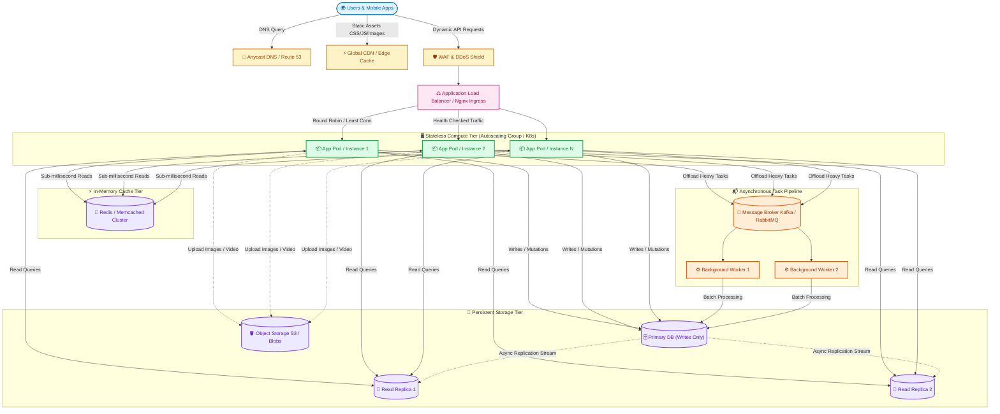

# 🌐 System Design Fundamentals for DevOps: From 1 Server to 10 Million Users

> ☕ *"Take a deep breath and grab a warm cup of coffee, Ravi. System design isn't about memorizing complex buzzwords or having every answer immediately. It's simply the art of knowing which puzzle piece to add when things start breaking under pressure. You already know containers and servers; today, we're just learning how to connect them like an orchestra."*  
> — **Rithu**

**Ravi:** *"Rithu, whenever interviewers ask 'How would you design Twitter or Netflix?', my mind goes completely blank. I feel like an imposter because I've only managed individual servers and pipelines!"*  
**Rithu:** *"That's completely normal, Ravi! Every senior architect started right there. Nobody builds a 10-million-user system on day one. We start with one lonely server, let traffic break it, observe the bottlenecks, and evolve it step-by-step. Let's walk through that journey together! 🌸"*

---

## 🎯 1. What Ravi Will Learn Today

By the end of this session, Ravi will be able to:
- 🏗️ **Deconstruct High-Scale Architectures**: Break down any massive web application into modular, independent tiers (Edge, Ingress, Compute, Cache, Storage, and Async).
- ⚖️ **Master Scaling Trade-Offs**: Confidently choose between Vertical vs. Horizontal scaling, and identify the exact moments when each is appropriate.
- 🚦 **Eliminate Single Points of Failure (SPOF)**: Design fault-tolerant systems using Reverse Proxies, Layer 4/7 Load Balancers, and Health Checking.
- ⚡ **Accelerate Throughput with Caching & Asynchrony**: Protect relational databases using Cache-Aside patterns (Redis) and Message Queues (RabbitMQ/Kafka).
- 🧪 **Build & Test a Scalable Cluster Locally**: Spin up an automated multi-replica load-balanced micro-architecture on their laptop using Docker Compose.

---

## 📊 2. Visual Architecture: The Modern Scalable Blueprint

Here is the battle-tested, high-availability architecture used by top tech companies to seamlessly serve millions of concurrent requests:



---

## 👶 3. Rithu Explains Like You Are a Beginner (ELI5)

### 🍕 The Pizza Food Truck Analogy

Imagine you open a small Italian pizza joint:

1. **Day 1 (The Single Server)**: You rent a tiny food truck. You take orders, roll dough, bake the pizza, and handle cash all by yourself. Life is peaceful when 5 customers arrive per hour.
2. **Day 30 (The Traffic Spike & Crash)**: An Instagram food influencer posts about your pizza. Suddenly, 500 hungry people crowd your truck! You pass out from exhaustion. Orders get dropped. The truck catches fire.
3. **The Vertical Scaling Temptation (Scale-Up)**: You hire a superstar chef who works twice as fast and buy a bigger oven. It helps for a week, but even superman has physical limits, and giant industrial ovens cost a fortune.
4. **The Horizontal Scaling Breakthrough (Scale-Out)**: Instead of one overworked master chef, you set up a kitchen line:
   - **The Host at the Door (Load Balancer)**: Stands out front, checks who is free, and assigns incoming diners to open tables evenly.
   - **The Counter Staff (Stateless App Servers)**: 5 cooks who assemble pizzas. If Cook #3 slips and sprains an ankle, the host simply routes tickets to the other 4 without missing a beat.
   - **The Pre-chopped Topping Trays (In-Memory Cache / Redis)**: Mozzarella, basil, and sauce are already pre-shredded in front of cooks so they don't have to run into the cold storage cellar for every individual slice.
   - **The Underground Cold Storage Vault (Database)**: The heavy warehouse where inventory is recorded permanently.
   - **The Overnight Delivery Truck (Message Queue & Workers)**: For slow, heavy tasks like ordering 200 bags of flour from Italy or printing monthly financial reports, cooks don't make the customer wait at the register. They just write a ticket, pin it on the message board, and a night worker processes it quietly.

---

### 🔍 Core Architectural Questions Answered

#### What is System Design?
System design is the process of defining the architecture, components, modules, interfaces, and data for a system to satisfy specified operational requirements (like handling 100,000 requests per second with 99.99% uptime).

#### Why do DevOps engineers need it?
DevOps isn't just writing CI/CD scripts; it's **operational architecture**. When Kubernetes pods crash from Out-Of-Memory (OOM) errors, databases deadlock, or latency spikes during Black Friday sales, the DevOps engineer is the first responder who must understand whether to tune kernel buffers, spin up replicas, or add an edge CDN.

#### How does it work under the hood?
Modern systems achieve massive scale by adhering to two iron-clad principles:
1. **Stateless Compute**: Keep application servers free of persistent state (no user files or sessions stored locally on disk). Any server can handle any request.
2. **Separation of Concerns**: Split reads from writes, static from dynamic content, and synchronous user-facing tasks from asynchronous background batch jobs.

#### Where is this used in production?
Every platform you use daily—Netflix streaming video chunks via CDNs, Uber matching drivers via geo-distributed caches and Kafka streams, and Amazon routing shopping carts through distributed microservices.

---

## ⚡ 4. The Essential 80/20 Concepts

Focus your attention on these 7 foundational concepts. They deliver 80% of real-world system design interview and operational value:

| Concept / Pattern | What Rithu Wants Ravi to Know | Practical Job Importance |
| :--- | :--- | :--- |
| **Vertical vs. Horizontal Scaling** | Vertical adds RAM/CPU to one machine (hard ceiling, expensive). Horizontal adds more commodity nodes behind a distributor (nearly limitless scale). | Knowing when **not** to scale horizontally (e.g., small databases under 50 GB) saves thousands of dollars in cloud bills. |
| **Layer 4 vs. Layer 7 Load Balancing** | L4 routes at TCP/UDP level (fast, blind to HTTP headers). L7 inspects HTTP/HTTPS headers, URLs, cookies, and routes intelligently. | Configuring Ingress controllers, path-based routing (`/api` vs `/static`), and SSL/TLS termination. |
| **Statelessness & Externalized Sessions** | Never save sessions in local memory (`fs.writeFile` or local RAM). Always offload user sessions to Redis or JWT tokens. | Essential for Kubernetes pod autoscaling (HPA) and blue-green deployments without logging users out. |
| **Cache-Aside Pattern (Lazy Loading)** | App checks Cache first. On Cache Miss, fetch from DB, write to Cache, then return. | Reduces database read load by 80–95%, dropping latency from 45ms to 1ms. |
| **Database Read Replicas vs. Sharding** | Read Replicas copy primary DB asynchronously for high read-to-write ratios (90:10). Sharding splits data horizontally by key (e.g., User ID range). | Standard pattern for scaling relational databases (PostgreSQL/MySQL) before resorting to complex sharding. |
| **Message Queues (Pub/Sub & Workers)** | Turn synchronous blocking API calls into fire-and-forget events using RabbitMQ, SQS, or Kafka. | Prevents API timeouts during email sending, video encoding, payment receipts, and third-party webhook calls. |
| **CDN & Edge Caching** | Serves static assets (images, videos, JS bundles) from geographically proximate edge points of presence (PoPs). | Cuts origin server bandwidth by 70%+ and drops Time-to-First-Byte (TTFB) globally. |

---

## 💻 5. Practical Configuration: Production-Grade Nginx Reverse Proxy & Load Balancer

Below is a modern, production-hardened `nginx.conf` demonstrating **Layer 7 Load Balancing**, **Least-Connections distribution**, **Active Health Checks**, and **Defensive Rate Limiting**.

```nginx
# /etc/nginx/nginx.conf
user nginx;
worker_processes auto;
error_log /var/log/nginx/error.log warn;
pid /var/run/nginx.pid;

events {
    # Maximum simultaneous connections per worker
    worker_connections 2048;
    multi_accept on;
}

http {
    include /etc/nginx/mime.types;
    default_type application/octet-stream;

    # Performance optimizations
    sendfile on;
    tcp_nopush on;
    tcp_nodelay on;
    keepalive_timeout 65;

    # 1. Rate Limiting: Protect backend compute from noisy neighbors & DDoS
    # Allocates a 10MB memory zone 'api_limit' allowing 20 requests per second per IP
    limit_req_zone $binary_remote_addr zone=api_limit:10m rate=20r/s;

    # 2. Upstream Pool: The fleet of stateless backend application servers
    upstream backend_app_cluster {
        # Routing algorithm: least_conn sends request to server with fewest active connections
        least_conn;

        # Keepalive connections pooled to backend instances
        keepalive 32;

        # Servers with failure threshold parameters
        server app_server_1:3000 max_fails=3 fail_timeout=10s;
        server app_server_2:3000 max_fails=3 fail_timeout=10s;
        server app_server_3:3000 max_fails=3 fail_timeout=10s backup; # Spare server on standby
    }

    server {
        listen 80;
        server_name api.company.internal;

        # Health probe endpoint for Cloud Load Balancers / Kubernetes
        location /healthz {
            access_log off;
            return 200 "Healthy\n";
        }

        # 3. Dynamic API Routing with Reverse Proxying
        location /api/ {
            # Apply rate limiting with a burst buffer of 10 requests without artificial delay
            limit_req zone=api_limit burst=10 nodelay;

            # Forward client identification headers to upstream apps
            proxy_set_header Host $host;
            proxy_set_header X-Real-IP $remote_addr;
            proxy_set_header X-Forwarded-For $proxy_add_x_forwarded_for;
            proxy_set_header X-Forwarded-Proto $scheme;

            # HTTP 1.1 keepalive optimization
            proxy_http_version 1.1;
            proxy_set_header Connection "";

            # Upstream proxy destination
            proxy_pass http://backend_app_cluster;

            # Timeouts preventing hanging worker processes
            proxy_connect_timeout 3s;
            proxy_send_timeout 10s;
            proxy_read_timeout 10s;
        }
    }
}
```

### 🔍 Line-by-Line Breakdown for Ravi
- **`limit_req_zone $binary_remote_addr zone=api_limit:10m rate=20r/s;`**: Uses binary IP representations (saving memory, only 4 bytes for IPv4) to create a shared 10 MB RAM table. It enforces a strict 20 req/s ceiling per client IP, shielding downstream compute nodes.
- **`upstream backend_app_cluster { least_conn; ... }`**: Defines the target group. `least_conn` is mathematically superior to round-robin when request processing times vary (e.g., quick 2ms read vs heavy 400ms report generation).
- **`max_fails=3 fail_timeout=10s`**: Passive circuit breaker. If an app pod fails 3 times consecutively, Nginx automatically stops routing traffic to it for 10 seconds.
- **`backup` flag**: `app_server_3` receives zero requests unless both primary servers are simultaneously dead—safeguarding zero-downtime during major rolling failures.
- **`proxy_set_header X-Forwarded-For`**: Preserves the original end-user IP so backend logging, auditing, and geo-location tools don't just see the load balancer's private IP.

---

## ⌨️ 6. Essential DevOps System Design Cheat Sheet

| Command / Tool | Syntax | What It Does | When to Run It in Production |
| :--- | :--- | :--- | :--- |
| **Horizontal Scale** | `docker compose up -d --scale app=5` | Spawns 5 concurrent containers for the `app` service behind the proxy. | When traffic surges or during local stress/load testing. |
| **DNS Resolution Trace** | `dig +trace +question api.github.com` | Traces the authoritative DNS hierarchy step-by-step from root servers down to edge IPs. | Debugging DNS propagation delays, Latency spikes, and CDN edge resolution failures. |
| **Connection Benchmarking** | `ab -n 10000 -c 100 http://localhost/api/` | ApacheBench: fires 10,000 HTTP requests with 100 concurrent workers. | Validating Load Balancer throughput and verifying rate-limiting rules. |
| **Realtime Cache Inspector** | `redis-cli -h 127.0.0.1 -p 6379 info stats` | Displays hit/miss counts, connected clients, and evictions in Redis. | Diagnosing low cache-hit ratios (`keyspace_hits / (keyspace_hits + keyspace_misses)`). |
| **Network Socket State** | `ss -s` *(or `netstat -ant \| grep TIME_WAIT`)* | Summarizes raw TCP socket states (established, time-wait, closed). | Diagnosing port exhaustion behind busy reverse proxies. |
| **Nginx Syntax & Reload** | `nginx -t && nginx -s reload` | Validates configuration files for syntax errors and hot-reloads worker processes with 0 downtime. | Applying routing changes or SSL certificates safely in live environments. |

---

## 🧪 7. Hands-on Practice: Ravi's Zero-Cost Local System Design Lab

In this hands-on lab, Ravi will build a **complete, working mini-cluster** on his laptop: an Nginx Load Balancer distributing requests across multiple backend application replicas with a shared Redis cache!

### 🎯 Objective
Spin up 3 containerized application replicas behind an Nginx Layer 7 Load Balancer and observe real-time round-robin traffic balancing and hostname switching.

### 📋 Prerequisites
- Docker & Docker Compose installed (`docker --version` and `docker compose version`).

---

### Step 1: Create a Sandbox Directory
Run in your PowerShell or bash terminal:
```bash
mkdir system-design-lab
cd system-design-lab
```

### Step 2: Create a Minimal Backend Server (`app.py`)
This tiny Python service prints the unique container ID/hostname that answered the request:

```python
# app.py
from http.server import BaseHTTPRequestHandler, HTTPServer
import socket
import os

class SimpleHandler(BaseHTTPRequestHandler):
    def do_GET(self):
        self.send_response(200)
        self.send_header('Content-type', 'application/json')
        self.end_headers()
        hostname = socket.gethostname()
        response = f'{{"status": "ok", "served_by_container": "{hostname}"}}\n'
        self.wfile.write(response.encode('utf-8'))

if __name__ == '__main__':
    server = HTTPServer(('0.0.0.0', 5000), SimpleHandler)
    print("Backend server listening on port 5000...")
    server.serve_forever()
```

### Step 3: Create a Containerfile for the Backend (`Dockerfile`)
```dockerfile
# Dockerfile
FROM python:3.11-alpine
WORKDIR /app
COPY app.py .
EXPOSE 5000
CMD ["python", "app.py"]
```

### Step 4: Create the Nginx Reverse Proxy Config (`nginx.conf`)
```nginx
events { worker_connections 1024; }

http {
    upstream backend_nodes {
        server app:5000;
    }

    server {
        listen 80;

        location / {
            proxy_pass http://backend_nodes;
            proxy_set_header Host $host;
            proxy_set_header X-Real-IP $remote_addr;
        }
    }
}
```

### Step 5: Tie It Together with `docker-compose.yml`
```yaml
version: '3.8'

services:
  lb:
    image: nginx:alpine
    container_name: lab_load_balancer
    ports:
      - "8080:80"
    volumes:
      - ./nginx.conf:/etc/nginx/nginx.conf:ro
    depends_on:
      - app

  app:
    build: .
    restart: always
```

---

### Step 6: Launch and Scale the Cluster!
```bash
# Build and start 3 backend instances behind the load balancer
docker compose up -d --build --scale app=3
```

---

### ✅ Verification Step
Send 6 consecutive requests through the load balancer:
```bash
# On Windows PowerShell:
1..6 | ForEach-Object { (Invoke-RestMethod -Uri http://localhost:8080).served_by_container }

# Or using curl in Bash / Git Bash:
for i in {1..6}; do curl -s http://localhost:8080 | grep served_by_container; done
```

#### Expected Output:
```text
a4f891b2c3d4
e781bc0912fa
f12984aa7710
a4f891b2c3d4
e781bc0912fa
f12984aa7710
```
🎉 **Ravi's Aha! Moment**: Look at the container IDs rotating! Even though you query `localhost:8080`, Nginx evenly distributes each request across three completely independent compute nodes.

---

### 🧹 Cleanup / Teardown Steps
Always clean up after your experiments to free your machine's CPU and memory:
```bash
docker compose down --volumes --rmi local
cd ..
rm -rf system-design-lab
```

---

## ⚠️ 8. Rithu's Top 3 Beginner Traps

### 🪤 Trap 1: The "Sticky Session" Memory Trap
- **Symptom / What happens**: You add 4 new application containers during a marketing spike, but Server #1 continues to crash with 98% memory consumption while Servers #2, #3, and #4 sit idle at 2% CPU.
- **Why it happens**: The application stored user session data (shopping carts, login tokens) in local server memory (`express-session` default memory store or PHP local files), forcing the load balancer to bind each user to one specific server ("session stickiness").
- **Rithu's Fix**: **Make the compute tier strictly stateless!** Store session IDs in an external in-memory Redis cluster or use cryptographically signed Stateless JWTs. Any container should be able to serve any request interchangeably.

---

### 🪤 Trap 2: The "Cache Stampede" (Dogpiling) Catastrophe
- **Symptom / What happens**: An app is running smoothly at 50,000 requests/sec. Suddenly, at 12:00:00 AM, the primary relational database's CPU spikes to 100%, query latency jumps from 2ms to 30 seconds, and the entire platform crashes.
- **Why it happens**: A popular cached key (e.g., `homepage_hot_deals`) had a strict 24-hour expiration (`TTL = 86400s`). When the clock struck midnight, the key expired. 20,000 concurrent user requests experienced a simultaneous **Cache Miss** and all hammered the underlying database at the exact same millisecond.
- **Rithu's Fix**:
  1. **Add Random Jitter**: Never use uniform TTLs. Set expiration to `base_ttl + random_between(1, 300)` seconds so keys expire gradually.
  2. **Mutex Locking**: Use a distributed lock so only *one* worker recomputes the cache key while other requests wait or receive stale data for a couple seconds.

---

### 🪤 Trap 3: Treating the Database as a Universal Message Queue
- **Symptom / What happens**: Developers write pending emails, image resizing jobs, and audit logs directly into a `tasks` table with a column `status='pending'`. Every 2 seconds, 20 worker containers poll `SELECT * FROM tasks WHERE status='pending' FOR UPDATE`. The database disk I/O hits 100% saturation and locks regular customer checkouts.
- **Why it happens**: Relational databases are optimized for indexed ACID queries, not high-frequency polling queues with table-level row locking.
- **Rithu's Fix**: Offload queue operations to systems purpose-built for queues: **RabbitMQ**, **AWS SQS**, or **Redis Streams**. They handle atomic acknowledgment, retries, and dead-letter queues (DLQs) in RAM with zero database read/write penalties.

---

## 💬 9. Ravi's Doubt Corner (Senior DevOps Interview Prep)

### ❓ Question 1 (Ravi asks):
> *"Rithu, in an interview, how do I answer the classic question: 'Should we use SQL or NoSQL for this system?' without sounding like I'm just guessing?"*

**Rithu's Model Answer:**  
*"Ravi, impress your interviewer by anchoring your answer around **Data Structure and Access Patterns**, not buzzwords. Use this mental model:*
- *Choose **Relational (SQL)** (PostgreSQL, MySQL) when:*
  1. Data has strict ACID transactional requirements (e.g., money balances, ledger entries, booking seats).
  2. The data schema is structured and highly relational (foreign keys, many-to-many joins).
- *Choose **NoSQL** when:*
  1. **Key-Value (Redis, DynamoDB)**: For sub-millisecond session state, shopping carts, or rate-limiter counters.
  2. **Document Store (MongoDB)**: For polymorphic data where schemas evolve frequently (catalogs, dynamic user profiles).
  3. **Wide-Column / Time-Series (Cassandra, ClickHouse, InfluxDB)**: For write-heavy append-only log streams, telemetry, and IoT sensor metrics.
*Wrap up with: 'We usually embrace a **Polyglot Persistence** model—using PostgreSQL for user billing, Redis for caching, and ClickHouse for analytical logs.' That shows true senior maturity!"*

---

### ❓ Question 2 (Ravi asks):
> *"What is the practical difference between Horizontal Sharding and Read Replicas, and when must we jump from one to the other?"*

**Rithu's Model Answer:**  
*"Think of it in terms of bottleneck type:*
- ***Read Replicas** solve a **Read-Throughput Bottleneck**. If your app does 95% reads (viewing profiles) and 5% writes (updating bios), you keep 1 primary writer and spin up 4 read-only replicas using asynchronous replication.
- ***Sharding** solves a **Write-Throughput or Storage-Capacity Bottleneck**. When your data size exceeds single-disk capacities (e.g., 5 Terabytes of active chat logs) or write IOPS exceed what a single server can physically write, you partition the data across multiple independent primary databases using a partition key (e.g., `user_id % 4`).
- **Rule of Thumb**: *Always exhaust Read Replicas, Caching (Redis), and Indexing before sharding. Sharding introduces immense operational complexity (cross-shard joins, re-balancing keys, and complex backups)."*

---

### ❓ Question 3 (Ravi asks):
> *"What is the difference between Latency and Throughput, and how does that affect our SLA monitoring?"*

**Rithu's Model Answer:**  
*"Let's use an easy highway analogy:*
- ***Throughput*** is the *width* of the highway (how many cars pass a checkpoint per minute—e.g., 5,000 requests per second / RPS).
- ***Latency*** is the *speed* of an individual car from entrance to exit (how long a single user waits for their response—e.g., 85 milliseconds).
- **The DevOps Trap**: *A system can have astronomical throughput while suffering dreadful latency (e.g., processing 100,000 requests/sec, but each user waits 12 seconds). In your Prometheus/Grafana dashboards, always monitor **p95 and p99 latency percentiles** alongside request volume, because average latency hides extreme user pain!"*

---

## ⚡ 10. Quick Revision with Rithu

- 🌐 **Start Simple**: Always begin with a single instance, identify the bottleneck using metrics, and add distributed components only when required.
- 🧱 **Decouple Everything**: Ensure your compute tier is strictly stateless so cloud auto-scalers or Kubernetes HPAs can spin pods up and down effortlessly.
- ⚡ **Shield the Database**: A database is the hardest tier to scale. Protect it with Edge CDNs, In-Memory Caches (Redis), and Read Replicas.
- 📬 **De-synchronize with Queues**: If an API task takes longer than 200ms (like emailing or PDF generation), push it to a background message queue.
- 🛡️ **Embrace Failure**: Nodes *will* crash, disks *will* fill up, and networks *will* partition. Build with health checks, circuit breakers, and automated failover.

> [!TIP]
> **Rithu's Golden Architecture Rule**:  
> *"Fast systems are not built by making computers run faster; they are built by ensuring computers do less work. Cache what doesn't change, defer what isn't urgent, and keep your compute tier stateless."* 🚀☕
